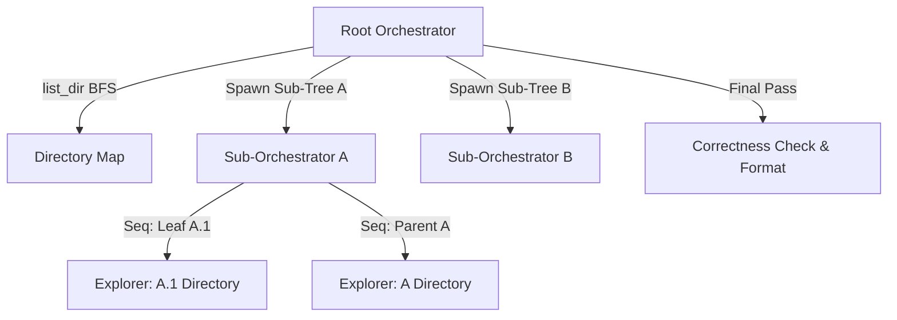
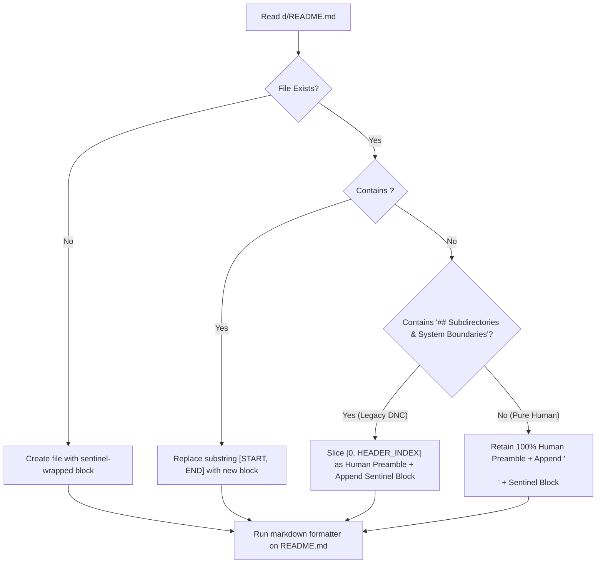

# Design Doc: EGM Repository & Package Bootstrap (egm-bootstrap)

*   **Author:** Brian Suchy ([@briansuchy](https://github.com/briansuchy))
*   **Status:** Current
*   **Date:** 2026-06-29

--------------------------------------------------------------------------------

## 1. Overview & Problem Statement

### 1.1 The Problem

In large-scale codebases (monoliths), establishing and maintaining a clear
architectural mental model is a primary challenge for both human developers and
AI assistants.

*   **Context Loss**: Without structured directory-level documentation, AI
    agents lack context on local invariants, public interfaces, and side
    effects. This leads to context window bloat, repetitive file-reading loops,
    and a risk of introducing regressions.
*   **Monolith Scale**: Manual bootstrapping of directory READMEs for large
    repositories is an intensive, tedious task that developers often
    deprioritize.

### 1.2 Overview & The "Peanuts and Hay" Metaphor

We propose the **`egm-bootstrap`** skill for the EGM plugin. This
skill automates the creation, correction, formatting, and correctness
verification of
[Design is the New Code (DNC)](../../README.md)
compliant `README.md` files across a directory tree.

*   **DNC Compliance**: Design is the New Code (DNC) is the EGM engineering
    philosophy that treats human-readable architectural contracts (invariants,
    interfaces, and side effects in directory READMEs) as the primary system
    assets. These documentation files serve as structured guardrails for human
    reviewers and AI agents alike.
*   **Metaphor Mapping**: In this context, both "Peanuts" and "Hay" refer to the
    generated directory-level `README.md` files:
    *   **Peanuts**: The granular, leaf-level **Component Package READMEs**
        containing specific file contracts.
    *   **Hay**: The parent-level **Repository Blueprints** that roll up child
        interface contracts to provide high-altitude indexes.

To ensure performance, efficiency, and robustness, the skill dynamically scales
its execution model based on the size of the target codebase:

1.  **Incremental Scoping**: The Root Orchestrator maps the tree level-by-level
    using native filesystem APIs (`list_dir`). If the directory count exceeds
    scale limits during discovery, it pauses immediately to warn the user,
    preventing hangs on massive repositories.
2.  **Sequential Execution (Small Trees)**: If the target has 5 or fewer
    subdirectories, the Root Orchestrator crawls and documents them sequentially
    in post-order, avoiding multi-agent coordination and startup overhead.
3.  **Unbounded Parallel Swarm (Medium/Large Trees)**: If the target has more
    than 5 subdirectories, the Root Orchestrator partitions the tree and spawns
    parallel instances of the orchestrator agent itself (using the framework's
    `self` subagent type) as Sub-Orchestrators (one per sub-tree).
    *   **Adaptive Depth Partitioning**: To prevent parallelization bottlenecks
        in repositories with a single nested source tree (e.g. `src/` or
        `java/`), the Root Orchestrator partitions using adaptive depth,
        descending levels of the discovery map until it splits the directories
        into balanced subtree branches.
    *   **Unbounded Spawning upon Approval**: The Root Orchestrator removes
        artificial concurrency limits. If the directory count is large (> 5), it
        asks for user approval to spawn the required number of
        Sub-Orchestrators, and then spawns all of them in parallel.
    *   **Direct Swarm Writing & Formatting**: Sub-Orchestrators process their
        subtrees in parallel, write or modify `README.md` files directly in
        their assigned folders, and format them using `mdformat`.
4.  **Sequential Bottom-Up Processing**: Within each sub-tree, the
    Sub-Orchestrator documents subdirectories sequentially in post-order
    (deepest leaves first), spawning `goldfish-explorer` agents to summarize
    files. This guarantees that parent directories are documented only after
    their subdirectories are complete, preventing race conditions.
5.  **Final Correctness Verification**: Before concluding work, the Root
    Orchestrator runs a final pass across all created and modified READMEs to
    verify DNC compliance, proper markdown formatting, valid relative
    links, and valid verification targets.
6.  **Optional Drift Review**: The Root Orchestrator optionally prompts the user
    to run the EGM Drift Report on the generated README updates to ensure
    consistency against the codebase.

### 1.3 Goals

*   **Automated Bootstrapping & Correction**: Recursively generate or correct
    DNC-compliant READMEs (`Interface`, `Invariants`, `Side Effects`) for any
    target source directory tree. Existing READMEs are corrected and updated
    without completely overwriting them.
*   **Idempotent Sentinel-Block Upserting**: Guarantee zero loss of human
    operational documentation on existing `README.md` files by encapsulating
    auto-generated DNC contracts inside explicit HTML sentinel markers
    (`<!-- EGM_BLUEPRINT_START ... -->` / `<!-- EGM_BLUEPRINT_END -->`),
    preserving all human runbook content above the sentinels byte-for-byte
    across runs.
*   **Markdown Formatting**: Ensure every modified or created README is
    properly formatted using markdown formatters.
*   **Final Correctness Check**: Perform a final verification pass on all
    modified READMEs as a correctness check before concluding work.
*   **Safe Scaling**: Handle deep/broad directory trees via dynamic user
    warnings, incremental BFS scoping, sub-tree partitioning, and unbounded
    parallel execution upon user approval.

### 1.4 Non-Goals

*   **Code Generation**: The skill will not write or refactor any functional
    source code; it is strictly limited to documentation.
*   **Non-Source Directories**: It will not document hidden system directories
    (e.g., `.git`, `.jj`, `.gemini`), build output paths, or dependency
    directories (e.g., `third_party`).

### 1.5 Critical User Journeys (CUJs)

#### CUJ 1: Bootstrap, Correct, Format, and Verify READMEs for a Directory Tree

*   **Given**: A source directory tree (e.g., `src/` or `pkg/`) where
    subdirectories either lack a `README.md` file or contain incomplete legacy
    READMEs.
*   **When**: The user runs the `egm-bootstrap` skill via the slash
    command `/egm-bootstrap <path>` (or harness-equivalent command / prompt)
    specifying the target root directory.
*   **Then**:
    1.  The Root Orchestrator maps the tree incrementally.
    2.  If directory count <= 5, it processes them sequentially.
    3.  If directory count > 5, it partitions the tree adaptively, requests user
        approval, and spawns unbounded parallel worker instances of the
        orchestrator agent itself (`self` Sub-Orchestrators).
    4.  Sub-Orchestrators process their sub-trees bottom-up, spawning a
        `goldfish-explorer` agent for each directory node.
    5.  DNC-compliant `README.md` files are created or corrected, and formatted
        using `mdformat`.
    6.  The Root Orchestrator runs a final correctness check pass across all
        modified READMEs.
    7.  The user is optionally prompted to run a Drift Report on the updates.

--------------------------------------------------------------------------------

## 2. Technical Plan

### 2.1 Swarm Architecture & Roles

The `egm-bootstrap` skill utilizes exactly two agent configurations:



*   **Node Orchestrator (`bootstrap-orchestrator`)**:
    *   Implemented as a single agent configuration.
    *   The **Root Instance** coordinates the pipeline: maps the tree
        incrementally, calculates count/depth, manages safety gates, manages
        unbounded parallel worker spawning upon user approval, documents
        remaining intermediate directories, compiles the final root README, and
        executes the final correctness check pass.
    *   The **Worker Instances (Sub-Orchestrators)** are spawned by the Root
        Instance to process a specific top-level subdirectory tree. They walk
        their sub-tree sequentially bottom-up, spawning explorers, writing or
        modifying README files directly in the filesystem, and formatting them
        with `mdformat`.
*   **`goldfish-explorer`**:

    *   A read-only, dynamic scout agent.
    *   **System Prompt**: > "You are a read-only codebase explorer. Your task
        is to analyze the source files in the target directory and return a
        concise, factual summary. Do not write or modify any files. Return a
        JSON object containing the directory's public symbols (interface),
        invariants, and side effects."
    *   **Scout File Constraints**: The scout caps total data read per directory
        at **50,000 bytes** to prevent context window bloat. Implementation
        and schema files (e.g. `.cc`, `.py`, `.java`, `.go`, `.rs`, `.ts`) are
        read up to a maximum of **300 lines** per file. If a directory's size
        exceeds the 50KB limit, files are selected for reading based on the
        following priority list:
        1.  Interface, schema, IDL, and header files (e.g. `.h`, `.hh`, `.hpp`,
            `.proto`, `.graphql`, `.gql`, `.thrift`, `.prisma`, `.sql`
            schema/DDL definitions, interface classes) are read completely.
        2.  Module entry points (e.g., `main.*`, `index.*`, `lib.*`, `mod.*`,
            `__init__.py`, or files matching the directory name) are read up
            to 300 lines.
        3.  Production source and configuration files sorted alphabetically are
            read up to 300 lines until the byte cap is reached.
        4.  Test files are completely ignored during context loading.
    *   **Output Schema**:

        ```json
        {
          "type": "object",
          "properties": {
            "interface": {
              "type": "array",
              "items": { "type": "string" }
            },
            "invariants": {
              "type": "array",
              "items": { "type": "string" }
            },
            "side_effects": {
              "type": "array",
              "items": { "type": "string" }
            }
          },
          "required": ["interface", "invariants", "side_effects"]
        }
        ```

### 2.2 Agent Reporting & Context Contracts

The communications follow a hierarchical reporting pattern:

1.  **Explorer to Sub-Orchestrator**: `goldfish-explorer` analyzes all files in
    a directory and returns a structured JSON summary (interface, invariants,
    side effects) to its parent `bootstrap-orchestrator`.
2.  **Parent Context Propagation**: When the Sub-Orchestrator processes parent
    directory `P`, it propagates the compiled interface summaries of its child
    subdirectories as prompt context when invoking the parent's
    `goldfish-explorer` scout. This enables the parent explorer to accurately
    summarize child interface boundaries.
    *   *Propagating Heuristics*:
        1.  If the child directory was documented during this execution run, the
            Sub-Orchestrator retrieves its public interface directly from the
            in-memory execution cache (or worker JSON return payload), consuming
            the structured data directly.
        2.  If the child README was corrected/modified, the Sub-Orchestrator
            retrieves the updated symbols directly from the scout scan and
            legacy extraction.
3.  **Child to Parent Orchestrator**: Subdirectories return their compiled
    README summary to the parent `bootstrap-orchestrator`, which uses this
    to document the parent's "Subdirectories" interface section.
4.  **Worker to Root Orchestrator**: Sub-Orchestrators return their compiled
    subtree contract metadata to the Root Orchestrator using the structured JSON
    schema defined below.

#### 2.2.1 Worker Return Interface Schema

Sub-Orchestrator worker subagents report completed subtree structures using the
following schema:

```json
{
  "type": "object",
  "properties": {
    "subtree_index": {
      "type": "array",
      "items": {
        "type": "object",
        "properties": {
          "path": { "type": "string" },
          "summary": { "type": "string" },
          "interface": { "type": "array", "items": { "type": "string" } },
          "invariants": { "type": "array", "items": { "type": "string" } },
          "side_effects": { "type": "array", "items": { "type": "string" } }
        },
        "required": ["path", "summary"]
      }
    }
  },
  "required": ["subtree_index"]
}
```

### 2.3 Directory Filtering & Classification Rules

To prevent documenting empty directories and ensure the correct template is
selected, we enforce the following rules during directory discovery:

*   **Non-Code Filtering**: To prevent documenting empty directories, any
    directory that contains no source code files AND contains no subdirectories
    with code is excluded. Because a top-down traversal cannot know if
    subdirectories contain code deeper down, pruning is executed as a
    **bottom-up post-processing pass** after the complete tree has been mapped
    in Phase A.
    *   *Source Code Files*: Defined as files containing executable code,
        schemas, and contracts (e.g., `.c`, `.cc`, `.cpp`, `.cxx`, `.h`, `.hh`,
        `.hpp`, `.rs`, `.go`, `.zig`, `.lean`, `.java`, `.kt`, `.scala`, `.cs`, `.fs`,
        `.py`, `.rb`, `.php`, `.lua`, `.sh`, `.bash`, `.ts`, `.tsx`, `.js`,
        `.jsx`, `.mjs`, `.cjs`, `.swift`, `.m`, `.dart`, `.sql`, `.proto`,
        `.graphql`, `.gql`, `.thrift`, `.prisma`, `.tf`, `.hcl`, `.cue`).
        Excludes build manifests, lockfiles, test fixtures, documentation, and
        generic data dumps.
*   **Test Directory Exclusion**: Any directory containing exclusively test code
    (e.g., folders named `tests`, `testing`, `testdata`, or containing only
    files matching `*_test.*` or `*Test.*`) is excluded from documentation
    during the pruning pass.
*   **Test File Filtering**: In hybrid package directories containing both
    production and test files, the explorer scout filters out test files and
    ignores their public symbols during context scanning to prevent test
    fixtures from polluting the documented public interface.
*   **Custom Exclusions**: The discovery loop supports custom ignore patterns.
    By default, it ignores hidden/system directories (`.git`, `.jj`, `.gemini`,
    `node_modules`). Additionally, it reads a local `.egmignore` file (if
    present) containing glob patterns to exclude custom folders (e.g.
    `*testdata*`, `*mocks*`, `third_party`).
*   **Directory Classification**:
    *   **Repository Root (Blueprint / Hay)**: The target root folder of the
        bootstrap execution is *always* classified as the Repository Root, even
        if it contains direct source files. It is documented using the
        "Repository Root README Template" (using the optional Local Interface
        section for files in the root folder).
    *   **Component Package (Peanut)**: Any non-root directory containing direct
        source code files. If it also contains child subdirectories with code
        contracts, its README's `Interface` section will include relative links
        to the child subdirectories' contracts.
    *   **Repository Blueprint (Hay)**: Any non-root directory containing *no*
        direct source code files, but containing subdirectories with code
        contracts (regardless of whether a `BUILD` file is present).

### 2.4 Document Templates

#### 📄 Component Package (Peanuts) README Template

Used for folders containing direct source files. Focuses on local module
contracts.

```markdown
# [Component Name]

## Overview
[Prose overview of the component's architectural role and goals]

## Interface
- [Public classes, functions, and symbols]
- [Subdirectories list and links to their contracts]

## Invariants
- [State and call invariants that must be preserved by developers/agents]

## Side Effects
- [State mutations, network calls, disk access, locks, or external side effects]

## Verification
- Build: `build //[package_path]...`
- Test: `test //[package_path]...`
```

#### 📄 Repository Root (Blueprint / Hay) README Template

Used for root directory nodes that coordinate child sub-trees.

```markdown
# [Repository Name] Blueprint

## System Overview
[High-altitude architectural overview of this subsystem]

[Optional section if the root directory contains direct source files]
## Local Interface & Invariants
- [Direct symbols, invariants, and side effects of files in the root folder]

## Subdirectories & System Boundaries
- [Subdirectory Name]: [Link to child README.md] - [Summary of child contract/role]

## Global Invariants
- [System-wide constraints that cross component boundaries]

## Global Side Effects
- [Shared resources, databases, or external integrations affected by this subsystem]

## System Verification
- Run: `test //[system_path]...`
```

#### 📄 Intermediate Blueprint README Template

Used for intermediate non-code directories that sit between the root and package
leaves (applicable to directories classified as Repository Blueprints that are
not the execution root).

```markdown
# [Directory Name]

## Overview
[Factual overview of the subdirectories and systems grouped under this directory path]

## Subdirectories & Boundaries
- [Subdirectory Name]: [Link to child README.md] - [Summary of child contract/role]
```

*Note: All subdirectory indexes in Hay templates must use relative paths (e.g.
`./subdir/README.md`) to maintain local rendering compatibility.*

### 2.5 Execution Pipeline

#### Phase A: Incremental Directory Scoping & Plan Definition

1.  **Incremental BFS Discovery**: The Root Orchestrator maps the target tree
    level-by-level (BFS) using a directory queue and native `list_dir` tool
    calls, preserving intermediate folder nodes. **Symbolic links are ignored**
    during traversal to prevent infinite recursion and duplicate mapping.
2.  **Safety Gate**: During the BFS loop, if the total running count of
    discovered directories exceeds **15**, the Root Orchestrator immediately
    pauses the discovery traversal and calls the `ask_question` tool to warn the
    user of the large execution scope and require confirmation before proceeding
    with further mapping or worker spawning.
3.  **Bottom-up Post-Pruning Pass**: Once the mapping traversal is complete (and
    approved), the Root Orchestrator walks the mapped tree bottom-up (from
    leaves to root). It filters out hidden, system, build-output, test-only, and
    non-code directories according to the Filtering Rules.
4.  Once the pruned tree is resolved, the Root Orchestrator calculates the
    maximum depth.
5.  **Execution Strategy**:
    *   **Sequential (Size <= 5)**: The Root Orchestrator executes the bottom-up
        documentation sequentially in a single thread.
    *   **Parallel (Size > 5)**: The Root Orchestrator partitions the discovery
        map into independent subtree branches.
        *   **Adaptive Depth Partitioning Algorithm**:
            1.  Set `depth = 1`.
            2.  Extract directory nodes from the discovery map located at the
                current `depth`.
            3.  If the count of nodes at `depth` is between 3 and 5: return
                these nodes as subtree partition roots.
            4.  If the count of nodes at `depth` < 3: increment `depth`, repeat
                step 2.
            5.  If the count of nodes at `depth` > 5: group the largest branches
                (measured by total nested folder count) into 3-4 separate
                partitions, combine the remaining small branches into a single
                fallback partition subtree, and return these partition root
                boundaries.
            6.  Fallback: If `depth` limit of 3 is reached and count is still <
                3, return the immediate children of the root (or fall back to
                sequential execution).
        *   It spawns a parallel worker (Sub-Orchestrator) for each partition
            subtree, passing parameters `is_worker: true` and `sub_tree_root:
            <path>` to the `self` subagent invocation.
    *   **Unbounded Spawning upon Approval**: The Root Orchestrator removes
        artificial concurrency limits. If the directory count is large (> 5), it
        asks for user approval to spawn the required number of
        Sub-Orchestrators, and then spawns all of them in parallel.
6.  **Conditional Branching Control**: The `egm-bootstrap` skill
    configuration (`SKILL.md`) checks these parameters at start:
    *   If `is_worker` is false/unset: Executes the Root Orchestrator role (runs
        BFS mapping, safety gates, spawns workers, compiles the final blueprint
        README, and executes the final correctness check pass).
    *   If `is_worker` is true: Skips Phase A and executes the Sub-Orchestrator
        role (processes the assigned `sub_tree_root` subtree bottom-up, spawning
        explorers, writing/modifying files directly, and formatting them with
        `mdformat`).

#### Phase B: Bottom-Up Bootstrapping

1.  Under the parallel strategy, the Root Orchestrator spawns parallel
    `bootstrap-orchestrator` instances as Sub-Orchestrators, passing each
    its target sub-tree.
2.  Each Sub-Orchestrator processes its sub-tree in post-order (deepest leaves
    first):
    *   **Correction & Modification Policy**: Before generating documentation,
        the Sub-Orchestrator checks if `README.md` already exists in the active
        folder. If `README.md` exists, it does not overwrite it completely.
        Instead, it reads the existing content, spawns the `goldfish-explorer`
        scout to compile the true code contracts, and uses
        `replace_file_content` (or `write_to_file`) to correct and update the
        existing README to be DNC compliant while preserving developer notes and
        descriptions.
        *   *Scout Scan Requirement*: Whether the README exists or not, the
            Sub-Orchestrator **always spawns** the `goldfish-explorer` scout to
            scan the source code in the directory and compile the true code
            symbol boundary.
        *   *Legacy Symbol Extraction Prompt*: To parse pre-existing manual
            README files, the Sub-Orchestrator calls the reasoning LLM with the
            following extraction prompt: > "Analyze the following unstructured
            README.md content. Extract all public symbol names, classes,
            interfaces, invariants, and side effects. Format your response
            strictly as a JSON object matching the following schema: {
            \"interface\": string[], \"invariants\": string[], \"side_effects\":
            string[] }."
    *   **Verification Command Target Lookup**: When generating the `##
        Verification` section, the Sub-Orchestrator checks if a `BUILD` file
        exists in the active folder. If present:
        *   It checks if test files (matching `*_test.*` or `*Test.*`) are
            present. If test files exist, it writes the `Test:` command;
            otherwise it omits the test command.
        *   If target names in the `BUILD` file are ambiguous or don't match the
            folder name, it falls back to building the entire package wildcard
            target: `build //[package_path]:all`.
        *   If no local `BUILD` file exists: it scans the nearest ancestor
            `BUILD` file to locate targets whose `srcs` attribute references
            files in the active subdirectory (e.g. via direct path list or
            glob). If a matching target is found, it references that target
            (e.g., `build //[ancestor_path]:my_target`). If multiple
            targets match or no match is found, it falls back to the package
            wildcard target: `build //[ancestor_path]:all`. If no ancestor
            package is found, it omits the verification command.
        *   *Starlark Parsing Fallback*: If the ancestor `BUILD` file contains
            complex Starlark macros or dependencies that cannot be resolved via
            file reading, the Sub-Orchestrator falls back to referencing the
            wildcard `:all` target of the ancestor package, or omits the target.
    *   **Scout Definition & Spawning**: The Sub-Orchestrator dynamically
        declares the read-only `goldfish-explorer` subagent type using
        `define_subagent` if not already defined in its active session.
        *   *Subagent Definition Arguments*:
            *   `TypeName`: `goldfish-explorer`
            *   `Role`: `goldfish-explorer`
            *   `enable_write_tools`: `false`
            *   `enable_subagent_tools`: `false`
            *   `SystemPrompt`: As defined in Section 2.1.
        *   It then spawns the scout sequentially for the active directory.
    *   **Child Fault Tolerance**: If a child subdirectory fails to document
        (e.g., explorer timeout or tool error), the Sub-Orchestrator logs a
        warning, inserts a placeholder link (e.g. `- [Subdirectory Name]: [Link
        to child README.md] - (Details pending/documentation failed)`) in the
        parent's directory index, and continues documentation instead of
        aborting.
    *   Generates or corrects `README.md` using the appropriate template
        depending on its classification (Component Peanut or Blueprint Hay;
        Blueprint Hay nodes use the "Intermediate Blueprint template" if they
        are not the execution root).
    *   **Markdown Formatting**: Immediately after writing or correcting
        `README.md`, the Sub-Orchestrator executes
        `markdown formatter (e.g. prettier or markdownlint)`
        via `run_command` to ensure proper markdown formatting.
3.  Once all parallel worker instances finish:
    *   **Root Fault Tolerance**: If a parallel worker fails or times out, the
        Root Orchestrator logs a warning, inserts a placeholder warning link
        (e.g., `[Subtree Root] (Documentation failed / Subagent execution
        timeout)`) inside the root Blueprint's subdirectory index, and completes
        the remaining compilation.
    *   **Intermediate Directory Documentation**: The Root Orchestrator
        identifies any intermediate directories sitting between the root and the
        partitioned subtree roots. It processes these intermediate directories
        sequentially bottom-up, generating Intermediate Blueprint READMEs using
        the compiled summaries returned by the workers, and formatting them with
        `mdformat`.
    *   The Root Orchestrator checks if the root directory itself contains any
        direct source files. If present, it spawns a `goldfish-explorer` scout
        for the root directory to extract local symbols and invariants,
        appending them to the root README under the `## Local Interface &
        Invariants` section.
    *   It compiles the final root `README.md` (Blueprint), writes it, and
        formats it with `mdformat`.
    *   **Final Correctness Verification**: The Root Orchestrator performs a
        final verification pass across all created and modified READMEs in the
        `subtree_index` to verify EGM compliance (`Interface`, `Invariants`,
        `Side Effects`), proper markdown formatting, valid relative links
        (explicitly verifying referenced child README or SKILL files physically
        exist), and valid verification targets before concluding work.
    *   **Optional Drift Review**: The Root Orchestrator calls `ask_question` to
        offer running the `egm-drift-report` skill on the generated updates to
        verify consistency with the codebase.
    *   Terminates successfully.

### 2.6 Processing Tools

*   **Directory Discovery**: Use native `list_dir` calls in a BFS loop
    (filtering out `.git`, `.jj`, `.gemini`, `third_party`, `node_modules`).
    BUILD files are preserved during discovery to extract build/test
    targets for the Verification template section.
*   **Markdown Formatting**: Use `run_command` to execute
    `markdown formatter (e.g. prettier or markdownlint)` on
    every modified or created README.

### 2.7 Incremental Sentinel-Block Upsert Architecture

To safely run `egm-bootstrap` over directories that already contain
human-authored operational documentation (such as repository runbooks or oncall
metadata), the skill enforces **Idempotent Sentinel-Block Bootstrapping**:

1.  **Sentinel Boundary Markers**: Every DNC block generated by
    sub-orchestrators or leaf workers is wrapped inside explicit HTML sentinel
    markers:

    *   **Start Sentinel:** `
        <!-- EGM_BLUEPRINT_START: AUTO-GENERATED BY egm-bootstrap. PUT HUMAN NOTES ABOVE THIS LINE -->`
    *   **End Sentinel:** `<!-- EGM_BLUEPRINT_END -->`

2.  **Three-State Upsert State Machine**: When writing or updating
    `d/README.md`, workers execute:



--------------------------------------------------------------------------------

## 3. Alternatives Considered

### 3.1 Single-Agent Flat Crawler

Instead of a recursive swarm, we considered using a single agent that walks the
directory tree sequentially, reading files and updating READMEs as it goes.

*   **Why Rejected**:
    *   **Context Window Limits**: Walking a large directory tree sequentially
        accumulates too much token history, leading to context truncation and
        loss of precision.
    *   **Execution Time**: Sequential execution is slower for deep or broad
        directory trees.
    *   **Parallelism**: It cannot leverage parallel execution. The swarm model
        allows subagents to run in parallel, reducing execution time.

### 3.2 Direct Reuse of `growing-peanuts-and-hay` Skill

We investigated using the existing `growing-peanuts-and-hay` skill
(an internal prototype precursor)
directly.

*   **Why Rejected**:
    *   The skill is team-specific, sequential, and hardcoded to specific
        language conventions.
    *   EGM requires a general-purpose, language-agnostic tool (supporting C++,
        Python, Java, etc.) that can scale to large repositories in parallel.
    *   We chose to write `egm-bootstrap` to consolidate their DNC
        templates and bottom-up logic into a generic skill that supports
        parallel scaling via `self` workers.

--------------------------------------------------------------------------------

## 4. Detailed Implementation

All changes will be housed within the open-source repository structure:

### 4.1 Implementation Files

1.  **`skills/egm_bootstrap/SKILL.md`**

    *   **Rationale**: Defines the EGM workflow steps for the bootstrap process.
    *   **YAML Frontmatter Input Schema**:

        ```yaml
        name: egm-bootstrap
        description: Bootstrap directory README.md files across a repository subtree.
        inputs:
          path:
            type: string
            description: The target root directory path to bootstrap.
            required: true
          is_worker:
            type: boolean
            description: Internal parameter. True if executing as a worker Sub-Orchestrator.
            default: false
          sub_tree_root:
            type: string
            description: Internal parameter. The root path of the assigned subtree partition.
            required: false
        ```

    *   **`SKILL.md` Algorithmic Flow**:

        1.  **Startup Check**: Read `is_worker` parameter. If true, jump to step
            6 (Worker Flow).
        2.  **BFS Scoping**: Run `list_dir` in a queue loop to map the directory
            tree, ignoring symlinks and `.egmignore` globs.
        3.  **Warning Gate**: If discovery count > 15, call `ask_question` and
            wait for user approval.
        4.  **Partitioning**: If count <= 5, document sequentially. Else, run
            Adaptive Depth Partitioning to divide the tree into balanced
            subtrees.
        5.  **Spawning**: Invoke `self` subagents in parallel upon user
            approval, passing `is_worker: true` and `sub_tree_root`. Jump to
            step 9.
        6.  **Worker Flow**: Declare the read-only `goldfish-explorer` subagent
            type dynamically at startup. Traverse the assigned subtree bottom-up
            (post-order).
        7.  **Explorer Scan & Formatting**: For each folder, check Correction &
            Modification Policy. Read existing README, spawn scout,
            correct/update the file to be DNC compliant using
            `replace_file_content` or `write_to_file`, and format it with
            a markdown formatter.
        8.  **Reporting**: Compile subtree index and return JSON (Worker
            Interface Schema) to the Root Orchestrator.
        9.  **Compilation & Final Verification**: The Root Orchestrator compiles
            child metadata (recovering from worker timeouts), runs a scout on
            the root folder files if present, writes the Blueprint README,
            formats it with a markdown formatter, performs a final correctness check pass
            across all modified READMEs, optionally prompts to run Drift Report,
            and exits.

2.  **`skills/egm_bootstrap/TEST.md`**

    *   **Rationale**: Lists verification and test scenarios for the bootstrap skill.

3.  **`skills/egm_bootstrap/test_scenarios.yaml`**

    *   **Rationale**: Automated integration tests evaluating bootstrap scenarios
        (small tree sequential execution, parallel subtree partitioning, and safety gates).

4.  **`agents/bootstrap_orchestrator.md`**

    *   **Rationale**: Defines the system prompt and instructions for the
        `bootstrap-orchestrator` persona.

--------------------------------------------------------------------------------

## 5. Non-Functional Requirements

### 5.1 Security & Privacy

*   **Source Centric**: The scoping only reads source files. It must ignore
    hidden directories containing sensitive data (e.g., local credentials,
    `.git/` history).

### 5.2 Performance & Token Overhead

*   **Swarm Concurrency**: Subagents should be invoked with `Workspace=inherit`
    to run in parallel.
    *   **`Workspace=inherit`**: In the Antigravity framework, launching a
        subagent with `Workspace=inherit` instructs the system to share the
        parent's workspace directory directly with the subagent, rather than
        checking out a new isolated branch. This is required for parallel read
        operations as it avoids cloning overhead and ensures all subagents see
        the same local filesystem state.
*   **VCS Isolation**: Sub-Orchestrator workers and explorers must perform no
    version control commands (e.g. `git add`, `git commit`). All filesystem
    changes are written locally. Tracking and submitting the generated
    `README.md` files is deferred to the parent EGM session framework or the
    user upon skill completion, avoiding concurrent VCS database locks.
*   **Temporary File Isolation**: Parallel workers sharing the workspace must
    perform all status tracking, check-pointing, and log writing in independent,
    worker-specific directories using their unique `conversationId` under the
    application data directory (e.g.
    `<appDataDir>/brain/<conversation_id>/scratch/`). They must not write any
    temporary files inside the source repository workspace, leaving the
    source tree unmodified.
*   **Antigravity Framework**: Antigravity is the agent SDK ecosystem and
    runtime framework for autonomous coding assistants.
*   **Token Optimization**: Goldfish scouts are read-only, ephemeral, and only
    read single directories, preventing context window exhaustion on the
    orchestrator.
    *   *Subagent Isolation vs. Direct File Reading*: Offloading file-level
        reading to specialized `goldfish-explorer` scouts keeps the
        Sub-Orchestrator's context window compact, as it only receives
        structured JSON summaries rather than raw code files. This reduces token
        overhead at the cost of subagent startup latency.
*   **Warning Gate**: If directory count > 15, the user is prompted via
    `ask_question` to prevent unbounded execution and token waste on large
    repositories.

### 5.3 Risks & Mitigations

*   **LLM Rate Limits**: Partitioning a broad repository tree could trigger too
    many concurrent API calls. This is mitigated by requiring explicit user
    approval before spawning unbounded parallel workers.
*   **VCS Database Locks**: Mitigated by prohibiting workers and scouts from
    executing any VCS tracking/commit commands (`jj`/`g4`), deferring operations
    to EGM session completion.
*   **State Collision on Shared Workspace**: Mitigated by storing execution
    checkpoints in worker-specific scratchpad directories under `<appDataDir>`,
    avoiding modifications to the workspace.
*   **Worker failures leaving partial files**: Handled as an incremental
    progress feature. The Correction & Modification Policy preserves partial
    progress and corrects existing files on subsequent runs, allowing developers
    to resume execution without data loss.
*   **Documentation Drift**: Bootstrapped READMEs can drift from the codebase
    over time. This is out of scope for the bootstrapping tool but should be
    resolved in future EGM plugins by running periodic EGM drift check tools
    (e.g. `egm-drift-report`).
*   **Hallucination Risk**: Automated documentation of invariants and side
    effects can suffer from LLM hallucinations. The generated README files
    include standard verification commands (build/test targets) so users can
    build and execute the package code to verify functionality.

--------------------------------------------------------------------------------

## 6. Verification & Test Plan

### 6.1 Static Analysis & Skill Validation

Verification ensures the skill definition, frontmatter, heading hierarchy, and
sentinel blocks conform to EGM standards.

### 6.2 Integration Testing & Scenarios

Automated integration test suites in `skills/egm_bootstrap/test_scenarios.yaml` evaluate:

*   `bootstrap_small_tree`: Verifies sequential execution for a tree with <= 5
    directories, ensuring it generates conforming Peanut and Hay READMEs,
    formats them, and runs a final correctness check pass.
*   `bootstrap_parallel_tree`: Verifies unbounded parallel worker spawning upon
    user approval, child context propagation, direct filesystem
    writing/modifying, formatting, and final correctness verification.
*   `bootstrap_safety_gate`: Verifies the warning gate triggers when the mapped
    directory count exceeds 15, pausing traversal and prompting the user.
*   `bootstrap_incremental_sentinel_upsert`: Verifies that running
    `egm-bootstrap` against an existing `README.md` containing human
    operational notes preserves all human text above the sentinel block while
    updating the DNC contract below.
