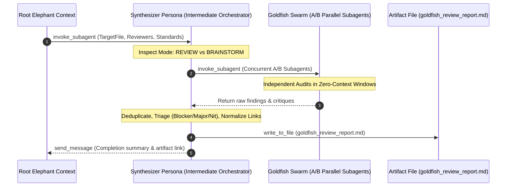

# EGM Synthesizer Persona (Swarm Orchestration & Output Aggregation)

*   **Author:** Brian Suchy ([@briansuchy](https://github.com/briansuchy))
*   **Status:** Current
*   **Date:** 2026-07-31

--------------------------------------------------------------------------------

## Overview

The **EGM Synthesizer Persona** (`synthesizer`) is an intermediate
orchestration layer, responsible for starting multiple subagents and
deduplicating feedback across them. It is used to consolidate feedback across
the various subagents started by EGM skills and prevent context window bloat in
runtimes that support nested subagents (e.g., Antigravity).

## The Problem

Directly managing a multi-agent review swarm from the primary user conversation
has challenges:

1.  **Context Pollution & Token Bloat**: Spawning 6 to 12 parallel reviewers
    directly in the root session floods the primary context window with
    thousands of tokens of raw, verbose tool outputs and intermediate subagent
    chatter, degrading the model's reasoning capacity.
2.  **Redundant & Overlapping Critiques**: Multiple reviewers examining the same
    document frequently identify the same underlying issue from slightly
    different perspectives (e.g., structural vs. design). Unfiltered output
    overwhelms the human engineer with duplicate findings.
3.  **Inconsistent Link Formatting**: Stateless subagents often construct
    inconsistent or broken relative file links.
4.  **Chat Stream Interruption**: Dumping raw review traces into the user chat
    violates the Artifact-First UX principle.

## System Architecture & Dataflow

## Operating Modes

The synthesizer operates in two distinct modes depending on the invocation
context:

### 1. `Mode: REVIEW` (Document Audit)

*   **Redundant Subagent Spawning (A/B Sampling)**: Launches two independent
    instances of each requested reviewer (e.g., `Hostile Design Critic A` and
    `Hostile Design Critic B`) to maximize finding recall and eliminate
    non-deterministic evaluation gaps.
*   **Role Title Enforcement**: Subagent roles are strictly suffixed with
    `Auditor`, `Reviewer`, or `Critic` for clear observability in execution
    dashboards.
*   **Severity Triage**: Categorizes all aggregated findings into three tiers:
    *   🔴 **Blocker**: Architectural flaws, unaddressed SPOFs, missing file
        targets, or unresolvable dependencies.
    *   🟡 **Major**: Incomplete error handling, unstated scaling assumptions, or
        missing verification plans.
    *   🟢 **Nit**: Minor clarity issues, terminology inconsistencies, or
        formatting discrepancies.
*   **Link Normalization**: Constructs clean markdown links for all referenced
    lines: `[path:Lstart-end](path#Lstart-Lend)`.
*   **Artifact Emission**: Writes the consolidated report to
    `goldfish_review_report.md` (or `zoom_out_report.md` /
    `comprehension_report.md`).

--------------------------------------------------------------------------------

### 2. `Mode: BRAINSTORM` (Concept Ideation)

*   **6-Lens Swarm**: Spawns parallel brainstormers across six perspectives:
    `Skeptical Architect`, `Codebase Grounding Auditor`, `UX & Ergonomics`,
    `Naive Comprehension`, `Implementation Feasibility`, and `Structural
    Design`.
*   **Concept Synthesis**: Aggregates divergent ideas, highlights hidden risks,
    identifies existing infrastructure reuse opportunities, and compiles a
    unified `concepts_brief.md` artifact.

--------------------------------------------------------------------------------

## Inter-Agent Communication Contract

1.  **Input Parameters**:
    *   `TargetFile`: Absolute path to target document.
    *   `LineRange`: Target line bounds (or `full file`).
    *   `Reviewers`: Array of reviewer persona shortnames.
    *   `Standards`: Key-value mapping of reviewers to standard markdown files.
    *   `GoldfishContext`: Supplementary reading list for reviewer baseline.
2.  **Output Contract**:
    *   The synthesizer must never output the full report text in chat or via
        `send_message`.
    *   It writes the report to disk using file-writing tools.
    *   It returns a single message via `send_message` containing:
        *   Total count of findings by severity.
        *   Clean link to the generated artifact.

## Implementation Files

| File Path | Type | Purpose & Reason for Existence |
| :-------- | :--- | :----------------------------- |
| `agents/synthesizer.md` | Persona Prompt | System prompt, tool permissions, and operational logic for the `synthesizer` orchestration persona. |

## References

*   Dave Rensin, [Elephants, Goldfish, and the New Golden Age of Software Engineering](https://medium.com/@drensin/elephants-goldfish-and-the-new-golden-age-of-software-engineering-c33641a48874) (Medium, 2026).
