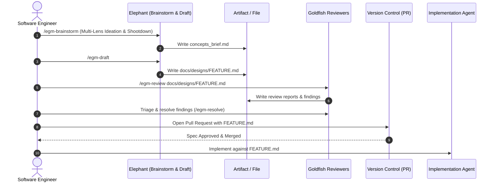

# EGM Architecture & System Lifecycle

*   **Authors:** Jim Quinn ([@quinnjim](https://github.com/quinnjim)), Elise Ewing ([@eewing314](https://github.com/eewing314)), Dave Rensin ([@drensin](https://github.com/drensin))
*   **Status:** Current
*   **Date:** 2026-06-06

--------------------------------------------------------------------------------

## Overview

The **Elephant-Goldfish Model (EGM)** is an implementation of Spec-Driven
Development (SDD) based on [Elephants, Goldfish, and the New Golden Age of Software Engineering](https://medium.com/@drensin/elephants-goldfish-and-the-new-golden-age-of-software-engineering-c33641a48874).
It emphasizes collaborative use of AI for design and review, maintaining verified
technical specifications checked directly into the codebase.

This document specifies the overarching system architecture of EGM: its
component model, its end-to-end dataflow, and its lifecycle across coding agent
runtimes.

## The Problem

Unstructured, conversational AI code generation suffers from four systemic
failure modes:

1.  **Hallucination Cascades & Context Pollution**: When a single LLM thread
    interviews the developer, creates the design, and writes the code, the
    session context accumulates speculative hypotheses and conversational bias.
    The model validates its own faulty assumptions instead of detecting errors.
2.  **Premature Implementation ("Weeds Syndrome")**: Coding agents default to
    writing code immediately in nearby files, bypassing high-level architectural
    placement, simplicity checks (YAGNI), and existing infrastructure reuse.
3.  **Chat Dump Fatigue**: Presenting multi-page design specs or lengthy review
    feedback directly in chat windows clutters conversation history, degrades
    LLM context performance, and creates poor user ergonomics.
4.  **Documentation Drift**: Design documents written during project kickoff
    routinely rot as code evolves, breaking future AI agent onboarding.

## Design Principles

*   **The Elephant & The Goldfish**:

    *   **The Elephant**: A deep-context agent loaded with system history, CUJs,
        and codebase maps to explore requirements and draft designs.
    *   **The Goldfish**: Subagents that start with fresh conversation context
        and review a draft using supplied material and rubrics. Access to
        workspace files, host instructions, and memory depends on the
        [harness](../harnesses.md).

*   **Human Ownership**: AI is a tool for exploration and review; the human
    engineer is responsible for architectural decisions, trade-offs, and owns
    the outcome.

*   **Artifact-First UX**: All long-form deliverables (drafts, summaries, review
    reports) are saved as dedicated artifacts or workspace files.

*   **Living Specifications**: Designs are checked-in artifacts in the source
    tree (`docs/designs/`) and checked for drift when requested.

## System Architecture & Component Model

The open-source EGM framework is organized into four decoupled subsystems:

### 1. Skills Layer (`skills/`)
Modular agent capabilities executable via slash commands or direct invocation:
*   `egm-brainstorm`: 7-lens shootdown swarm for early concept exploration.
*   `egm-draft`: Section-by-section specification compiler.
*   `egm-review`: Orchestrator for the multi-stage review pipeline.
*   `egm-review-loop`: Concurrent subagent review dispatcher.
*   `egm-resolve`: Interactive resolution and patch application.
*   `egm-drift-report`: Agent workflow comparing specs and READMEs to code via host search and file-reading tools.
*   `egm-bootstrap`: Recursive bottom-up codebase documentation generator.

### 2. Personas Layer (`agents/`)
Stateless system prompt instructions for isolated Goldfish reviewer subagents
(Comprehension, Design Critic, Implementation Readiness, Codebase Auditor,
Structural Validator, Style Editor, Inventive Catalyst, and Synthesizer).

### 3. Document Standards (`resources/document_standards/`)
Goldfish reviewers load the versioned rubrics listed in the
[shared runtime resources](../../resources/README.md). Those files own the
evaluation requirements; this design describes how the layers use them.

### 4. Living Documentation (`docs/`)
User guides (`getting_started.md`, `faq.md`) and technical design specifications
(`docs/designs/`).

## End-to-End Lifecycle & Dataflow

The EGM development pipeline transitions artifacts through five disciplined
phases:

### Phase 1: Upstream Ideation & Multi-Lens Shootdown (The Elephant)

*   **Command**: `/egm-brainstorm`
*   **Mechanics**: The Elephant interviews the engineer to anchor a core hypothesis,
    then spawns a 7-lens Goldfish swarm to shoot down flawed assumptions.
*   **Output**: A structured brief written to `concepts_brief.md`.

### Phase 2: Spec Authoring

*   **Command**: `/egm-draft`
*   **Mechanics**: Converts the concepts brief (or discussion notes) into an EGM-compliant
    technical design document written to `docs/designs/<feature>.md`.

### Phase 3: Isolated Verification (The Goldfish)

*   **Command**: `/egm-review`
*   **Execution**: The [review skill](../../skills/egm-review/SKILL.md) defines
    the full five-stage review and the presets for reviewing just the feature
    spec or implementation plan. Where needed, the skill identifies the boundary
    between those two parts of the document.
*   **Delegation**: The parent launches the comprehension reviewer directly.
    Other stages can use the synthesizer or direct dispatch, depending on the
    workflow and harness. Goldfish review requires fresh-context delegation.

### Phase 4: Human Review & Submission

*   The human engineer resolves or rejects Goldfish findings using
    `/egm-resolve`, updates the design doc, and submits the
    specification via Pull Request for human peer review.

### Phase 5: Implementation & Drift Monitoring

*   **Execution**: An implementation-readiness report, when available, informs
    the human approval decision. A feature-spec-only review covers the spec.
    Once the human authorizes implementation, coding agents follow the approved
    design and its `Target Scope & File Boundary` list.
*   **Phase Write Boundaries**: Phases 1–4 should write only design and review
    materials, such as `concepts_brief.md`, design drafts and final designs,
    review reports, and the design directory's `SITEMAP.md` if present.
    User-approved external review context can be saved in the working directory
    or the host's artifact directory. Treat saved context as reference material.
    Production source and dependency edits belong to Phase 5. Skills express
    this boundary as an instruction. Its
    enforcement depends on host permissions.
*   **Maintenance**: Run `/egm-drift-report` as needed to
    detect divergence between codebase implementations and checked-in design docs.

## Artifact-First UX Protocol

To maintain conversation health and prevent context degradation, all EGM skills
adhere to the following UX protocol:

Write proposals, drafts, and review reports to artifacts or workspace files
using the [host's available surfaces](../harnesses.md). Link to the artifact
from chat. The selected workflow determines when to pause for feedback.

## References

*   Dave Rensin, [Elephants, Goldfish, and the New Golden Age of Software Engineering](https://medium.com/@drensin/elephants-goldfish-and-the-new-golden-age-of-software-engineering-c33641a48874) (Medium, 2026).

## Alternatives Considered

*   **Monolithic In-Thread Review vs. Multi-Subagent Pipeline**:
    *   *Alternative*: Run review prompts sequentially within the same chat
        session.
    *   *Rejection*: Severe context degradation and confirmation bias; the model
        validates its own mistakes.
*   **Direct-to-Code vs. Spec-Driven Development**:
    *   *Alternative*: Prompting agents to generate code directly from feature
        requests.
    *   *Rejection*: Results in higher comment density per kLOC, duplicated
        utility implementations, and zero checked-in architectural memory.
