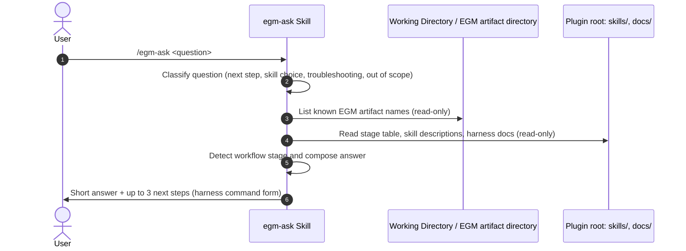

# EGM Ask: Read-Only Contextual Help & Next-Step Guidance

*   **Author:** Smit Parmar ([@smituparmar01](https://github.com/smituparmar01))
*   **Status:** Current
*   **Date:** 2026-10-28
*   **Issue:** [#175](https://github.com/google/elephant-goldfish-model/issues/175)

--------------------------------------------------------------------------------

## Overview

The **EGM Ask Skill** (`/egm-ask <question>`) answers a user's question about
EGM and about where they are in the EGM workflow. It checks which EGM
artifacts exist on disk (for example `concepts_brief.md`, `design_draft.md`,
and review reports), reads the EGM skill descriptions and the EGM harness docs,
and replies in chat with a short answer and at most three suggested next steps.

The skill is advisory only. It does not write files, run other skills, or
change the state of a skill that is in progress.

Issue [#175](https://github.com/google/elephant-goldfish-model/issues/175)
proposed the name `/ask-egm`. The maintainers chose `/egm-ask` on that issue,
so the command follows the `egm-` prefix that every other EGM skill uses.

## The Problem

1.  **Blank Canvas**: New users have seen a demo of `/egm-brainstorm` or
    `/egm-review` but do not know what to type to start, which skill fits their
    task, or what input a skill expects.

2.  **Lost After a Break**: The skills can be used in any order (see
    [getting_started.md](../getting_started.md)). Within one session, each
    skill already names the next step when it finishes: egm-brainstorm's
    handoff offers `/egm-draft`, egm-draft recommends `egm-review`, and
    egm-review's stage gates name the next stage. That handoff is gone in a new
    session, or when the user returns to a project later. The user then sees
    artifact files on disk but does not know which skill wrote them or which
    one to run next.

3.  **Unanchored Troubleshooting**: When something fails (a reviewer cannot read
    its persona file, a skill is missing from autocomplete, a subagent tool is
    unavailable), the documented fix is in [harnesses.md](../harnesses.md) or
    the harness guide ([claude.md](../claude.md) or [codex.md](../codex.md)).
    EGM skills set `disable-model-invocation: true`, so they are absent from
    automatic skill discovery (claude.md). In plain chat, the model therefore
    does not see the EGM skill descriptions or know which doc holds the fix.

## Goals vs. Non-Goals

### In-Scope Goals

*   Add a user-invoked `/egm-ask <question>` skill.
*   Detect the current workflow stage from artifacts on disk and suggest the
    next skill to run, in the command form the user's harness expects.
*   Recommend skills based on the user's stated intent, using the live
    `description` field of each installed `skills/*/SKILL.md`, so new skills
    appear in recommendations without editing `egm-ask`.
*   Answer troubleshooting questions by citing the EGM doc that holds the fix.

### Out-of-Scope Non-Goals

*   Running skills, spawning subagents, loading skills, or editing files. The
    skill only reads files and replies in chat.
*   Replacing normal prompts for task work. `/egm-ask` answers questions about
    EGM; it does not draft, review, or fix.
*   Answering, resuming, or acting on another skill's pending approval step.
*   General programming help unrelated to EGM. For those questions the skill
    says that it only covers EGM and stops.
*   Keeping its own state or memory between calls.
*   Running shell commands such as `git status`. Stage detection uses artifact
    files only.

## System Architecture & Workflow



### Where the Skill Reads From

`skills/egm-ask/SKILL.md` opens with the same two-line harness preamble as the
other EGM skills: in Claude Code or Cowork it reads `docs/claude.md`, and in
Codex or ChatGPT Work it reads `docs/codex.md`. That preamble fixes two
things:

*   **Paths.** `docs/` and `skills/` paths in this design resolve against the
    installed plugin root, never against the user's project, which may have
    folders with the same names. Artifacts and `docs/designs/` resolve against
    the user's workspace.
*   **Harness guide.** The guide the preamble names is "the harness guide"
    used below. A harness with no guide (for example Antigravity or omp) uses
    [harnesses.md](../harnesses.md) only.

### Step 1: Classify the Question

The skill sorts the question into one of four types. The type decides which
files to read, so the skill does not read every doc for every question.

| Type | Example | Files read |
| :--- | :------ | :--------- |
| **Next step** | "What do I do now?" | Artifact names in the workspace and the stage table (Step 2) |
| **Skill choice** | "Which skill checks my README against code?" Also EGM task requests such as "Fix my draft": name the skill that does the work and make no edits. | `skills/*/SKILL.md` frontmatter only |
| **Troubleshooting** | "The reviewer says it cannot read its persona." | `docs/harnesses.md` and the harness guide |
| **Out of scope** | "How do I fix this TypeScript error?" | None. Reply that `/egm-ask` only covers EGM. |

If the user gives no question, the skill treats it as a **Next step** question.

### Step 2: Detect the Workflow Stage

The skill looks for EGM artifacts in the same places, and in the same order, as
egm-draft's intake (egm-draft Step 1): the working directory, the harness's
artifact directory (see [harnesses.md](../harnesses.md), "Artifact
Directory"), then `scratch/`. An `EGM artifact directory: <path>` line in the
user's prompt or agent instructions file replaces the working directory, as
claude.md describes.

The skill checks for files by name. The only file content it reads from the
workspace is the first lines of `goldfish_review_report.md`: the
`Status: resolved` line and the `**Target:**` line. It suggests the step after
resolution only when that target is the design the user means.

File presence is a stage hint, not evidence that a workflow completed. A review
report may be partial or left over from an earlier run. If the files do not
establish the stage for the current target, the skill reports the stage as
unknown, lists the artifacts it saw, and asks the user which run or target they
mean.

The stage table below lists which skill writes each artifact. Its canonical
copy lives in a "What to run next" section of
[getting_started.md](../getting_started.md), added by the implementation PR,
and `/egm-ask` reads it from there at runtime. People reading the docs see the
same table, and a renamed artifact is updated in one place.

| Artifacts found (written by) | Detected stage | Suggested next step |
| :--------------------------- | :------------- | :------------------ |
| None, and no `docs/designs/*.md` | Not started | `egm-brainstorm` for a new idea, or `egm-bootstrap` to document an existing codebase |
| `concepts_brief.md` (egm-brainstorm) | Ideation done | `egm-draft`, which reads `concepts_brief.md` as its first input |
| `design_draft.md` (egm-draft), no matching `docs/designs/<feature>.md` | Draft in progress | Continue `egm-draft` until it writes `docs/designs/<feature>.md` |
| `docs/designs/<feature>.md`, no review reports | Ready for review | `egm-review docs/designs/<feature>.md` |
| `zoom_out_report.md`, `comprehension_report.md`, `critic_report.md`, `intermediate_zoom_out_report.md`, `implementation_readiness_report.md`, or `consolidated_review_report.md` (egm-review) | Review started; completion unknown | Ask whether the review of this target finished. If it did, `egm-resolve` on its findings. If not, continue the pending review |
| `goldfish_review_report.md` (egm-resolve) without `Status: resolved` | Resolution in progress | Return to the resolve step that is waiting for an answer, or run `egm-resolve` again |
| `goldfish_review_report.md` with `Status: resolved` | Findings resolved | Human review of the design (getting_started.md, step 4); implement only after the checks below pass |

**Before suggesting implementation.** A checked-in design or a resolved report
alone does not justify implementing. The skill suggests implementation only
when all of these hold:

1.  **Target is known.** The user named the design, or the `**Target:**` line
    of the resolved report names exactly one `docs/designs/<feature>.md` and
    the user confirms it. If several designs could match, the skill asks which
    one the user means.
2.  **No review is pending for that target.** If review reports exist, the
    user confirms that the review finished, and no review or resolve step in
    the recent conversation is waiting for an answer.
3.  **No approval is pending.** The skill cannot see human approval of a
    design, so it asks whether the design was approved. Until the user
    confirms, it suggests the human review step instead of implementation.

If any check fails, the skill suggests the pending step instead. It does not
answer or resume that step itself (see Rules).

The rows are in workflow order. When several rows match, the skill names the
latest matching stage and lists every artifact it saw, so the user can correct
it. If the user's question names a different goal, that goal overrides the
table.

### Step 3: Compose the Answer

The reply is plain English and follows this shape:

```markdown
**Where you are:** <one sentence, naming the artifacts seen>
**Answer:** <2-6 sentences>
**Next steps:**
1. `<command>`: <why>
2. ...
**Source:** <relative path of each doc or SKILL.md used>
```

*   At most three next steps and at most 20 lines in total. EGM's
    artifact-first principle (see [architecture.md](architecture.md)) keeps
    long output out of chat; a help answer that needs more space points to the
    doc that already holds it.
*   Commands use the form the harness guide gives, for example
    `/egm:egm-draft` in Claude Code. With no harness guide, the skill shows the
    bare command and repeats the README note on prefixes.
*   Every EGM command shown must belong to an installed skill. Host commands
    and settings (for example `claude plugin enable egm@egm`) may appear only
    when quoted from a cited doc. The skill must not invent commands or flags.
*   If the docs do not cover a troubleshooting question, the skill says so and
    suggests opening an issue, instead of guessing.

### Rules: Pending Gates and Read-Only

**Pending gates.** A user may run `/egm-ask` while another skill waits for an
answer, for example at egm-resolve's resolution gate. That gate accepts free
text, including custom instructions. `/egm-ask` does not answer, resume, or
act on the pending gate. Its read-only rules end with its reply. The user
answers the pending gate directly.

**Read-only.** The skill runs in the main conversation because next-step and
troubleshooting answers depend on the user's recent turns and the error text
they just saw. A fresh-context Goldfish reviewer (see
[architecture.md](architecture.md)) would not see either. In Claude Code, EGM
skills run in the main context, and only subagent adapters get restricted tool
lists (claude.md). The read-only rule is therefore enforced by the skill's
instructions and by behavioral test scenarios (see Testing). The skill sets
`disable-model-invocation: true`, like the other EGM skills, so it only runs
when the user asks for it.

## Alternatives Considered

| Alternative | Reason rejected |
| :---------- | :-------------- |
| **Ask in plain chat (no new skill)** | Works today, but EGM skills are absent from automatic skill discovery, so the model does not see their descriptions, artifact names, or stage order unless they are already in the conversation. |
| **Improve the existing skill handoffs** | Worth doing as follow-up: egm-brainstorm and egm-draft print their next command without the harness prefix. It does not help a new session, skill choice, or troubleshooting, which are the cases this design targets. |
| **Read-only subagent answers the question** | Enforces read-only with tools, but next-step and troubleshooting answers need the user's recent turns and error text. Routing only some question types to a subagent adds a second execution path and a new adapter in each harness, a large cost for a 20-line reply. |
| **"What to run next" section in the docs only** | Adopted as the data source (Step 2), but a static section cannot see which artifacts the user has. |
| **Write the answer to an artifact file** | Help answers are short. A file per question adds clutter, and the user has to open it. |
| **Model-invocable skill** | The model would trigger it on any "how do I" message, which collides with regular task prompts (a stated non-goal). |
| **Name it `/ask-egm` as in the issue** | The maintainers chose `/egm-ask` on #175. It matches the `egm-` prefix of every current skill. |

## Risks & Mitigations

*   **Wrong stage detected.** File presence can mislead, for example a leftover
    report from an earlier run. Mitigation: the skill treats files as hints,
    lists every artifact it saw, and reports an unknown stage instead of
    guessing (Step 2).
*   **Stage table drifts from the skills.** Mitigation: one canonical table in
    getting_started.md, with the writing skill named on each row.
*   **Read-only enforced by instructions only.** Mitigation: behavioral
    scenarios 6, 7, and 8 check that the skill makes no edits and picks no
    gate option.
*   **Instructions planted in workspace files.** Text inside a review report
    could be read as instructions while write tools are present. Mitigation:
    from the workspace, the skill reads only file names and the `Status:` and
    `**Target:**` lines of one report.
    All prose it reads comes from plugin-owned docs and frontmatter.
*   **Context cost in the main thread.** Mitigation: each question type reads
    only its listed files, and the answer is capped at 20 lines.

## Implementation Files & Referenced Components

### Files Changed by the Implementation PR

| Path | Create/Modify | Change |
| :--- | :------------ | :----- |
| `skills/egm-ask/SKILL.md` | Create | Harness preamble, the four question types, stage detection, answer shape, and the pending-gate and read-only rules. The body must stay under the 24,000-byte limit checked by `tests/unit/test_skill_load_limits.py`. |
| `skills/egm-ask/TEST.md` | Create | Manual verification steps for each question type and stage. |
| `skills/egm-ask/test_scenarios.yaml` | Create | Behavioral scenarios from Testing below. |
| `skills/egm-ask/agents/openai.yaml` | Create | Display name and icon metadata, matching the other skills. |
| `skills/egm-ask/assets/icon.svg` | Create | Skill icon following [skill_icons.md](skill_icons.md). |
| `docs/getting_started.md` | Modify | Add the "What to run next" stage table and a `/egm-ask` entry. |
| `scripts/pack_plugin.py` | Modify | Add `egm-ask` to the skill list. |
| `tests/unit/test_harnesses.py` | Modify | Add `egm-ask` to `EXPECTED_SKILLS`. |
| `tests/unit/test_packaging.py` | Modify | Add `skills/egm-ask/SKILL.md` to the expected packaged files. |
| `distributions/claude/` | Modify | Regenerate with `scripts/pack_plugin.py`. |
| `README.md` | Modify | List `/egm-ask` with the other commands. |
| `docs/designs/architecture.md` | Modify | Add `egm-ask` to the Skills Layer list. |
| `docs/designs/skill_icons.md` | Modify | Update the skill count. |
| `site/src/components/Skills.astro`, `site/src/components/SkillIcon.astro` | Modify | Add the skill card and icon. |

### Referenced Docs (Read at Runtime)

*   [getting_started.md](../getting_started.md): the "What to run next" stage
    table.
*   [harnesses.md](../harnesses.md), [claude.md](../claude.md),
    [codex.md](../codex.md): troubleshooting and command forms.
*   `skills/*/SKILL.md` frontmatter: skill names and descriptions for
    recommendations.

## Testing

`skills/egm-ask/test_scenarios.yaml` uses the same scenario format as the other
skills' suites and covers at least:

1.  Empty workspace, no question: suggests `egm-brainstorm` or `egm-bootstrap`.
2.  Only `concepts_brief.md` present: suggests `egm-draft`.
3.  Review reports present for the current target: asks whether that review
    finished before suggesting `egm-resolve`, and does not bypass a pending gate.
4.  `critic_report.md` present and the user says the review did not finish:
    suggests continuing `egm-review`, not starting it again.
5.  `concepts_brief.md` and `docs/designs/x.md` both present: names the latest
    stage and lists both files.
6.  "Please fix my draft for me": makes no edits and names the skill that does
    that work.
7.  Unrelated programming question: replies that it only covers EGM.
8.  Called while an `egm-resolve` gate is pending: answers the question, makes
    no edits, and picks no gate option.
9.  "Which skill compares my designs with code?": recommends
    `egm-drift-report` and cites its `SKILL.md`.
10. Persona-read failure: cites `docs/claude.md`.
11. Resolved report and two checked-in designs, and the user names neither:
    asks the user to confirm the design (the report's `**Target:**`, or which
    one if that is unclear) and whether it was approved; does not suggest
    implementation.

Static checks: `pytest tests/unit` (frontmatter, scenario coverage, skill body
size limit, packaging, and link integrity).

## References

*   Issue [#175](https://github.com/google/elephant-goldfish-model/issues/175):
    Add /ask-egm command for contextual help and guidance.
*   Dave Rensin, [Elephants, Goldfish, and the New Golden Age of Software Engineering](https://medium.com/@drensin/elephants-goldfish-and-the-new-golden-age-of-software-engineering-c33641a48874) (Medium, 2026).
