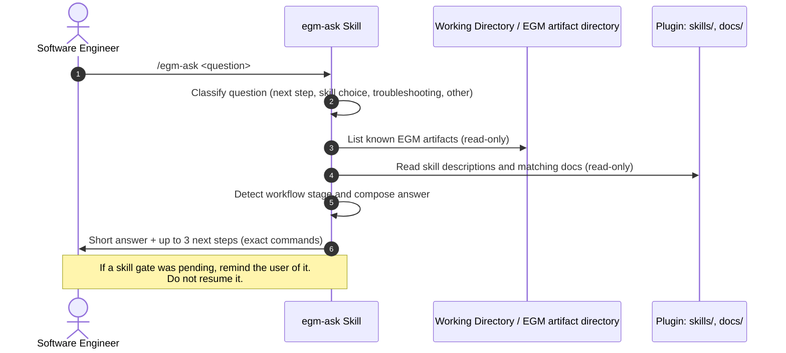

# EGM Ask: Read-Only Contextual Help & Next-Step Guidance

*   **Author:** Smit Parmar ([@smituparmar01](https://github.com/smituparmar01))
*   **Status:** Draft
*   **Date:** 2026-10-28
*   **Issue:** [#175](https://github.com/google/elephant-goldfish-model/issues/175)

--------------------------------------------------------------------------------

## Overview

The **EGM Ask Skill** (`/egm-ask <question>`) answers a user's question about
EGM and about where they are in the EGM workflow. It reads the workflow
artifacts already on disk (for example `concepts_brief.md`, `design_draft.md`,
and `goldfish_review_report.md`), the EGM skill descriptions, and the EGM
troubleshooting docs. It then replies in chat with a short answer and at most
three suggested next steps.

The skill is advisory only. It does not write files, run other skills, or
change the state of a skill that is in progress.

Issue [#175](https://github.com/google/elephant-goldfish-model/issues/175)
proposed the name `/ask-egm`. This design uses `/egm-ask` instead, so the
command follows the `egm-<verb>` prefix every other EGM skill uses
(`egm-draft`, `egm-review`, `egm-drift-report`).

## The Problem

1.  **Blank Canvas**: New users have seen a demo of `/egm-brainstorm` or
    `/egm-review` but do not know what to type to start, which skill fits their
    task, or what input a skill expects.

2.  **Lost Between Steps**: The skills are meant to be used out of order (see
    [getting_started.md](../getting_started.md)). After a skill finishes, users
    often do not know which skill to run next, or which artifact the next skill
    will read.

3.  **Unanchored Troubleshooting**: When something fails (a reviewer cannot read
    its persona file, a skill is missing from autocomplete, a subagent tool is
    unavailable), the fix is usually already in
    [faq.md](../faq.md), [harnesses.md](../harnesses.md), or the harness guide.
    A plain chat question often gets a general answer that ignores these docs.

## Goals vs. Non-Goals

### In-Scope Goals

*   Add a user-invoked `/egm-ask <question>` skill.
*   Detect the current workflow stage from artifacts on disk and suggest the
    next skill to run, with the exact command.
*   Recommend skills based on the user's stated intent, using the live
    `description` field of each installed `skills/*/SKILL.md`, so new skills
    appear in recommendations without editing `egm-ask`.
*   Answer troubleshooting questions by citing the matching section of the EGM
    docs.

### Out-of-Scope Non-Goals

*   Running skills, spawning subagents, loading skills, or editing files. The
    skill only reads files and replies in chat.
*   Replacing normal prompts for task work. `/egm-ask` answers questions about
    EGM; it does not draft, review, or fix.
*   General programming help unrelated to EGM. For those questions the skill
    says that it only covers EGM and stops.
*   Keeping its own state or memory between calls.

## System Architecture & Workflow



### 1. Step 1: Classify the Question

The skill sorts the question into one of four types. The type decides which
files to read, so the skill does not read every doc for every question.

| Type | Example | Files read |
| :--- | :------ | :--------- |
| **Next step** | "What do I do now?" | Workspace artifacts (Step 2) |
| **Skill choice** | "Which skill checks my README against code?" | `skills/*/SKILL.md` frontmatter only |
| **Troubleshooting** | "The reviewer says it cannot read its persona." | `docs/faq.md`, `docs/harnesses.md`, and the current harness guide (`docs/claude.md` or `docs/codex.md`) |
| **Out of scope** | "How do I fix this TypeScript error?" | None. Reply that `/egm-ask` only covers EGM. |

If the user gives no question, the skill treats it as a **Next step** question.

### 2. Step 2: Detect the Workflow Stage

The skill looks for EGM artifacts in the working directory, or in the folder
named by an `EGM artifact directory: <path>` line, following the same rule as
[claude.md](../claude.md). It checks for files by name only and reads at most
the first heading and section titles of each, so a large draft does not fill
the context. File presence is a stage hint, not evidence that a workflow
completed. A review report may be partial or left over from an earlier run.
When completion matters, read its bounded status or summary section. If that
does not establish completion for the current target, report the stage as
unknown and ask the user which run or target they mean.

| Artifacts found | Detected stage | Suggested next step |
| :-------------- | :------------- | :------------------ |
| None, and no `docs/designs/` | Not started | `/egm-brainstorm` for a new idea, or `/egm-bootstrap` to document an existing codebase |
| `concepts_brief.md` only | Ideation done | `/egm-draft` (reads `concepts_brief.md` as its first input) |
| `design_draft.md`, no review report | Draft in progress | Finish the draft, then `/egm-review <path>` |
| `goldfish_review_report.md` or `consolidated_review_report.md` | Review artifact present; completion must be checked | `/egm-resolve` only when the current review is complete; otherwise continue the pending review |
| `docs/designs/*.md` and no in-progress artifacts | Designs checked in | Implement, or `/egm-drift-report` to compare designs with code |

When more than one row matches, the skill names the most advanced stage and
lists the other artifacts it saw, so the user can correct it. The table is a
hint, not a rule: if the user's question names a different goal, the user's
goal wins.

### 3. Step 3: Compose the Answer

The reply is plain English and follows this shape:

```markdown
**Where you are:** <one sentence, naming the artifacts seen>
**Answer:** <2-6 sentences>
**Next steps:**
1. `<exact command>`: <why>
2. ...
**Source:** <relative path of each doc or SKILL.md used>
```

*   At most three next steps, and at most about 20 lines in total. The project's
    artifact-first principle keeps long output out of chat; a help answer that
    needs more space should point to the doc that already holds it.
*   Every command shown must belong to an installed skill. The skill must not
    invent commands or flags.
*   If the docs do not cover a troubleshooting question, the skill says so and
    suggests opening an issue, instead of guessing.

### 4. Interaction with In-Progress Skills

A user may run `/egm-ask` while another skill waits at a gate (for example an
`/egm-resolve` multiple-choice checkpoint). In that case `/egm-ask` answers,
then adds one line naming the pending gate and how to continue it. It does not
resume the gate or pick an option.

### 5. Read-Only Guarantee

The skill runs in the main conversation because it needs the conversation's
recent context (for example an error the user just saw). A fresh-context
Goldfish would not see that context.

Most harnesses cannot remove tools from a skill that runs in the main thread.
The read-only rule is therefore enforced by the skill's instructions and by
behavioral test scenarios (see Testing). The skill sets
`disable-model-invocation: true`, like the other EGM skills, so it only runs
when the user asks for it.

This also bounds how much `/egm-ask` adds to the main thread: the question,
a few file reads, and one short reply. It cannot fully avoid adding to the
thread, because every harness runs slash commands inside the current
conversation.

## Alternatives Considered

| Alternative | Reason rejected |
| :---------- | :-------------- |
| **Ask in plain chat (no new skill)** | Works today, but the model does not know EGM's artifact names or stage order and often gives general advice. `/egm-ask` grounds the answer in the installed skills and docs. |
| **Goldfish subagent answers the question** | Keeps the main thread cleaner, but a zero-context subagent cannot see the error or step the user is asking about. Passing that context in would repeat most of the thread. |
| **Static "what next" section in the docs** | Useful and cheap, but cannot read the user's workspace. This design reuses the docs as its source instead of replacing them. |
| **Write the answer to an artifact file** | Help answers are short. A file per question adds clutter, and the user has to open it. |
| **Model-invocable skill** | The model would trigger it on any "how do I" message, which collides with regular task prompts (a stated non-goal). |
| **Name it `/ask-egm` as in the issue** | Breaks the `egm-<verb>` naming used by all seven current skills and by the packaging tests. |

## Implementation Files & Referenced Components

### Core Skill Files (Stage 2)

| File Path | Type | Purpose & Reason for Existence |
| :-------- | :--- | :----------------------------- |
| `skills/egm-ask/SKILL.md` | Skill Definition | Implements the four question types, stage detection table, answer shape, and read-only rules. |
| `skills/egm-ask/TEST.md` | Verification Guide | Manual verification steps for each question type and stage. |
| `skills/egm-ask/test_scenarios.yaml` | Evaluation Benchmark | Behavioral scenarios, including the read-only and out-of-scope cases. |
| `skills/egm-ask/agents/openai.yaml` | Codex Interface | Display name and icon metadata, matching the other skills. |
| `skills/egm-ask/assets/icon.svg` | Skill Icon | Follows [skill_icons.md](skill_icons.md). |

### Registration Points (Stage 2)

Adding a skill touches the lists that name every skill:

*   `scripts/pack_plugin.py` and `tests/unit/test_harnesses.py`
    (`EXPECTED_SKILLS`), plus `tests/unit/test_packaging.py`.
*   `distributions/claude/skills/egm-ask/`, mirrored the same way as the
    existing skills.
*   `README.md`, [getting_started.md](../getting_started.md), the skills list
    in [architecture.md](architecture.md), and the skill count in
    [skill_icons.md](skill_icons.md).
*   `site/src/components/Skills.astro` and `site/src/components/SkillIcon.astro`.

### Referenced Docs (Read at Runtime)

*   [getting_started.md](../getting_started.md): workflow order and the purpose
    of each skill.
*   [faq.md](../faq.md), [harnesses.md](../harnesses.md),
    [claude.md](../claude.md), [codex.md](../codex.md): troubleshooting.
*   `skills/*/SKILL.md` frontmatter: skill names and descriptions for
    recommendations.

## Testing

`skills/egm-ask/test_scenarios.yaml` covers at least:

1.  Empty workspace, no question: suggests `/egm-brainstorm` or `/egm-bootstrap`.
2.  Only `concepts_brief.md` present: suggests `/egm-draft`.
3.  Complete current review report: suggests `/egm-resolve`. A partial or
    stale report does not imply completion and does not bypass a pending gate.
4.  "Which skill compares my designs with code?": recommends
    `/egm-drift-report` and cites its `SKILL.md`.
5.  Persona-read failure: cites the permission section of `docs/claude.md`.
6.  "Please fix my draft for me": declines to edit, and suggests the skill that
    does that work.
7.  Unrelated programming question: replies that it only covers EGM.
8.  Called while an `/egm-resolve` gate is pending: answers, names the pending
    gate, and does not choose an option.

Static checks: `pytest tests/unit` (frontmatter, scenario coverage, skill body
size limit, packaging, and link integrity).

## Open Questions

1.  Is `/egm-ask` acceptable as the name, or do maintainers prefer `/ask-egm`
    from the issue?
2.  Should stage detection also look at `git status` (for example, uncommitted
    changes under `docs/designs/`)? This design leaves it out to keep the skill
    free of shell commands.

## References

*   Issue [#175](https://github.com/google/elephant-goldfish-model/issues/175):
    Add /ask-egm command for contextual help and guidance.
*   Dave Rensin, [Elephants, Goldfish, and the New Golden Age of Software Engineering](https://medium.com/@drensin/elephants-goldfish-and-the-new-golden-age-of-software-engineering-c33641a48874) (Medium, 2026).
