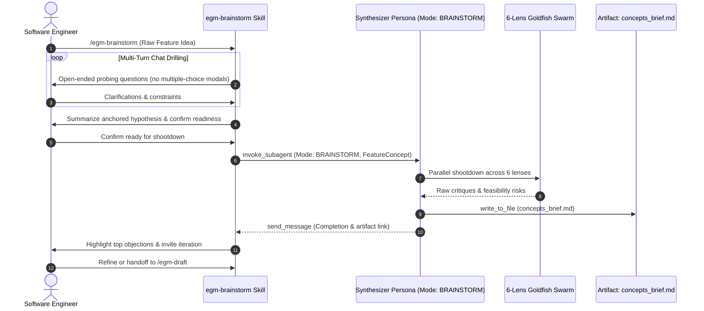

# EGM Brainstorm: Zero-Doc Upstream Ideation & Multi-Lens Shootdown

*   **Author:** Brian Suchy ([@briansuchy](https://github.com/briansuchy))
*   **Status:** Current
*   **Date:** 2026-07-31

--------------------------------------------------------------------------------

## Overview

The **EGM Brainstorm Skill** (`/egm-brainstorm`) is a fast way to validate
ideas. It is intended to be run early when a human doesn't know what solution
they want yet. It gives early access to a Goldfish swarm for "half-baked"
concepts and can be used before any formal design discussion begins.

## The Problem

Drafting formal technical design documents too early in the ideation cycle leads
to two major failure modes:

1.  **Premature Commitment to Flawed Hypotheses**: When developers write full
    design documents for early-stage ideas, they invest significant effort
    specifying details for a premise that may be unnecessary.

2.  Standard AI chat brainstorming without adversarial review runs the risk of
    sycophancy.

## System Architecture & Workflow

### 1. Step 1: Open-Ended Problem Drilling

*   The skill deliberately avoids structured multiple-choice question modals
    (`ask_question`) during early ideation, forcing open-ended exploration in
    chat across multiple turns.
*   Probes the root bottleneck, consuming systems, hard non-negotiable
    invariants, and explicit non-goals.
*   Constructs a 2-3 sentence anchored hypothesis and requires explicit human
    approval before spawning the subagent swarm.

### 2. Step 2: The 6 Goldfish Brainstorming Lenses

The `synthesizer` persona spawns six concurrent Goldfish subagents to audit the
concept from distinct, conflicting perspectives:

| Lens / Persona | Core Objective | Key Question Challenged |
| :------------- | :------------- | :---------------------- |
| **1. Contrarian / YAGNI** | Complexity minimization | *Can existing libraries, APIs, or services solve this without new code?* |
| **2. Cost & Resource Economics** | Budget & infrastructure scaling | *What is peak QPS, memory footprint, storage load, or token cost at scale?* |
| **3. UX & Developer Ergonomics** | Usability & cognitive overhead | *Is the CLI/API intuitive? Are error messages actionable, or does it add developer friction?* |
| **4. Migration & Compatibility** | Rollout safety & version skew | *How do existing clients/data migrate? Does this break serialized formats or persistent storage?* |
| **5. Observability & SRE** | Telemetry & debuggability | *Are operations traceable with distributed tracing? Are monitoring metrics and alerts actionable for oncalls?* |
| **6. Tech Debt & Maintenance** | Long-term maintainability | *Does this introduce tightly coupled state machines that will become tech debt in 2 years?* |

### 3. Step 3: Synthesis into `concepts_brief.md`

The synthesizer consolidates the multi-lens feedback into `concepts_brief.md` in
the side-panel artifact directory or local workspace:

*   Executive Summary & Problem Framing
*   Multi-Lens Analysis & Risk Matrix
*   Scope Boundaries (Goals vs. Non-Goals)
*   Key Architectural Decisions

### 4. Step 4: Iterative Refinement & Handoff

The engineer reviews the brief, addresses key objections, and decides whether
to:

*   Abandon the idea altogether.
*   Continue refining the hypothesis with additional Goldfish shootdown passes.
*   Transition into **`/egm-draft`** (when the concept is concrete and ready for
    formal design doc authoring).

## Implementation Files & Referenced Components

The brainstorm capability is implemented via its core skill definition and
delegates directly to the shared EGM subagent swarm and document standards:

### Core Skill Files

| File Path | Type | Purpose & Reason for Existence |
| :-------- | :--- | :----------------------------- |
| `skills/egm-brainstorm/SKILL.md` | Skill Definition | Implements `/egm-brainstorm` workflow, multi-turn open-ended drilling, shootdown delegation, and brief finalization. |
| `skills/egm-brainstorm/TEST.md` | Unit Tests | Verification test scenarios validating the brainstorm ideation and multi-lens critique flow. |
| `skills/egm-brainstorm/test_scenarios.yaml` | Evaluation Benchmark | Benchmark test suite evaluating brainstorm ideation and multi-lens critique flow. |

### Referenced Personas & Infrastructure Components

The ideation shootdown swarm relies on intermediate orchestration and
specialized Goldfish personas defined in `agents/` and document standards:

*   **Intermediate Orchestration**:
    [`agents/synthesizer.md`](../../agents/synthesizer.md) (`Mode: BRAINSTORM`)
    coordinates the parallel fan-out and compiles `concepts_brief.md`.
*   **6-Lens Goldfish Personas**:
    *   [`agents/zoom_out.md`](../../agents/zoom_out.md): Contrarian / YAGNI Lens.
    *   [`agents/design_critic.md`](../../agents/design_critic.md): Cost, Quota & Resource Economics Lens.
    *   [`agents/comprehension.md`](../../agents/comprehension.md): UX & Developer Ergonomics Lens.
    *   [`agents/implementation_readiness.md`](../../agents/implementation_readiness.md): Migration & Compatibility Lens.
    *   [`agents/codebase_details.md`](../../agents/codebase_details.md): Codebase Grounding & Existing Reuse Lens.
    *   [`agents/structural.md`](../../agents/structural.md): Maintainability & Tech Debt Lens.
*   **Referenced Standards**: Evaluates concepts against
    [`zoom-out-standard.md`](../../resources/document_standards/zoom-out-standard.md)
    and [`heilmeier-standard.md`](../../resources/document_standards/heilmeier-standard.md).

## References

*   Dave Rensin, [Elephants, Goldfish, and the New Golden Age of Software Engineering](https://medium.com/@drensin/elephants-goldfish-and-the-new-golden-age-of-software-engineering-c33641a48874) (Medium, 2026).
*   DARPA, [The Heilmeier Catechism](https://www.darpa.mil/about/heilmeier-catechism).
