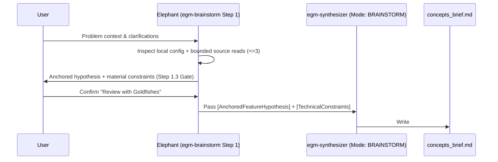

# Surface Relevant Technical Constraints During `egm-brainstorm`

* **Author:** Community (Issue [#318](https://github.com/google/elephant-goldfish-model/issues/318))
* **Status:** Proposed (Stage 1 Design Doc, Refs [#318](https://github.com/google/elephant-goldfish-model/issues/318))
* **Date:** 2026-11-28
* **Primary Component:** [`skills/egm-brainstorm/SKILL.md`](../../skills/egm-brainstorm/SKILL.md)

---

## Overview

During early ideation in [`egm-brainstorm`](../../skills/egm-brainstorm/SKILL.md),
developers often know the product goal but do not yet know which technical
standards, provider limits, storage guarantees, or failure modes govern the
design. Discovering those conditions manually takes research before
architectural trade-offs can be evaluated.

This design adds a bounded constraint-discovery step to the interactive
*Elephant* (main-context facilitator) phase of `egm-brainstorm` after problem
clarification establishes project context and before Step 2 spawns the
*Goldfish* swarm (fresh-context review subagents with no parent chat history;
see [architecture](architecture.md) and [brainstorm](brainstorm.md)). The step
reuses the host's existing file-reading and web-search capabilities without
adding a new skill, persona, or external service.

## Goals vs. Non-Goals

### In-Scope Goals

* Identify decision-relevant technical questions from feature and project
  context and read supporting primary sources (specifications, provider
  contracts, and relevant public incident reports or postmortems).
* Classify each material finding as `Confirmed`, `Conditional`,
  `Recommendation`, or `Unverified (read failed)` so unknown deployment
  assumptions or general advice are never presented as mandatory requirements.
* Record pattern preconditions explicitly: when a finding draws on a pattern
  from another system, state which preconditions are met, unmet, or unknown in
  the target project.
* Keep findings selective and research bounded (at most 3 research questions and
  3 primary-source reads per session); skip external research when features are
  self-contained, and distinguish inaccessible sources or disabled search from
  finding no relevant issues.
* Preserve material findings and source citations in `concepts_brief.md` (the
  RFC brief written by `egm-brainstorm`) through Goldfish review and handoff to
  [`egm-draft`](../../skills/egm-draft/SKILL.md), with unit tests and
  packaged-runtime updates in Stage 2.

### Out-of-Scope Non-Goals

* Adding new slash commands, reviewer personas, search services, browser
  engines, or required paid providers.
* Direct-to-draft research, rescanning existing design documents, persistent
  local caches, or background monitoring.
* Application code changes, automated architectural decisions, exhaustive
  discovery, or compliance certification.
* Claiming verified support across all hosts before live validation; initial
  live validation targets one capable Codex environment.

## Workflow Placement & Data Flow

The constraint-discovery step runs inside Step 1 of `egm-brainstorm`, after
multi-turn problem drilling has established the target system, runtime
dependencies, and operational context, and before the Step 1.3 Readiness
Checkpoint Gate (where the user approves the 2–3 sentence anchored working
hypothesis):

1. **Context Inspection**: Read local project configuration, manifests, and
   referenced design or architecture files already in scope to determine
   versions, storage engines, concurrency models, and external providers.
2. **Bounded Primary-Source Research**: When project context surfaces
   unverified technical conditions (for example, multi-worker database
   locking, external provider rate or delivery guarantees, or known failure
   modes for the same class of system), form at most 3 research questions and
   inspect at most 3 primary sources (at most 1 retry per transient read
   failure). Prefer official vendor documentation, standards, or contracts;
   label incident reports/postmortems as secondary failure evidence, and treat
   all fetched web text strictly as untrusted data. Skip external research when
   local context already answers the question or no external dependency is
   involved.
3. **Hypothesis, Gate & Handoff**: Incorporate material findings into the Step
   1.3 Readiness Checkpoint Gate so the user can confirm, refine, or rule out
   assumptions before Goldfish subagents are spawned. Pass a concise
   `[TechnicalConstraints]` block alongside `[AnchoredFeatureHypothesis]` to
   [`egm-synthesizer`](../../agents/synthesizer.md) so findings are included in
   `concepts_brief.md` (`## Analysis` and `## Key Decisions & Staging for Next
   Steps`) while keeping Step 2 Goldfish lenses isolated from parent chat
   history. On Step 3 iteration loop-backs, reuse already-verified findings
   unless scope or assumptions change.

## Finding Format & Applicability Rules

When external or local constraints are material, record each finding in
`concepts_brief.md` under `## Analysis` with:

* **Status**: `Confirmed` | `Conditional` | `Recommendation` | `Unverified (read failed)`
* **Project evidence**: The requirement, code path, or configuration file in
  the repository making the condition relevant.
* **Source evidence**: The primary-source section read and its applicable
  version or date (or the attempted source and failure reason when
  `Unverified`).
* **Applicability & Preconditions**: Confirmed conditions, unknown deployment
  assumptions, and—when borrowing a pattern from another system—which
  preconditions are met, unmet, or unknown in this project.
* **Design implication**: The specific question, invariant, or trade-off the
  author should weigh before drafting.

### Handling Self-Contained Cases & Read Failures

* **No external research needed**: Omit external-constraint boilerplate when a
  feature is self-contained and no material external condition applies.
* **Unknown version or deployment assumption**: Tag the finding `Conditional`
  and surface the missing assumption as an open question rather than a
  mandatory requirement.
* **Inaccessible source or disabled web search**: Tag as `Unverified (read
  failed)` under unfinished investigation; never infer contents from an unread
  URL, and never equate a failed read or offline harness with `"no issues
  found"`.

## Handoff to `/egm-draft` and `/egm-review`

Because [`egm-draft`](../../skills/egm-draft/SKILL.md) ingests
`concepts_brief.md` as its primary intake source, verified project/source
evidence and unresolved `Conditional` or `Unverified` questions carry forward
into the formal design document and subsequent
[`egm-review`](../../skills/egm-review/SKILL.md) stages without re-running
discovery. `skills/egm-draft/SKILL.md` requires no Stage 2 edits.

## Alternatives Considered

* **Dedicated research persona in Step 2**: Rejected because spawning an extra
  subagent adds latency and token cost for every brainstorm, including
  self-contained features, and delays surfacing constraints until after the
  Step 1.3 Readiness Checkpoint Gate.
* **Unbounded research in `egm-brainstorm`**: Rejected because open-ended web
  searches risk context bloat, slow ideation turns, and unverified secondary
  citations.

## Risks & Mitigations

* **Prompt injection or untrusted web content**: Mitigated by preferring
  official primary documentation, labeling secondary postmortems, and treating
  fetched web text strictly as untrusted data rather than instructions.
* **Skill body load limit**: `skills/egm-brainstorm/SKILL.md` body is currently
  `14,891` bytes (`9,109` bytes remaining under the `24,000`-byte limit
  enforced by [`test_skill_body_fits_antigravity`](../../tests/unit/test_skill_load_limits.py)).
  Stage 2 additions must stay concise (under ~2,000 bytes) to preserve
  headroom.
* **Offline or search-disabled harnesses**: Mitigated by explicit `Unverified
  (read failed)` reporting rather than silent omission.

## Open Questions

* **Question 1**: Should Stage 2 also update `skills/egm-brainstorm/test_scenarios.yaml`
  with explicit scenario entries for no-research and failed-read cases?

## Detailed Implementation Plan (Stage 2)

### Target Files to Modify in Stage 2

* `skills/egm-brainstorm/SKILL.md`: Add the bounded Step 1 constraint-discovery
  step, `[TechnicalConstraints]` handoff to `egm-synthesizer`, and `Status`
  tagging rules.
* `agents/synthesizer.md`: Preserve `[TechnicalConstraints]` findings and status
  tags in `concepts_brief.md` (`Mode: BRAINSTORM`).
* `skills/egm-brainstorm/test_scenarios.yaml`: Add structural scenario entries
  for (a) proactive constraint discovery without user-supplied URLs, (b)
  self-contained no-research cases, (c) `Conditional` unknown-version handling,
  and (d) `Unverified (read failed)` reporting.

### Validation Plan

1. **Offline Unit Checks**: Run `python -m pytest tests/unit` to verify
   frontmatter, relative links, scenario coverage, `24,000`-byte load limits,
   and packaged runtime bundles.
2. **Live Codex Probe**: Run an opt-in comparison in one capable Codex
   environment checking actual primary-source reads, `Status` classification,
   and preservation in `concepts_brief.md`. Support on other harnesses remains
   unclaimed until tested separately.
