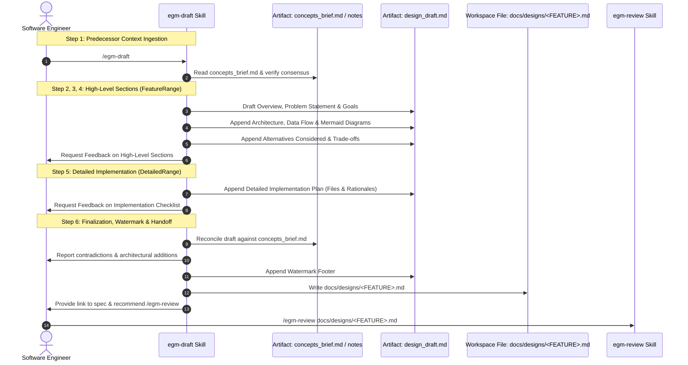

# EGM Design Drafting: Specification Authoring & Semantic Boundaries

*   **Authors:** Jim Quinn ([@quinnjim](https://github.com/quinnjim)), Elise Ewing ([@eewing314](https://github.com/eewing314))
*   **Status:** Current
*   **Date:** 2026-06-06

--------------------------------------------------------------------------------

## Overview

The **EGM Design Drafting Skill** (`/egm-draft`) converts the ideation
artifact (`concepts_brief.md` from `/egm-brainstorm` or discussion notes) into a
formal, living design document under `docs/designs/`. It drafts the document
iteratively section-by-section, gathering feedback at each stage before saving to
disk.

Crucially, it establishes **semantic boundaries** within the document to enable
downstream multi-agent reviews (`/egm-review`) and automated drift auditing
(`/egm-drift-report`).

## The Problem

Directly asking AI models to author a comprehensive technical design in a single
prompt produces severe quality issues:

1.  **Monolithic Hallucination & Wall-of-Text Output**: Models output massive,
    unstructured markdown blobs directly into the chat pane, making review
    difficult and truncating technical depth.
2.  **Premature Code Dumping**: Instead of focusing on architectural invariants,
    data flows, and file-level rationales, models generate raw, unmaintainable
    helper code.
3.  **Lack of Semantic Structure for Downstream Tooling**: Without strict
    standardized section boundaries (e.g., distinguishing high-level goals from
    concrete implementation plans), automated reviewers cannot partition audit
    responsibilities.

## Design Principles

*   **Section-by-Section Iterative Drafting**: Drafts are authored incrementally
    (Overview & Goals -> Architecture & Diagrams -> Alternatives ->
    Implementation Plan), requesting user feedback between sections.
*   **Artifact-First Delivery**: All drafting state is rendered into side-panel
    artifacts (`design_draft.md`) or persistent workspace files. Printing large
    drafts directly to the chat stream is strictly prohibited.
*   **Semantic Split by Design**: Drafts are partitioned into a high-level
    conceptual section (`FeatureRange`) and a concrete execution section
    (`DetailedRange`) to facilitate targeted downstream Goldfish reviews.
*   **Exhaustive File & Rationale Enumeration**: The implementation plan must
    enumerate every file to create, modify, or delete, accompanied by an
    architectural rationale, without generating raw source code.
*   **Provenance Watermarking**: Finalized documents append a standardized
    provenance watermark footer to track AI authoring state.

## System Architecture & Workflow



--------------------------------------------------------------------------------

## The Drafting Protocol (`/egm-draft`)

The `/egm-draft` workflow converts the ideation artifact into a living
markdown design doc:

### Step 1: Predecessor Context Ingestion

Parses `concepts_brief.md` (or `discussion_summary.md` / feature notes) from the artifact directory (falling back to the
scratch directory or workspace root if needed) and verifies user consensus.

### Step 2: Overview, Problem & Goals

Drafts the user-facing problem statement, business value, goals, and non-goals
in `design_draft.md`.

### Step 3: Technical Plan & Architecture

Appends component diagrams (Mermaid), API signatures, and data flow narratives.

### Step 4: Alternatives Considered

Documents rejected alternatives with concrete trade-off justifications (latency,
complexity, maintenance), read from the brief's `Alternatives Weighed` section.

### Step 5: Detailed Implementation Plan

Drafts the execution section:

*   Unified checklist of every file to create, modify, or delete.
*   Explicit architectural rationale for each file change.
*   **No implementation code**: Includes only schemas, type definitions, and
    pseudocode.

### Step 6: Finalization, Formatting & Registration

*   Reconciles the draft against the predecessor context and asks the user to
    decide each contradiction. It does not self-grade against the Zoom Out
    standard; `/egm-review` Stage 5 does that from a fresh context.
*   Appends a standardized provenance watermark footer (*`*Drafted with EGM*`*)
    separated by a horizontal rule delimiter (`--------------------------------------------------------------------------------`)
    after trailing open questions.
*   Writes the document to `docs/designs/<FEATURE>.md`.
*   Registers the document in `docs/designs/README.md` if present.
*   Formats markdown using standard markdown formatters.
*   Outputs a clickable link and instructs the user to run `/egm-review`.

--------------------------------------------------------------------------------

## Semantic Boundary Discovery

EGM design documents are deliberately structured to enable the downstream
Goldfish review engine to parse the document into two semantic zones:

1.  **Feature Range (`FeatureRange`)**: Lines 1 through the header boundary.
    Contains the high-level problem statement, goals, architecture, and
    alternatives. Audited by the **Design Critic** (`egm_design`) and
    **Comprehension Reviewer** (`egm_comprehension`).
2.  **Detailed Range (`DetailedRange`)**: From `## Detailed Implementation Plan`
    to EOF. Contains file targets, schemas, and test plans. Audited by the
    **Implementation Readiness Reviewer** (`egm_implementation_readiness`) and
    **Codebase Details Auditor** (`egm_codebase_details`).

Standardizing on the `## Detailed Implementation Plan` header allows automated
boundary discovery without requiring manual line range configuration. Terminal
footer watermarks (`*Drafted with EGM*`) residing at EOF are treated
as inert structural metadata and excluded from requirement audits during review
and drift analysis.

## Provenance Watermarking

To support lightweight provenance tracking and human inspection, all design
`/egm-draft` specs include a footer watermark:

```markdown
--------------------------------------------------------------------------------

*Drafted with EGM*
```

*   **Delimited EOF Placement**: Appended at the absolute end of the document,
    separated from trailing sections (`### Open Questions`) by a horizontal
    line.
*   **Best-Effort & Forward-Looking**: Applies strictly to newly drafted or
    updated specifications moving forward; no retroactive migration sweeps or
    blocking presubmits are imposed on legacy documents.

--------------------------------------------------------------------------------

## Standards Alignment

Read the linked standard for its requirements.

| Authoring Step | Governing Standard |
| :------------- | :----------------- |
| Architecture Outline | [Zoom-out standard](../../resources/document_standards/zoom-out-standard.md) |
| Document Structure | [Feature specification standard](../../resources/document_standards/feature-spec-standard.md) |
| Detailed Plan | [Implementation readiness standard](../../resources/document_standards/implementation-readiness-standard.md) |

--------------------------------------------------------------------------------

## Implementation Files

The drafting capability is implemented across the following skill and reference files:

| File Path | Type | Purpose & Reason for Existence |
| :-------- | :--- | :----------------------------- |
| `skills/egm-draft/SKILL.md` | Skill Definition | Implements `/egm-draft` section-by-section markdown compilation, sitemap registration, and formatting. |
| `skills/egm-draft/TEST.md` | Unit Tests | Verification test scenarios validating the drafting and finalization workflow. |
| `skills/egm-draft/test_scenarios.yaml` | Evaluation Benchmark | Co-located behavioral eval suite evaluating model adherence to the drafting protocol. |
| `skills/egm-draft/references/design_doc.md` | Document Template | Canonical markdown design document template defining required sections and layout. |
| `resources/execution_instructions.md` | Execution Instructions | Core execution rules enforcing no-code guardrails, silent compliance, and one-question-at-a-time pacing. |

--------------------------------------------------------------------------------

## References

*   Dave Rensin, [Elephants, Goldfish, and the New Golden Age of Software Engineering](https://medium.com/@drensin/elephants-goldfish-and-the-new-golden-age-of-software-engineering-c33641a48874) (Medium, 2026).
*   GitHub, [GitHub Flavored Markdown Spec](https://github.github.com/gfm/).
