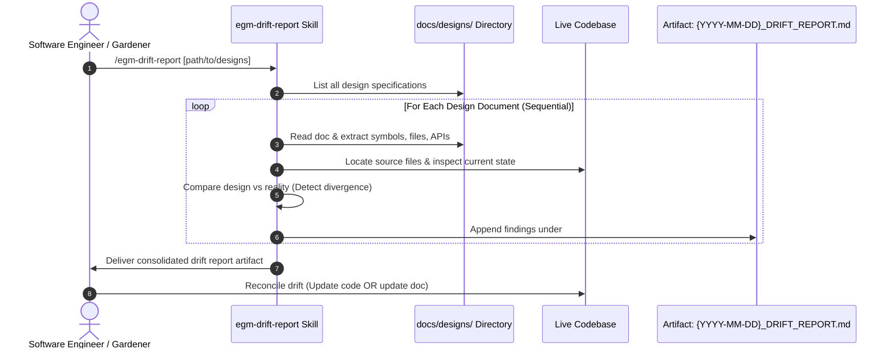

# EGM Drift Detection Protocol (Living Specifications & Code Synchronization)

*   **Author:** Jim Quinn ([@quinnjim](https://github.com/quinnjim))
*   **Status:** Current
*   **Date:** 2026-06-07

--------------------------------------------------------------------------------

## Overview

The **EGM Drift Detection Skill** (`/egm-drift-report`) audits checked-in design
documents under `docs/designs/` and package `README.md` hierarchies against
source code to identify and report architectural divergence.

It is intended to be incorporated as a ritual by teams practicing EGM to keep
their design documents in sync with their feature implementations.

## The Problem

Documentation drift, particularly when paired with AI tooling, has these
problems:

1.  **Stale Context**: Without a system to keep them up to date, quick
    point-fixes or untracked refactors leave designs outdated. When a human or
    AI agent consults an outdated spec to design a new feature, they make flawed
    assumptions that lead to broken implementations.

2.  **Silent Architectural Rot**: Without automated verification, differences
    between the intended design and actual code (e.g., hardcoded bypasses
    instead of dynamic resolvers) accumulate unnoticed until production
    incidents occur.

3.  **Human Fatigue**: Manually cross-referencing multi-page design docs against
    dozens of implementation files is tedious and rarely performed consistently.

## System Architecture & Workflow



--------------------------------------------------------------------------------

### Drift Detection Heuristics

The drift skill audits code against four core divergence categories:

| Divergence Category | Description | Example Reportable Drift |
| :------------------ | :---------- | :----------------------- |
| **Missing Features** | Logic or components described in the design but completely absent in source code. | A scheduled cleanup task specified in the design doc was never implemented in the service binary. |
| **Incomplete Models** | Structs, schemas, dataclasses, or classes missing fields specified in the design. | A model schema in the design defines 5 fields, but the code implementation only has 3. |
| **Logic Shortcuts** | Hardcoded values, mock fallbacks, or bypasses where dynamic logic was designed. | A dynamic quota lookup was designed, but the code uses a hardcoded constant `DEFAULT_QUOTA = 100`. |
| **Architectural Divergence** | Code implemented using different design patterns, frameworks, or dependencies than planned. | The design specified using gRPC service endpoints, but the implementation uses custom HTTP handlers. |

--------------------------------------------------------------------------------

### Execution Protocol

1.  **Intake & Discovery**: Identifies target design folder (`docs/designs/`)
    or package tree (`README.md`).
2.  **Sequential Processing**: Audits documents one-by-one to prevent tool
    buffer overflows and context degradation.
3.  **Source Grounding**: Resolves referenced classes, endpoints, and files via
    code search and file viewing tools. If a document references unlinked symbols,
    the report prompts the engineer to add explicit links for cheaper future scans.
4.  **Difference Filtering**: Reports **ONLY** actionable discrepancies. If the
    implementation matches the design completely, it outputs `"No drift detected."`
5.  **Artifact Output**: Formats all results into `{YYYY-MM-DD}_DRIFT_REPORT.md`
    using strict markdown headings:

    ```markdown
    ## <DESIGN_DOC_NAME>

    * [Divergence item 1 with file:line reference]
    * [Divergence item 2]
    <!-- Or "No drift detected." -->
    ```

--------------------------------------------------------------------------------

### Operational Maintenance Cadence

To keep documentation living and trustworthy, we recommend (but do not enforce)
the following:

*   **Weekly Gardener Rotation**: Teams running EGM incorporate
    `/egm-drift-report` into their weekly build gardener or oncall checklist.
*   **Two-Way Reconciliation**: Every drift detected is actionable:
    *   *If the code change was intentional*: Update the design document to
        reflect reality.
    *   *If the design was violated*: File an issue or prompt an agent to complete
        the missing implementation.

## Implementation Files

The drift detection skill is implemented across the following files:

| File Path | Type | Purpose & Reason for Existence |
| :-------- | :--- | :----------------------------- |
| `skills/egm-drift-report/SKILL.md` | Skill Definition | Implements `/egm-drift-report` sequential document scanner, divergence heuristics analyzer, and report generator. |
| `skills/egm-drift-report/TEST.md` | Test Plan | Points to `pytest tests/unit` and `TESTING.md` (frontmatter and link checks); no drift-specific tests. |
| `skills/egm-drift-report/test_scenarios.yaml` | Evaluation Scenario | Single `detect_all_drift` scenario with a broad `required_pattern` assertion; `tests/unit/test_scenario_coverage.py` validates structure, but no in-repo runner executes the assertion. |

## References

*   Dave Rensin, [Elephants, Goldfish, and the New Golden Age of Software Engineering](https://medium.com/@drensin/elephants-goldfish-and-the-new-golden-age-of-software-engineering-c33641a48874) (Medium, 2026).


