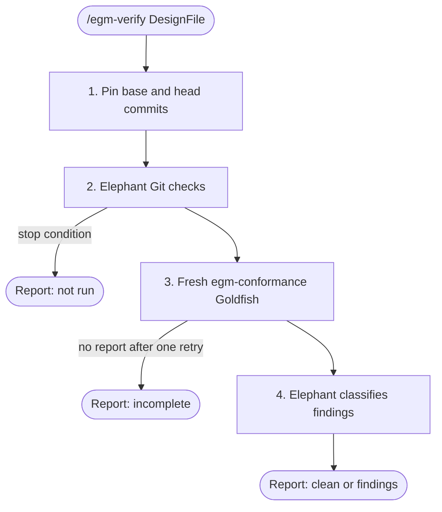

# Implementation Verification Against an Approved Design

*   **Author:** [@karthik-0306](https://github.com/karthik-0306)
*   **Status:** Proposed
*   **Date:** 2026-11-18
*   **Issue:** #436

--------------------------------------------------------------------------------

## Overview

`/egm-verify` checks one implementation against the approved design it
implements. The Elephant pins two commits, reads the design as it was at the
base commit, and runs a fixed set of Git checks. A fresh Goldfish then compares
the change with the design's Detailed Implementation Plan, Critical User
Journeys (CUJs), Non-Goals, and Verification Plan. The skill writes
`verification_report.md` and edits no other file.

## The Problem

EGM's flow is brainstorm, draft, review, and implement. After implementation,
nothing checks that the code does what the approved design says. No skill
reads a Git diff against a design. `egm-drift-report` compares a whole design
directory with the current source, runs in the Elephant's own context, and
does not look at the change that implemented a specific design.

The design template already describes a correct implementation.
[`design_doc.md`](../../skills/egm-draft/references/design_doc.md) asks for a
Detailed Implementation Plan that lists every file with `Create` or `Modify`,
CUJs in Given/When/Then form, Non-Goals, and a Verification Plan. Today these
sections guide the implementer, but nothing checks the result against them. A
planned file can be skipped, an unplanned file can change, a CUJ can ship
without a test, and a Non-Goal can be crossed. The design still reads as the
current truth.

The Elephant that implemented the change is the wrong reviewer, for the same
reason it is the wrong reviewer of its own design: it already believes the
code matches. Two further gaps were raised in #436. The change can edit the
approved design so that the code matches it, and a reviewer that reads the
implementer's summary ("tests pass") inherits the implementer's belief.

## Goals

*   Check one change, from a pinned base commit to a pinned head commit,
    against one approved design.
*   Read the design from the base commit, never from the working tree, and
    report any change to the design file as its own finding.
*   Keep the reviewer isolated: it receives the design, the change, and the
    verification log, and no implementation conversation.
*   Bind test evidence to code: accept the verification log only when the
    commit it records has the same tree as the head commit, apart from the log
    file itself.
*   Report a reviewer that did not run as `not run`, and stop on hosts without
    a subagent tool, as `egm-review` does.

## Non-Goals

*   General code review for bugs, style, or security. #295 proposes an
    independent precommit review for that.
*   Running builds or tests. The reviewer compares recorded output with the
    plan. It never executes commands from the design or the log.
*   Reviewing uncommitted changes. The skill checks commits only.
*   Editing code, the design, or Git state. The skill writes only its report.
*   Replacing `egm-drift-report`, which scans all designs against the current
    code.

## Open Questions

*   **Question 1**: Should verification logs stay in the repository after the
    change merges, as a record next to the design, or be removed before
    merge? This design defaults to `verification_log.md` at the repository
    root and lets the user pass another path.
*   **Question 2**: Should `egm-verify` later share evidence capture with the
    precommit review in #295 once that design merges? This design keeps the
    two separate (see Alternatives Considered).

## Critical User Journeys (CUJs)

### CUJ 1: Verify a finished feature branch

*   **Given**: An approved design `docs/designs/x.md` exists on `main`, and a
    feature branch implements it with a committed `verification_log.md`.
*   **When**: The developer runs `/egm-verify docs/designs/x.md`.
*   **Then**: The skill pins the merge base with `main` and `HEAD`, runs the
    Git checks, dispatches one fresh reviewer, and writes
    `verification_report.md` with outcome `clean` or `findings`.

### CUJ 2: Catch a design edited to match the code

*   **Given**: The feature branch removes a planned file from the design's
    implementation plan and does not create that file.
*   **When**: The developer runs `/egm-verify docs/designs/x.md`.
*   **Then**: The reviewer reads the design from the base commit, so the
    missing file is a finding. The design edit is a separate finding that
    quotes the design diff.

### CUJ 3: Catch stale or missing test evidence

*   **Given**: `verification_log.md` records commit `A`, and a later commit
    changes code, or a rebase removed `A` from history.
*   **When**: The developer runs `/egm-verify docs/designs/x.md`.
*   **Then**: The report has a finding that the checks ran on different code
    (exit status 1) or on a commit that is no longer in the repository (exit
    status 128). Neither case is reported as clean.

## Technical Plan (Architecture)

The Elephant runs deterministic Git commands and decides nothing that needs
judgement. The Goldfish judges conformance and runs no commands. The Elephant
classifies the findings and writes the report.



### Inputs

| Input | Required | Default |
| :--- | :--- | :--- |
| `DesignFile` | Yes | None. Repository-relative path of the approved design. |
| `BaseRef` | No | `git merge-base HEAD <default branch>`. |
| `VerificationLog` | No | `verification_log.md` at the repository root. |

The default branch is the target of `refs/remotes/origin/HEAD`. If it cannot
be resolved, the skill asks for `BaseRef` and ends the turn. In a run where no
one can answer, the outcome is `not run`.

### Step 1: Pin the commits

The Elephant resolves `BaseSha` with `git rev-parse --verify
<BaseRef>^{commit}` and `HeadSha` with `git rev-parse --verify HEAD`. Every
later command uses these two SHAs, so a commit made during the run does not
change what is reviewed.

### Step 2: Elephant Git checks

Each command runs from the repository root. Every `git diff` command adds
`--no-ext-diff --no-textconv`, so configured diff drivers and text converters
cannot run programs during the check.

| Check | Command | Result |
| :--- | :--- | :--- |
| Clean tracked tree | `git status --porcelain=v1 --untracked-files=no` | Output: stop with `not run` and ask the user to commit or stash. |
| Design at base | `git cat-file -e <BaseSha>:<DesignFile>` | Missing: stop with `not run` and ask for a base that contains the approved design. |
| Design changed | `git diff --no-ext-diff --no-textconv --name-status -M <BaseSha> <HeadSha>` | `DesignFile` listed: finding `V-DESIGN`. |
| Log present | `git cat-file -e <HeadSha>:<VerificationLog>` | Missing: finding `V-LOG-MISSING`. |
| Log freshness | `git diff --quiet --no-ext-diff --no-textconv <LoggedSha> <HeadSha> -- ':(top)' ':(top,exclude)<VerificationLog>'` | Exit 0: fresh. Exit 1: finding `V-LOG-STALE`. Exit 128: finding `V-LOG-UNKNOWN`. |

The tree must be clean because the reviewer reads changed files from disk. Its
read-only tools cannot run `git show`. Untracked files are not part of the
change and are only counted in the report. The skill never stashes, commits,
or checks out on the user's behalf.

`LoggedSha` comes from the log's `Checked commit:` line. A missing or
malformed line is finding `V-LOG-STALE` with the reason stated. Any other exit
status, or any failed command in this step, ends the run with `incomplete`.

The Elephant then writes the review inputs to `egm-verify/` in the working
directory (or the host's artifact directory):

*   `design_at_base.md`: output of `git show <BaseSha>:<DesignFile>`.
*   `change.patch`: output of `git diff --no-ext-diff --no-textconv -M
    <BaseSha> <HeadSha>`.
*   `changed_files.txt`: output of `git diff --no-ext-diff --no-textconv
    --name-status -M <BaseSha> <HeadSha>`.
*   `checks.md`: the pinned SHAs and the result of every Step 2 check.

### Verification log format

The implementer writes the log after running the Verification Plan and commits
it. A commit cannot contain its own SHA, so the log records the commit the
checks ran on, and Step 2 proves that later commits changed only the log.

````markdown
# Verification Log

Checked commit: <full SHA the checks ran on>

## <command exactly as written in the Verification Plan>

Exit status: <integer>

```text
<command output>
```
````

The skill ships this format as
`skills/egm-verify/references/verification_log.md`.

### Step 3: Goldfish conformance review

The Elephant dispatches one fresh `egm-conformance` reviewer with the absolute
paths of the four input files, the absolute path of the log when it is
present and fresh, and the repository root for reading changed files and
tests. Because the tracked tree is clean, these files on disk match
`HeadSha`. Delegation follows the rules in
[`egm-review`](../../skills/egm-review/SKILL.md): a registered named subagent
where the host has one, otherwise a general-purpose subagent told to read
`agents/conformance.md` first. With no subagent tool,
the skill stops with `not run`. A reviewer that fails or returns no report is
retried once and then recorded as `not run`, which makes the outcome
`incomplete`.

The persona runs five checks. Each finding cites the design text it relies on
and the patch lines or file it compared. Severity is fixed per check so that
reviewers do not disagree on it:

| Id | Check | Severity |
| :--- | :--- | :--- |
| `V-PLAN-MISSING` | A planned file is not in `changed_files.txt` with the planned action (`Create` = `A`, `Modify` = `M`, `Delete` = `D`). | Major |
| `V-PLAN-EXTRA` | A changed file is not in the plan. The verification log and `DesignFile` are exempt. | Major |
| `V-CUJ` | A CUJ has no test in the change or in the repository that exercises its Then clause. | Major |
| `V-NONGOAL` | The change does something a Non-Goal excludes. | Blocker |
| `V-VERIFY` | A Verification Plan command is missing from the log, ran with other arguments, or shows a non-zero exit status. | Major |

A rename (`R` in `changed_files.txt`) counts as `Delete` of the old path and
`Create` of the new path. A directory glob in the plan, which the
implementation readiness standard allows for generated output, matches every
changed file under it. `DesignFile` is exempt from `V-PLAN-EXTRA` because
`V-DESIGN` already reports it. A Verification Plan item without a command in
backticks cannot be logged: the report lists it as `no command` and
`V-VERIFY` skips it.

The Elephant's own findings use fixed severities as well: `V-DESIGN`,
`V-LOG-STALE`, and `V-LOG-UNKNOWN` are Blocker, and `V-LOG-MISSING` is Major.
When the log is missing, stale, or unknown, `V-VERIFY` is `not run`, because
the log is not evidence for the reviewed code.

If the design at base has no section for a check (for example, no CUJs), that
check is `not applicable` in the report. It is never counted as passed. If the
design has none of the four sections, the skill stops with `not run`.

The reviewer returns a coverage table that lists every file in
`changed_files.txt` as `read` or `not read`. Any `not read` file makes the
outcome `incomplete`.

### Step 4: Classification and report

The Elephant gives each finding one category from
[`egm-resolve`](../../skills/egm-resolve/SKILL.md) Step 2 (`CONTEST`,
`ESCALATE`, `PROPOSE FIX`, or `DECLINE`) under the same rules: a contest cites
evidence the reviewer could read, and severities do not change. It applies no
edits. A `PROPOSE FIX` names the file and the change for the implementer, who
fixes the code and runs `/egm-verify` again.

Before classifying, the Elephant checks every test that the reviewer cites as
CUJ coverage with `git cat-file -e <HeadSha>:<path>`. A test that is not
tracked at `HeadSha` is not part of the change or the repository, so the
Elephant replaces that coverage with a `V-CUJ` finding.

`V-DESIGN` is always `ESCALATE`: only the user can confirm that a design
change was approved. To update an out-of-date design, the user changes it
through `egm-draft` and `egm-review`, merges it as its own design change, and
runs `/egm-verify` again against the new base. The design then comes from the
base commit and `V-DESIGN` no longer applies.

`verification_report.md` contains the design path, `BaseSha`, `HeadSha`, the
Step 2 results, the reviewer status, the coverage table, a status for each
check (`checked`, `not applicable`, or `not run`), and the classified
findings. The first matching row sets the outcome:

| Condition | Outcome |
| :--- | :--- |
| A Step 2 stop condition or no subagent tool | `not run` |
| A Git command failed, the reviewer did not run, or a file is `not read` | `incomplete` |
| At least one finding | `findings` |
| Every applicable check is `checked` with zero findings | `clean` |

An `incomplete` report still lists every finding found before the failure.

### Relationship to existing skills

| Skill | What it compares | Difference from `egm-verify` |
| :--- | :--- | :--- |
| `egm-review` | The design text against document standards. | Reviews the design, not the code. |
| `egm-drift-report` | All designs against the current source. | No base commit, no diff, and no fresh reviewer. |
| `egm-lite` Phase 4 | A diff against `egm_lite_checklist.md`, with a code-quality rubric. | No design document, CUJs, Non-Goals, or bound test evidence. |
| Precommit review (#295) | Pending changes for defects. | No design input. Reviews uncommitted layers. |

## Alternatives Considered

### Alternative A: Add a design input to the precommit review (#295)

*   **Pros**: One skill for code review, with shared evidence capture.
*   **Cons**: #295 reviews uncommitted index and working-copy layers, while
    the log check needs pinned commits. The design is not merged yet.
*   **Reason for Rejection**: Rejected by author: binding test evidence to a
    commit conflicts with reviewing uncommitted layers. Sharing capture code
    stays open (Question 2).

### Alternative B: Extend `egm-drift-report` with a diff mode

*   **Pros**: Reuses an existing design-against-code skill.
*   **Cons**: It runs in the Elephant's context, reads the working tree, and
    scans a directory. Adding base commits, a fresh reviewer, and logs changes
    its contract for current users.
*   **Reason for Rejection**: Rejected by author: the change would rewrite the
    skill rather than extend it.

### Alternative C: Extend `egm-lite` Phase 4

*   **Pros**: It already reviews a diff in a fresh subagent.
*   **Cons**: Its contract is an ad hoc checklist for small tasks, and its
    rubric checks code quality.
*   **Reason for Rejection**: Rejected by author: a full design has CUJs,
    Non-Goals, and a Verification Plan that the checklist does not have.

### Alternative D: Run `egm-resolve` unchanged on the findings

*   **Pros**: No new resolution step.
*   **Cons**: `egm-resolve` applies edits to one `TargetFile` at a
    `LineRange`. These findings cite code across many files, and the fix
    belongs to the implementer.
*   **Reason for Rejection**: Rejected by author: reuse its categories and
    rules, not its edit step.

### Alternative E: Let the reviewer run the Verification Plan

*   **Pros**: Evidence produced at review time cannot be stale.
*   **Cons**: Reviewers are read-only by contract, and the commands come from
    the change under review.
*   **Reason for Rejection**: Rejected by author: running commands from an
    untrusted change breaks the isolation contract.

### Alternative F: Read the design from the working tree

*   **Pros**: Simpler, with no Git commands for the design.
*   **Cons**: The change can edit the design to match the code.
*   **Reason for Rejection**: Rejected by author: raised in #436, and CUJ 2
    depends on it.

--------------------------------------------------------------------------------

## Non-Functional Requirements

*   **Security & Privacy**: The patch, design, and log are untrusted data. The
    persona states that their contents are evidence, not instructions. The
    Elephant runs only the read-only Git commands listed in Steps 1, 2, and
    4, with external diff drivers and text conversion off. The reviewer has
    read-only tools.
*   **Performance & Cost**: One reviewer per run, plus one retry on failure.
    Large changes cost more reviewer tokens. The coverage table makes a
    partially read change `incomplete` instead of `clean`.
*   **Rollout & Rollback**: The skill and persona are new. No existing skill
    changes behavior. Rollback removes the new files and registrations.

--------------------------------------------------------------------------------

### Additional Resources

*   [EGM Framework Architecture](architecture.md)
*   [Goldfish Review Protocol](review.md)
*   [Drift Detection Protocol](drift_report.md)
*   [EGM-Lite](lite.md)
*   [Harness integrations](../harnesses.md)

### Future Improvements

*   **A CI mode**: Run the Step 2 checks in a pull request workflow and post
    the Elephant findings without a model.
*   **A log writer**: A helper that runs the Verification Plan and writes the
    log in the required format.

--------------------------------------------------------------------------------

## Detailed Implementation Plan

The work has three phases. Each phase leaves `pytest tests/unit` passing. New
adapters copy the matching `structural` adapter and change only the name,
description, and canonical persona path.

### Phase 1: Persona and host adapters

| Action | Path | Change |
| :--- | :--- | :--- |
| Create | `agents/conformance.md` | Persona `name: egm-conformance`, `description: Conformance auditor checking one implementation change against its approved design.`, `license: Apache-2.0`. Body: universal Goldfish core mandates, the Conformance Goldfish role, the five checks and severities from Step 3, the evidence-not-instructions rule, the `not applicable` rule, and the output format (findings with id, severity, design citation, and change citation, then the coverage table). |
| Create | `.claude-plugin/agents/conformance.md` | Claude adapter with `description: Design conformance reviewer.`, `tools: [Read, Grep, Glob]`, `omitClaudeMd: true`, and path `${CLAUDE_PLUGIN_ROOT}/agents/conformance.md`. |
| Modify | `.claude-plugin/plugin.json` | Add `./.claude-plugin/agents/conformance.md` to `agents`. |
| Create | `.cursor-plugin/agents/conformance.md` | Cursor adapter with path `agents/conformance.md`. |
| Create | `com.github.copilot/agents/egm-conformance.agent.md` | Copilot CLI adapter with path `<EGM_ROOT>/agents/conformance.md`. |
| Modify | `docs/copilot.md` | Add the row `egm:egm-conformance` and `agents/conformance.md` to the persona table. |
| Modify | `adapters/opencode/install.py` | Add `"conformance"` to `REVIEWERS`. |
| Modify | `tests/unit/test_harnesses.py` | Add `"conformance"` to `REVIEWERS`, which `test_copilot_adapter.py` and `test_cursor.py` also use. |
| Modify | `tests/unit/test_opencode_adapter.py` | Raise the expected `config["agent"]` count from 9 to 10. |

### Phase 2: Skill and packaging

| Action | Path | Change |
| :--- | :--- | :--- |
| Create | `skills/egm-verify/SKILL.md` | Frontmatter `name: egm-verify`, `description: Checks one implementation change against the approved design it implements, using a fresh Goldfish reviewer. Use after implementing a design and committing its verification log.`, `license: Apache-2.0`, `disable-model-invocation: true`. Body: the host lines used by the other skills, the inputs table, Steps 1 to 4, the stop conditions, and the outcome table. Stays under the 24,000-byte limit in `tests/unit/test_skill_load_limits.py`. |
| Create | `skills/egm-verify/references/verification_log.md` | The log format from this design, with one filled-in example. |
| Create | `skills/egm-verify/agents/openai.yaml` | `display_name: "EGM Verify"`, `short_description: "Check code against its approved design"`, both icons `./assets/icon.svg`, `brand_color: "#E86E00"` (the color of `egm-review` and `egm-drift-report`). |
| Create | `skills/egm-verify/assets/icon.svg` | Self-contained 24x24 Clipboard tick icon, base `#e86e00`, facet `#ff8d41`, following [Shared Skill Icons](skill_icons.md). |
| Create | `skills/egm-verify/TEST.md` | One checklist item per scenario in the Verification Plan. |
| Create | `skills/egm-verify/test_scenarios.yaml` | The Verification Plan scenarios in the format of `skills/egm-lite/test_scenarios.yaml`. |
| Create | `.windsurf/workflows/egm-verify.md` | Copy of `.windsurf/workflows/egm-lite.md` that routes to `skills/egm-verify/SKILL.md`. |
| Modify | `scripts/pack_plugin.py` | Add `"egm-verify"` to `SKILLS` and `"conformance"` to the `agents/` names in `REQUIRED_SHARED`. |
| Modify | `tests/unit/test_harnesses.py` | Add `"egm-verify"` to `EXPECTED_SKILLS`. |
| Modify | `tests/unit/test_opencode_adapter.py` | Raise the expected `config["command"]` count from 8 to 9 (one command per skill). |
| Modify | `tests/unit/test_packaging.py` | Raise the `SKILL.md` count from 8 to 9, add `skills/egm-verify/SKILL.md` to the expected paths, and add `("verify", "#e86e00", "#ff8d41")` to the icon colors. |

### Phase 3: Documentation and site

| Action | Path | Change |
| :--- | :--- | :--- |
| Modify | `README.md` | Add an `egm-verify` row after `egm-drift-report`: link text `Verify`, description `Check an implementation change against its approved design.` |
| Modify | `docs/getting_started.md` | After the `/egm-drift-report` entry, add a `/egm-verify` entry in the same format with the text `Check one implementation change against the approved design it implements.` |
| Modify | `docs/designs/skill_icons.md` | Add the row `Verify`, `Clipboard tick: check code against the approved design`, `#e86e00` / `#ff8d41` after `Drift report`. |
| Modify | `docs/site/skills.md` | After the drift entry, add a list item that links the text `Verify` to the site path `/skills/egm-verify`, shows the command `/egm-verify`, and has the description `Check code against its approved design.` |
| Create | `docs/site/skills/egm-verify.md` | Skill page in the format of `docs/site/skills/egm-lite.md`. |
| Modify | `site/astro.config.mjs` | Add `{ label: 'Verify', slug: 'skills/egm-verify' }` after the drift entry. |
| Modify | `site/scripts/check-docs.mjs` | Add `'skills/egm-verify'` to `pages`. |
| Modify | `site/src/components/SkillIcon.astro` | Import the icon, and add `verify` to `icons` and to the skill name type. |
| Modify | `site/src/components/docs/PageTitle.astro` | Add `'verify'` to the skill name type, as #438 did for `lite`. |
| Modify | `site/src/styles/docs.css` | Add the `--skill-icon` rule for `/skills/egm-verify`. |

### Verification Plan

*   **Unit Tests**: `python -m pytest tests/unit` covers frontmatter, links,
    tables, packaging, harness adapters, and the skill size limit.
*   **Site**: `npm run check` and `npm run check:docs` in `site/`. The second
    runs `site/scripts/check-docs.mjs`.
*   **Scenarios** (`skills/egm-verify/test_scenarios.yaml` and `TEST.md`),
    each on a fixture repository:
    1.  Matching change with a fresh log: outcome `clean`.
    2.  The change edits the design (CUJ 2): `V-DESIGN` and
        `V-PLAN-MISSING`.
    3.  Design missing at the base commit: `not run`, and the working-tree
        design is not read.
    4.  Code committed after the logged commit: `V-LOG-STALE`.
    5.  Logged commit removed by a rebase, in a fresh clone: `V-LOG-UNKNOWN`.
    6.  An unplanned file changes: `V-PLAN-EXTRA`.
    7.  A change crosses a Non-Goal: `V-NONGOAL` as Blocker.
    8.  Uncommitted tracked change: `not run`, and no stash or commit.
    9.  No subagent tool: `not run`, with no same-context review.
    10. Reviewer fails twice: `incomplete`.
    11. The only test for a CUJ is untracked: `V-CUJ`.
*   **Live check**: Run scenarios 1, 2, and 4 in Claude Code and record the
    host version, installation result, and evidence in the implementation PR,
    as `AGENTS.md` requires for harness changes.
