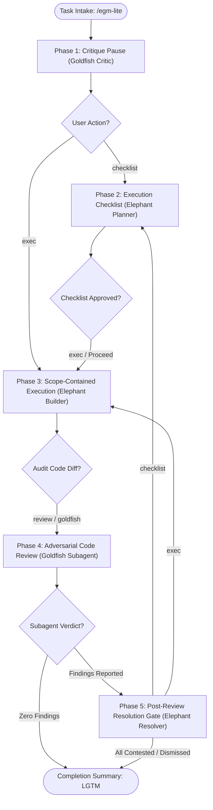

# EGM-Lite: Rapid Ad-Hoc Engineering Protocol

*   **Author:** Jonathan Njeunje ([@njeunje](https://github.com/njeunje))
*   **Status:** Proposed
*   **Date:** 2026-11-10

--------------------------------------------------------------------------------

## Overview

**EGM-Lite** (`/egm-lite`) adapts the Elephant-Goldfish Model (EGM) for small, rapid iterations,
specification revisions, code refactors, and bug fixes without requiring a full multi-document lifecycle. It enforces
a decoupled 5-phase state machine with explicit **Elephant and Goldfish persona switching**:
**Phase 1: Critique Pause** (Goldfish (Critic)), **Phase 2: Lightweight Execution Checklist**
(Elephant (Planner)), **Phase 3: Scope-Contained Execution** (Elephant (Builder)), **Phase 4:
Adversarial Code Review** (Goldfish (Reviewer via Subagent)), and **Phase 5: Post-Review Resolution
Gate** (Elephant (Resolver)).

## The Problem

Executing the full EGM lifecycle (`/egm-brainstorm` -> `/egm-draft` -> `/egm-review`) for small
changes introduces unnecessary process overhead. Conversely, unconstrained agent execution defaults
to:

1.  Ungrounded code edits without verifying upstream contracts.
2.  Speculative abstractions and out-of-scope refactoring (YAGNI).
3.  Self-validation masking edge cases and regressions.

EGM-Lite provides an on-rails middle ground with isolated verification gates and fast turnaround.

## System Architecture & Decoupled State Machine

Transitions between phases occur strictly upon explicit user command triggers and asynchronous
subagent completion:

*   **Code References & IDE Navigation**: All phases link referenced local files, symbols, and
    line ranges using clickable links, and cite external contracts via symbol or definition queries.
*   **Plain-English `> **BLUF:**` Blockquotes**: Phases that require a `> **BLUF:**` open with a
    concise single-paragraph blockquote (followed by `---`) stating the plain-English takeaway and
    recommended action without raw IDs, code literals, or line links.
*   **Decoupled & Opt-In Phase Triggers**: Transitions occur strictly on user commands.
    Developers can fast-path directly from Phase 1 to Phase 3 (`exec`) to bypass the
    checklist pause for routine fixes, and Phase 4 code review (`review` / `goldfish`) is
    opt-in rather than mandatory.
*   **Subagent Integrity Guard**: Phase 4 requires an isolated, fresh-context subagent
    tool (`invoke_subagent`). In single-agent environments without subagent capabilities,
    the protocol halts and informs the developer rather than executing a biased, same-context
    self-review.
*   **Non-Sycophantic Posture**: All phases lead with technical risks, trade-offs, or defects and
    forbid flattering adjectives or polite apologies.



### Phase 1: Critique Pause (`/egm-lite`)

*   **Persona**: Goldfish (Critic) — Adversarial, skeptical.
*   **Grounding & BLUF**: Probes target files, direct callers or tests, any existing directory
    `README.md` or user-cited doc, and repository definitions before proposing solutions, leading
    with a `> **BLUF:**` on whether the approach is ready for `exec` or blocked.
*   **Contract Tracking**: Tags assumptions as `[⚠️ UNVERIFIED]` (untested contracts) or `[⏳ ACK]`
    (scheduled for empirical test).
*   **Alternatives Considered**: When multiple viable approaches exist, documents trade-offs in
    `egm_lite_alternatives.md` (led by a `> **BLUF:**` on the recommended option and trade-off)
    and links the artifact in chat without inline discussion (omitting it for trivial or single-path
    tasks).
*   **Completion Gate**: Halts execution; awaits `checklist` (or fast-path `exec`) command.

### Phase 2: Lightweight Execution Checklist (`checklist`)

*   **Persona**: Elephant (Planner) — Structured, methodical.
*   **Artifact Generation**: Writes or updates `egm_lite_checklist.md` structured
    into three canonical sections:
    1.  *Targets & Tasks*: Ordered checklist items as GFM checkboxes (`- [ ]`) linking
        exact file paths and line ranges or tooling commands with brief rationales.
    2.  *Pre-Review Exclusions*: Explicitly agreed scope boundaries suppressed from
        review.
    3.  *Accepted CONTEST Rationales*: Settled false-positive findings retained across
        iteration loops to prevent redundant review flags.
*   **Completion Gate**: Halts execution until the user clicks **Proceed** or types `exec`.

### Phase 3: Scope-Contained Execution (`exec`)

*   **Persona**: Elephant (Builder) — Focused implementer.
*   **Fast-Path Initialization**: If triggered directly from Phase 1 or Phase 5 (bypassing the
    Phase 2 pause), first creates or updates `egm_lite_checklist.md` before modifying any code or
    running commands.
*   **Boundary Enforcement**: Applies any inline comments left on `egm_lite_checklist.md` and
    executes only approved items and targets in the checklist; zero speculative logic.
*   **Code Standards**: Adds inline comments on non-obvious or complex logic blocks.
*   **Test Verification & Self-Repair**: Runs local tests covering affected targets with autonomous
    monotonic convergence.
*   **Checklist Progress**: Updates `egm_lite_checklist.md` marking completed tasks with `- [x]`
    after test verification passes, leading with a `> **BLUF:**` on escalation halts, autonomous
    self-repairs, or multi-file summaries while omitting it on clean single-target runs.
*   **Completion Gate**: Prompts for `review` or `goldfish` and halts execution with a strict
    negative constraint forbidding subsequent phases until triggered.

### Phase 4: Adversarial Code Review (`review` / `goldfish`)

*   **Persona**: Goldfish (Reviewer via Subagent) — Isolated, zero-context auditor.
*   **Subagent Isolation**: Evaluates the clean VCS diff against the checklist in a fresh subagent
    context (`invoke_subagent`, `Agent`, or `spawn_agent`, stopping if no fresh-context subagent
    tool is available) with zero conversational bias, skipping pre-review exclusions and accepted
    `CONTEST` rationales recorded in the checklist and suppressing stylistic nitpicks.
*   **Adversarial Review Rubric**: Enforces a strictly binary output contract (findings only vs.
    explicit `[✅ LGTM]` on zero findings) across five dimensions:
    1.  *Thread & State Safety*: Race conditions, deadlocks, async mutations.
    2.  *Boundary Conditions*: Null checks, off-by-one, unhandled errors.
    3.  *Test Coverage & Regression Audit*: Unit test coverage of all new branches.
    4.  *YAGNI Audit*: Pruning unneeded abstractions.
    5.  *Contract & Tag Audit*: Verification that `[⚠️ UNVERIFIED]` and `[⏳ ACK]` tags are tested
        and removed.
*   **Completion Gate**: Halts execution after spawning the subagent and awaits its asynchronous
    response.

### Phase 5: Post-Review Resolution Gate (Subagent Response)

*   **Persona**: Elephant (Resolver) — Contextual triage.
*   **Strict Non-Mutating Triage**: The Elephant Resolver operates strictly in
    read-only presentation mode and is forbidden from modifying application source files
    during triage. Approved fixes are staged into `egm_lite_checklist.md` to be executed
    under a subsequent `exec` or `checklist` turn.
*   **Finding Triage (`PROPOSE FIX` vs. `CONTEST`)**: Cross-references subagent findings against the
    codebase without making code edits or running VCS mutations, opening with a `> **BLUF:**` led by
    **`[🛠️ X FIX | 🛡️ Y CONTEST]`** before presenting numbered and priority-tagged items
    (`[X] [PY]`, e.g., `[1] [P0]`, `[2] [P0]`, `[3] [P3]`) in a structured bullet list or compact
    comparison table sorted within each group in descending severity order
    (`P0` > `P1` > `P2` > `P3`, regardless of tier gaps), grouping `PROPOSE FIX` patches ahead of
    codebase-backed `CONTEST` false alarms (bypassed by default).
*   **Completion & Synchronization Gate**: Opens with a `> **BLUF:**` led by **`[✅ LGTM]`** on clean
    pass or when all findings are contested/dismissed (summarizing modified files and passing
    tests); otherwise prompts `checklist` (or fast-path `exec`) if flaws remain.

## Implementation Files

The EGM-Lite capability is implemented across the following package files:

| File Path | Type | Purpose & Reason for Existence |
| :-------- | :--- | :----------------------------- |
| `skills/egm-lite/SKILL.md` | Skill Definition | Implements the decoupled 5-phase state machine (`/egm-lite` -> `checklist` -> `exec` -> `review` -> resolution). |
| `skills/egm-lite/agents/openai.yaml` | Host Metadata | Declares extension interface, display names, and brand styling for OpenAI/Codex. |
| `skills/egm-lite/assets/icon.svg` | Vector Artwork | Self-contained 24x24 dual-facet icon (Checklist Spark) adhering to the EGM design system. |
| `skills/egm-lite/TEST.md` | Unit Tests | Verification test scenarios testing decoupled phase gating and persona switching. |
| `skills/egm-lite/test_scenarios.yaml` | Evaluation Benchmark | Benchmark test suite evaluating model adherence to the 5-phase EGM-Lite protocol. |

### Verification Plan

The EGM-Lite protocol is validated through deterministic behavioral evaluation
suites (`skills/egm-lite/test_scenarios.yaml`), protocol checklists
(`skills/egm-lite/TEST.md`), and unit tests (`pytest tests/unit`).

Verification enforces five core behavioral invariants:

1.  **State Machine & Pause Gating (Phases 1 & 2):** Asserts that mutating operations
    pause for user confirmation (`checklist` or fast-path `exec`),
    `egm_lite_checklist.md` is initialized with GFM checkboxes, and competing
    architectures are recorded in `egm_lite_alternatives.md`.
2.  **Scope-Contained Execution & Convergence (Phase 3):** Verifies that code edits
    stay strictly within approved checklist items, local tests execute with
    autonomous monotonic convergence, and completed tasks are marked `- [x]`.
3.  **Fresh-Context Subagent Isolation (Phase 4):** Enforces true context separation
    via a fresh-context subagent tool (`invoke_subagent`), refusing same-context
    Goldfish reviews and skipping user-agreed pre-review exclusions.
4.  **Binary Review Contract (Phase 4):** Asserts that any defect strictly suppresses
    LGTM and outputs prioritized findings (`P0`–`P3`), while clean passes lead with
    an explicit `> **BLUF:**` with `[✅ LGTM]`.
5.  **Post-Review Triage & Synchronization (Phase 5):** Validates presentation-only
    triage (`[🛠️ X FIX | 🛡️ Y CONTEST]`), persistence of `CONTEST` rationales in the
    checklist, and loop closure.

#### Test Execution

```bash
# Run unit tests, packaging validation, and harness discovery
pytest tests/unit

# Validate markdown link integrity
pytest tests/unit/test_link_integrity.py
```

## References

*   [EGM Framework Architecture](architecture.md)
*   [EGM Goldfish Review Protocol & Resolution Engine](review.md)
*   [EGM Design Drafting](draft.md)
*   [Shared Skill Icons](skill_icons.md)
*   [Testing Guidelines](../../TESTING.md)
