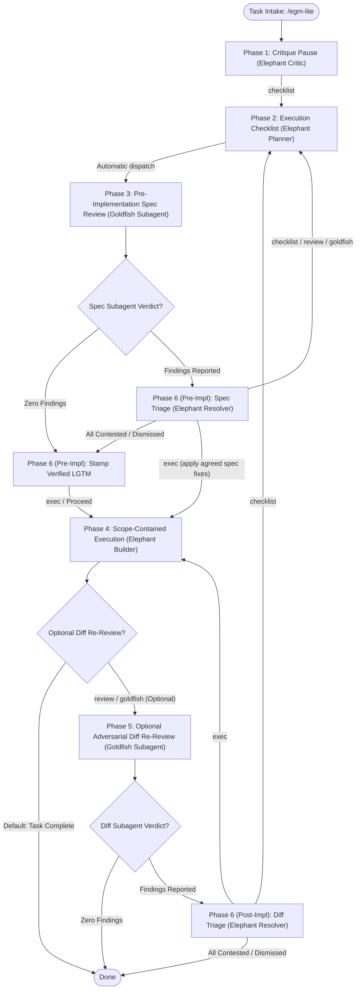

# EGM-Lite: Rapid Ad-Hoc Engineering Protocol

*   **Authors:** Jonathan Njeunje ([@njeunje](https://github.com/njeunje)), Elise Ewing ([@eewing314](https://github.com/eewing314))
*   **Status:** Proposed
*   **Date:** 2026-11-14

## Overview

**EGM-Lite** (`/egm-lite`) adapts the Elephant-Goldfish Model (EGM) for small iterations, specification revisions, targeted refactors, and bug fixes that do not warrant a multi-document design lifecycle. Rather than deferring independent review until code is already written, `/egm-lite` shifts verification upstream: generating an execution checklist in `egm_lite_checklist.md` automatically dispatches a fresh-context Goldfish subagent to audit the plan before any repository files are modified.

Once the checklist passes specification review and the developer approves execution, the Elephant builder records the starting workspace baseline, implements the approved items, and runs local tests. Because specification flaws are caught upstream, the task finishes once local tests pass; a post-implementation Goldfish re-review of the workspace diff remains available on demand (`review` or `goldfish`).

## The Problem

Running the full EGM lifecycle (`/egm-brainstorm` -> `/egm-draft` -> `/egm-review`) for localized fixes introduces multi-stage artifact overhead disproportionate to small changes. Skipping EGM altogether, however, exposes three recurring failure modes in single-session coding agents:

1.  Agents edit source files before verifying callers, tests, or external contracts.
2.  Agents introduce unrequested abstractions and out-of-scope edits (YAGNI violations).
3.  Same-context self-review or downstream-only diff review surfaces design mistakes only after implementation work is already sunk.

## Goals

*   Provide a lightweight, turn-gated Elephant-and-Goldfish workflow for small code iterations, targeted refactors, bug fixes, and specification updates that do not warrant a multi-document design lifecycle.
*   Ground proposed changes in live source files, callers, tests, and external contracts—surfacing unverified boundaries (`[⚠️ UNVERIFIED]` and `[⏳ ACK]`) before planning or editing begins.
*   Audit the execution plan (`egm_lite_checklist.md`) automatically in an isolated, fresh-context Goldfish subagent prior to implementation so design and scope flaws are caught before repository files are modified.
*   Restrict implementation to approved checklist items verified by local tests, while keeping post-implementation Goldfish diff re-review optional (`review` or `goldfish`) to avoid redundant subagent passes on routine changes.
*   Separate finding triage (`PROPOSE FIX` vs. `CONTEST`) from file mutation across both specification and diff reviews so developers explicitly approve what enters the checklist or codebase.

## Non-Goals

*   Replace the full EGM design lifecycle (`/egm-brainstorm`, `/egm-draft`, `/egm-review`) for large or multi-component architectural changes.
*   Simulate a same-context Goldfish review when the host environment exposes no isolated subagent tool.
*   Expand implementation beyond approved checklist items or require a mandatory post-implementation diff re-review after execution succeeds.

## System Architecture & State Machine

`/egm-lite` executes as a six-phase state machine separating in-session **Elephant** phases (deep repository and conversational context) from isolated **Goldfish** phases (fresh-context subagents with zero chat history). Each turn runs only the phase matching the active trigger—a user command (`checklist`, `exec`, `review`, `goldfish`), an artifact **Proceed** action, or an asynchronous subagent response—except that Phase 2 (`checklist`) chains automatically into Phase 3 in the same turn so every generated checklist is audited immediately.

`goldfish` and `review` act as state-bound aliases: prior to implementation (following specification triage in Phase 6) they update `egm_lite_checklist.md` in Phase 2 and re-trigger Phase 3, whereas after Phase 4 modifies workspace files they invoke the optional diff re-review in Phase 5. Out-of-order commands—such as invoking `exec` or `review` directly after Phase 1 before a checklist has been generated and audited—do not execute; instead, the agent emits a `> **BLUF:** [State Advisory]` blockquote naming the invalid transition and valid next command.

All phases enforce three cross-cutting output rules: local files and line ranges use clickable links while external contracts cite symbol or repository definitions; required `> **BLUF:**` openings appear as a single plain-English blockquote paragraph followed by `---` without raw IDs or code literals; and responses maintain an objective, non-sycophantic engineering tone that leads with risks or defects.

| Phase | Active Persona | Entry Trigger | Primary Responsibility | Exit Gate |
| :---- | :------------- | :------------ | :--------------------- | :-------- |
| **1. Critique Pause** | Elephant (Critic) | `/egm-lite <task>` | Probe target files, callers, tests, `README.md`, and external contracts in-session; challenge premises and map alternatives. | Awaits `checklist`. |
| **2. Execution Checklist** | Elephant (Planner) | `checklist` (or pre-impl `review` / `goldfish`) | Write or update `egm_lite_checklist.md` with `- [ ]` targets, exclusions, and `CONTEST` rationales. | Chains automatically in-turn to Phase 3. |
| **3. Automatic Spec Review** | Goldfish (Spec Subagent) | Automatic after Phase 2 | Audit `egm_lite_checklist.md` in a fresh subagent context against the Specification Review Rubric. | Awaits subagent response (or human fallback if no subagent tool exists). |
| **4. Execution** | Elephant (Builder) | `exec` / **Proceed** | Record review baseline, implement approved checklist items, run local tests, and mark `- [x]`. | Task complete; offers optional `review` / `goldfish`. |
| **5. Optional Diff Re-Review** | Goldfish (Code Subagent) | `review` / `goldfish` post-exec | Collect baseline-scoped workspace changes (including task commits and untracked files) for fresh audit. | Awaits subagent response. |
| **6. Resolution Gate** | Elephant (Resolver) | Subagent response | Present `[X] [PY]` triage (`PROPOSE FIX` vs. `CONTEST`) without file edits; gate next transition by state. | Pre-impl: `exec` or re-audit. Post-impl: Done, `checklist`, or `exec`. |

### Phase 1: Critique Pause (`/egm-lite`)

Phase 1 runs as an in-session Elephant critique before any planning or file edits occur. Leveraging full project context, the Elephant reads the target files, their direct callers or tests, any directory `README.md` or user-cited document, and underlying definitions for external dependencies to stress-test the user's premise. When an external boundary cannot be verified from source or documentation, the agent flags it as `[⚠️ UNVERIFIED]` and agrees with the developer either to verify it upfront or to defer it as `[⏳ ACK]` paired with a scheduled empirical test.

The response opens with a `> **BLUF:**` stating whether the approach is ready for `checklist` or blocked on open risks. When multiple viable designs exist, trade-offs are written to `egm_lite_alternatives.md` (opened by a `> **BLUF:**` naming the recommended option) and linked in chat rather than argued inline; single-path fixes omit this file. Phase 1 then halts and prompts for `checklist` so pre-implementation specification review always precedes code changes.

### Phase 2: Execution Checklist (`checklist`)

Commanding `checklist` runs Phase 2 (Elephant planner) and chains automatically in the same turn into Phase 3. The Elephant creates or updates `egm_lite_checklist.md` covering code, specification, or documentation targets: each target appears as a GFM checkbox (`- [ ]`) with clickable file and line-range links or tooling commands and a short rationale, followed by any deferred empirical tests, `[⚠️ UNVERIFIED]` / `[⏳ ACK]` risks, user-agreed pre-review exclusions, accepted `CONTEST` rationales carried across loops, and the Assumption Lifecycle Legend.

### Phase 3: Automatic Specification Review (Automatic after Phase 2)

Immediately after writing `egm_lite_checklist.md` in Phase 2—without pausing for another user prompt—the agent constructs a conversation-stripped prompt containing the full markdown of `egm_lite_checklist.md`, core task requirements, and target file paths, then spawns a fresh-context `Goldfish Specification Reviewer` subagent (`invoke_subagent`, `Agent`, or `spawn_agent`) and halts until the subagent responds. If the host environment exposes no fresh-context subagent tool, the agent refuses to simulate a same-context Goldfish review, explains the host limitation after writing `egm_lite_checklist.md`, and falls back to human **Proceed** / `exec` approval on the checklist.

### Phase 4: Scope-Contained Execution (`exec` / `Proceed`)

Phase 4 runs once the checklist is verified (or after the developer aligns on triage fixes in Phase 6 and commands `exec`, in which case Phase 4 updates `egm_lite_checklist.md` with the agreed tasks and `CONTEST` rationales before editing any target files). Prior to the first task edit, the Elephant builder records the starting commit and any pre-existing working-tree modifications in `egm_lite_checklist.md` (or starting target snapshots outside Git) and preserves that baseline across subsequent resolution loops without staging or committing user files merely to collect a diff.

Implementation is restricted to unchecked (`- [ ]`) items in `egm_lite_checklist.md`, applying any inline checklist comments accompanying approval and adding explanatory comments only on non-obvious logic. The agent runs local tests covering affected targets (or link/markdown validation for documentation tasks), resolving mechanical compile, import, or assertion failures only while making monotonic progress within approved targets without weakening assertions. Repeated failures, regressions, stalled convergence, or out-of-scope fixes halt execution with a `> **BLUF:**` escalation summary. Once tests pass, completed items are marked `- [x]`, a completion summary is printed (using a `> **BLUF:**` only for multi-file changes or self-repairs), and execution halts—noting that `review` or `goldfish` may be run optionally to audit the diff.

### Phase 5: Optional Adversarial Diff Re-Review (`review` / `goldfish`)

When the developer opts into a post-implementation audit after Phase 4, the agent collects all task changes against the recorded baseline in `egm_lite_checklist.md`: tracked diffs from `git diff <starting-commit>` (including intermediate task commits and staged/unstaged edits), deletions, and new untracked files from `git ls-files --others --exclude-standard`, while excluding unrelated pre-existing edits recorded in the baseline. Every checklist target (including gitignored targets) is verified in the collected inventory; if the baseline is missing or any target cannot be inspected, the agent stops and reports incomplete coverage rather than requesting an LGTM. Otherwise, it passes the checklist and collected change content to a fresh `Goldfish Code Reviewer` subagent (or stops if no subagent tool exists) and awaits its response.

Both Goldfish subagent passes (Phase 3 and Phase 5) enforce a binary review contract—returning `[✅ LGTM]` only on zero findings, and otherwise returning prioritized `[PY]` findings while skipping pre-review exclusions, honoring accepted `CONTEST` rationales, and suppressing stylistic nitpicks:

| Pass | Subagent Role | Input Artifact | Evaluation Rubric |
| :--- | :------------ | :------------- | :---------------- |
| **Phase 3 (Automatic Pre-Impl)** | `Goldfish Specification Reviewer` | `egm_lite_checklist.md` + task requirements + target paths (AST/`git diff` checks forbidden) | 1. Scope containment & YAGNI 2. External contract & `[⚠️ UNVERIFIED]` / `[⏳ ACK]` tagging 3. Error paths, timeouts, & boundary conditions 4. Concrete, runnable test plan |
| **Phase 5 (Optional Post-Impl)** | `Goldfish Code Reviewer` | `egm_lite_checklist.md` + baseline-scoped task diff & untracked files | 1. Thread & async state safety* 2. Null, off-by-one, & exception boundaries* 3. Unit test coverage of new branches* 4. YAGNI pruning 5. Resolution & removal of `[⚠️ UNVERIFIED]` / `[⏳ ACK]` tags *(Replaced on doc-only diffs by checklist consistency, clarity, and link hygiene)* |

### Phase 6: Unified Post-Review Resolution Gate (Subagent Response)

Phase 6 handles responses from both `Goldfish Specification Reviewer` (Phase 3, pre-implementation) and `Goldfish Code Reviewer` (Phase 5, post-implementation), discriminating the active stage from the subagent role and whether Phase 4 has modified target files.

When the subagent reports findings, triage is presentation-only—no file-editing or VCS tools may run during the turn. The Elephant resolver cross-references each claim against the codebase or checklist, opens with a `> **BLUF:**` led by `[🛠️ X FIX | 🛡️ Y CONTEST]`, and lists sequentially numbered `[X] [PY]` items (`P0`–`P3`, sorted highest severity first within each group) split into `PROPOSE FIX` patches/revisions and evidence-backed `CONTEST` false alarms. The developer may override any classification in chat.

Clean `[✅ LGTM]` verdicts (or turns where all findings are contested or dismissed after recording `CONTEST` rationales in `egm_lite_checklist.md`) branch by stage. Pre-implementation specification passes stamp `**Specification Status:** Verified [✅ LGTM]` in `egm_lite_checklist.md`, open with a `> **BLUF:**` led by `[✅ LGTM]`, and prompt the developer to click **Proceed** or type `exec`—never closing the task prematurely. Post-implementation diff passes update `egm_lite_checklist.md`, open with `[✅ LGTM]`, and summarize modified files and passing test targets. When unresolved fixes remain, pre-implementation triage prompts for `checklist` / `review` / `goldfish` (to update in Phase 2 and automatically re-audit in Phase 3) or `exec` (to apply agreed checklist revisions and implement in Phase 4), whereas post-implementation triage prompts for `checklist` or `exec`.

## Implementation & Verification

| File Path | Role | Purpose |
| :-------- | :--- | :------ |
| `skills/egm-lite/SKILL.md` | Skill Definition | Six-phase state machine with Elephant critique/planning, automatic Goldfish spec review, and optional Goldfish diff re-review. |
| `skills/egm-lite/agents/openai.yaml` | Host Metadata | OpenAI/Codex extension interface and display metadata. |
| `skills/egm-lite/assets/icon.svg` | Vector Icon | 24x24 dual-facet Checklist Spark keyline icon. |
| `skills/egm-lite/TEST.md` | Verification Guide | Interactive walkthrough checklist covering six-phase gating, automatic spec review, and persona transitions. |
| `skills/egm-lite/test_scenarios.yaml` | Scenario Suite | 19 declarative evaluation scenarios checking protocol invariants. |

Offline validation runs through the repository unit suite (`pytest tests/unit`; see [Testing Guidelines](../../TESTING.md)) alongside the declarative scenarios in `skills/egm-lite/test_scenarios.yaml`, checking six protocol invariants:

| Invariant | Phases | Verified Behavior |
| :-------- | :----- | :---------------- |
| **Premature-Execution Guard** | 1, Global | Phase 1 (Elephant Critic) gates on `checklist`, multi-option trade-offs land in `egm_lite_alternatives.md`, and premature `exec` or `review` commands emit `[State Advisory]` without bypassing spec review. |
| **Automatic Spec Review** | 2, 3 | `checklist` writes GFM checkboxes to `egm_lite_checklist.md` (Phase 2) and automatically dispatches `Goldfish Specification Reviewer` in the same turn (Phase 3) without AST or `git diff` checks. |
| **Baseline & Optional Re-Review** | 4 | Execution records the starting baseline before editing, stays within approved targets, marks completed items `- [x]`, and leaves Phase 5 diff re-review optional. |
| **Subagent Isolation & Coverage** | 3, 5 | Both Goldfish passes refuse same-context review when subagent tools are absent; Phase 5 captures task commits and untracked files against the baseline while excluding pre-existing unrelated edits. |
| **Binary Review Contract** | 3, 5 | Any defect suppresses `LGTM` in favor of `[P0]`–`[P3]` findings; `[✅ LGTM]` is emitted only on zero findings. |
| **State-Discriminated Triage** | 6 | Findings triage makes zero file mutations, pre-implementation spec LGTM gates on `exec` rather than closing the task, and accepted `CONTEST` rationales persist across loops. |

## References

*   [EGM Framework Architecture](architecture.md)
*   [EGM Goldfish Review Protocol & Resolution Engine](review.md)
*   [EGM Design Drafting](draft.md)
*   [Shared Skill Icons](skill_icons.md)
*   [Testing Guidelines](../../TESTING.md)
