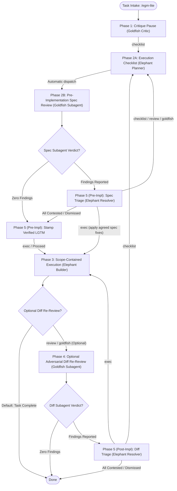

# EGM-Lite: Rapid Ad-Hoc Engineering Protocol

*   **Author:** Jonathan Njeunje ([@njeunje](https://github.com/njeunje)), Elise Ewing ([@eewing314](https://github.com/eewing314))
*   **Status:** Proposed
*   **Date:** 2026-11-14

--------------------------------------------------------------------------------

## Overview

**EGM-Lite** (`/egm-lite`) adapts the Elephant-Goldfish Model (EGM) for small, rapid iterations,
specification revisions, code refactors, and bug fixes without requiring a full multi-document
lifecycle. It enforces a decoupled 5-phase state machine with explicit **Elephant and Goldfish
persona switching** aligned to EGM's shift-left verification principle:

1.  **Phase 1: Critique Pause** — Goldfish (Critic) challenges premises and probes code invariants in-session.
2.  **Phase 2: Execution Checklist & Automatic Spec Review** — Elephant (Planner) writes `egm_lite_checklist.md` and **automatically** dispatches a fresh-context Goldfish Specification Reviewer subagent before any implementation edits occur.
3.  **Phase 3: Scope-Contained Execution** — Elephant (Builder) records the review baseline, implements the verified checklist items, and runs local tests, completing the task while offering an **optional** post-implementation diff re-review.
4.  **Phase 4: Optional Adversarial Diff Re-Review** — Goldfish (Code Reviewer via Subagent) audits the workspace changes on user request (`review` or `goldfish`).
5.  **Phase 5: Unified Post-Review Resolution Gate** — Elephant (Resolver) triages either pre-implementation specification findings or post-implementation diff findings in presentation-only mode.

## The Problem

Executing the full EGM lifecycle (`/egm-brainstorm` -> `/egm-draft` -> `/egm-review`) for small
changes introduces unnecessary process overhead. Conversely, unconstrained agent execution defaults
to:

1.  Ungrounded code edits without verifying upstream contracts.
2.  Speculative abstractions and out-of-scope refactoring (YAGNI).
3.  Downstream-only review or self-validation that catches architectural flaws only after code has already been written.

EGM-Lite provides an on-rails middle ground that shifts independent Goldfish verification upstream onto the execution checklist automatically, while keeping post-implementation diff re-review optional.

## Goals

*   **Automatic Pre-Implementation Specification Review:** Audit `egm_lite_checklist.md` automatically in an isolated, fresh-context Goldfish subagent before repository code or documents are modified.
*   **Optional Post-Implementation Diff Re-Review:** Complete routine executions cleanly once local tests pass on a verified checklist, while preserving an on-demand isolated Goldfish diff audit (`review` / `goldfish`) when desired.
*   **Unified Presentation-Only Triage:** Resolve both pre-implementation specification findings and post-implementation diff findings through a single deterministic resolution gate without mutating files during triage.

## Non-Goals

*   Replace the full EGM design lifecycle (`/egm-brainstorm`, `/egm-draft`, `/egm-review`) for large or multi-component architectural changes.
*   Perform or simulate a same-context Goldfish review when the host exposes no isolated, fresh-context subagent tool.
*   Expand implementation beyond the approved checklist or force a mandatory post-implementation diff re-review after execution succeeds.

## System Architecture & Decoupled State Machine

Transitions between phases occur strictly upon explicit user command triggers and asynchronous
subagent completion:

*   **State-Bound Command Aliases (`goldfish` / `review`):** `goldfish` and `review` are interchangeable aliases bound to execution state—prior to implementation they update and re-audit `egm_lite_checklist.md` (Phase 2), and following execution they trigger the optional workspace diff re-review (Phase 4).
*   **Banned Transitions & Graceful State Advisories:** Attempting implementation (`exec`) before `egm_lite_checklist.md` has been generated and audited in Phase 2 (unless the host lacks a subagent tool and halted at the human fallback gate), or requesting a diff review before workspace changes exist, emits a `> **BLUF:** [State Advisory]` blockquote guiding the developer to the valid next action rather than executing out of order.
*   **Subagent Integrity Guard:** Both Phase 2B (automatic specification review) and Phase 4 (optional diff re-review) require a fresh-context subagent tool (`invoke_subagent`, `Agent`, or `spawn_agent`). When unavailable, the protocol refuses same-context self-review—falling back to explicit human checklist approval in Phase 2 and stopping with an explanation in Phase 4.
*   **Code References & IDE Navigation:** All phases link referenced local files, symbols, and line ranges using clickable links, and cite external contracts via symbol or definition queries.
*   **Plain-English `> **BLUF:**` Blockquotes:** Phases that require a `> **BLUF:**` open with a concise single-paragraph blockquote (followed by `---`) stating the plain-English takeaway and recommended action without raw IDs, code literals, or line links.
*   **Non-Sycophantic Posture:** All phases lead with technical risks, trade-offs, or defects and forbid flattering adjectives or polite apologies.



### Phase 1: Critique Pause (`/egm-lite`)

*   **Persona**: Goldfish (Critic) — Adversarial, skeptical.
*   **Grounding & BLUF**: Probes target files, direct callers or tests, any existing directory `README.md` or user-cited doc, and repository definitions before proposing solutions, leading with a `> **BLUF:**` on whether the approach is ready for `checklist` or blocked.
*   **Contract Tracking**: Tags assumptions as `[⚠️ UNVERIFIED]` (untested contracts) or `[⏳ ACK]` (scheduled for empirical test).
*   **Alternatives Considered**: When multiple viable approaches exist, documents trade-offs in `egm_lite_alternatives.md` (led by a `> **BLUF:**` on the recommended option and trade-off) and links the artifact in chat without inline discussion (omitting it for trivial or single-path tasks).
*   **Completion Gate**: Halts execution and awaits the `checklist` command so pre-implementation specification review runs before any edits.

### Phase 2: Execution Checklist & Automatic Spec Review (`checklist`)

*   **Phase 2A — Checklist Generation (Elephant Planner)**:
    *   Writes or updates `egm_lite_checklist.md` structured into three canonical sections plus the Assumption Lifecycle Legend:
        1.  *Targets & Tasks*: Ordered checklist items as GFM checkboxes (`- [ ]`) linking exact file paths and line ranges or tooling commands with brief rationales (covering code, specifications, or design documents).
        2.  *Pre-Review Exclusions*: Explicitly agreed scope boundaries suppressed from review.
        3.  *Accepted CONTEST Rationales*: Settled false-positive findings retained across iteration loops to prevent redundant review flags.
*   **Phase 2B — Automatic Stateless Spec Review (Goldfish Specification Reviewer via Subagent)**:
    *   **Automatic Same-Turn Dispatch**: Immediately after writing `egm_lite_checklist.md`—without pausing for an intermediate user prompt—constructs a stripped specification-review prompt containing the full checklist markdown and task requirements, and spawns a fresh-context `Goldfish Specification Reviewer` subagent (`invoke_subagent`, `Agent`, or `spawn_agent`). If no fresh-context subagent tool exists, halts without simulating a same-context review and requests human `Proceed` / `exec` approval on `egm_lite_checklist.md`.
    *   **Specification Review Rubric**: Enforces a strictly binary output contract (`[✅ LGTM]` on zero findings, otherwise findings tagged `[PY]`) across four dimensions while skipping pre-review exclusions and accepted `CONTEST` rationales, suppressing stylistic nitpicks, and forbidding AST or git diff code checks:
        1.  *Scope Containment & YAGNI*: Change targets stay within task bounds without speculative abstractions.
        2.  *Contract & Invariant Tagging*: External dependencies and untested boundaries carry `[⚠️ UNVERIFIED]` or `[⏳ ACK]` tags with concrete verification plans.
        3.  *Edge Cases & Failure Modes*: Error handling, timeouts, and boundary conditions are accounted for in the plan.
        4.  *Test Plan Actionability*: Test targets or empirical validation steps are concrete and runnable.
    *   **Completion Gate**: Halts execution immediately after spawning the subagent and awaits its asynchronous response.

### Phase 3: Scope-Contained Execution (`exec` / `Proceed`)

*   **Persona**: Elephant (Builder) — Focused implementer.
*   **Checklist Synchronization & Review Baseline**: Reads the verified `egm_lite_checklist.md` (applying any inline comments or user-approved triage adjustments from Phase 5 before editing). Records the starting commit and any pre-existing working-tree edits in `egm_lite_checklist.md` before the first task edit so optional post-implementation reviews capture committed and untracked task changes while keeping unrelated pre-existing edits separate.
*   **Boundary Enforcement**: Implements only approved items and targets in the checklist across code, specifications, or documentation; zero speculative logic (No YAGNI).
*   **Code Standards**: Adds inline comments on non-obvious or complex logic blocks.
*   **Test Verification & Self-Repair**: Runs local tests covering affected targets with autonomous monotonic convergence (or markdown/lint validation for pure documentation tasks).
*   **Checklist Progress & Optional Re-Review Gate**: Updates `egm_lite_checklist.md` marking completed tasks with `- [x]`, outputs a concise completion and test summary (leading with `> **BLUF:**` on escalation halts, autonomous self-repairs, or multi-file summaries while omitting it on clean single-target runs), and halts—informing the developer that execution is complete and that `review` or `goldfish` is available as an **optional** post-implementation diff re-review.

### Phase 4: Optional Adversarial Diff Re-Review (`review` / `goldfish`)

*   **Persona**: Goldfish (Code Reviewer via Subagent) — Isolated, zero-context auditor.
*   **Opt-In Post-Implementation Trigger**: Runs only when explicitly requested by the developer after Phase 3 modifies workspace files.
*   **Baseline-Aware Change Collection & Subagent Isolation**: Collects every task change against the recorded baseline in `egm_lite_checklist.md`—including task commits, staged and unstaged edits, deletions, and new untracked files (`git diff <starting-commit>` plus `git ls-files --others --exclude-standard`, or before/after snapshots outside Git)—while excluding unrelated pre-existing changes. Stops and reports incomplete coverage if the baseline is missing or any checklist target cannot be inspected. Spawns a fresh-context `Goldfish Code Reviewer` subagent (stopping if no subagent tool is available) with zero conversational history.
*   **Adversarial Review Rubric**: Enforces the binary output contract (findings only vs. explicit `[✅ LGTM]` on zero findings), skipping pre-review exclusions and accepted `CONTEST` rationales and suppressing stylistic nitpicks across five dimensions (for documentation-only diffs, items 1–3 are replaced by factual consistency against the checklist, clarity, and link hygiene):
    1.  *Thread & State Safety*: Race conditions, deadlocks, async mutations.
    2.  *Boundary Conditions*: Null checks, off-by-one, unhandled errors.
    3.  *Test Coverage & Regression Audit*: Unit test coverage of all new branches.
    4.  *YAGNI Audit*: Pruning unneeded abstractions.
    5.  *Contract & Tag Audit*: Verification that `[⚠️ UNVERIFIED]` and `[⏳ ACK]` tags are tested and removed.
*   **Completion Gate**: Halts execution after spawning the subagent and awaits its asynchronous response.

### Phase 5: Unified Post-Review Resolution Gate (Subagent Response)

*   **Persona**: Elephant (Resolver) — Contextual triage.
*   **Deterministic State Discriminator**: Determines whether the incoming subagent response belongs to the **Pre-Implementation Specification Review** (`Goldfish Specification Reviewer` / prior to Phase 3) or the **Optional Post-Implementation Diff Re-Review** (`Goldfish Code Reviewer` / after Phase 3).
*   **Strict Non-Mutating Triage**: Operates in presentation-only mode during findings triage without modifying repository source files. Cross-references subagent findings against the codebase or checklist, opening with a `> **BLUF:**` led by **`[🛠️ X FIX | 🛡️ Y CONTEST]`** before presenting numbered and priority-tagged items (`[X] [PY]`, e.g., `[1] [P0]`, `[2] [P1]`) sorted within each group in descending severity order (`P0` > `P1` > `P2` > `P3`), grouping `PROPOSE FIX` items ahead of evidence-backed `CONTEST` false alarms.
*   **State-Specific Completion & Synchronization Gates**:
    *   *Pre-Implementation (Spec Review)*: On `[✅ LGTM]` (or when all findings are contested/dismissed), stamps `**Specification Status:** Verified [✅ LGTM]` in `egm_lite_checklist.md`, opens with `> **BLUF:**` led by **`[✅ LGTM]`**, and prompts the developer to click **Proceed** or type **`exec`** to begin Phase 3 implementation—strictly forbidding premature task closure. When findings remain, prompts `checklist` (or `review` / `goldfish`) to update `egm_lite_checklist.md` and automatically re-audit, or `exec` once aligned to apply the agreed checklist updates and implement.
    *   *Post-Implementation (Diff Re-Review)*: On `[✅ LGTM]` (or when all findings are contested/dismissed), updates `egm_lite_checklist.md`, opens with `> **BLUF:**` led by **`[✅ LGTM]`**, and summarizes modified files and passing tests; otherwise prompts `checklist` (re-plan with automatic spec review) or `exec` (record agreed diff-fix tasks in `egm_lite_checklist.md` and implement).

## Implementation Files

The EGM-Lite capability is implemented across the following package files:

| File Path | Type | Purpose & Reason for Existence |
| :-------- | :--- | :----------------------------- |
| `skills/egm-lite/SKILL.md` | Skill Definition | Implements the decoupled 5-phase state machine with automatic pre-implementation spec review and optional post-implementation diff re-review. |
| `skills/egm-lite/agents/openai.yaml` | Host Metadata | Declares extension interface, display names, and brand styling for OpenAI/Codex. |
| `skills/egm-lite/assets/icon.svg` | Vector Artwork | Self-contained 24x24 dual-facet icon (Checklist Spark) adhering to the EGM design system. |
| `skills/egm-lite/TEST.md` | Verification Guide | Interactive verification checklist testing decoupled phase gating, automatic spec review, and persona switching. |
| `skills/egm-lite/test_scenarios.yaml` | Evaluation Benchmark | Declarative scenario suite evaluating model adherence to the 5-phase EGM-Lite protocol. |

### Verification Plan

The EGM-Lite protocol is validated through deterministic behavioral evaluation
suites (`skills/egm-lite/test_scenarios.yaml`), protocol checklists
(`skills/egm-lite/TEST.md`), and unit tests (`pytest tests/unit`).

Verification enforces six core behavioral invariants:

1.  **Critique Pause & Premature-Execution Guard (Phase 1):** Asserts that mutating operations pause for `checklist`, competing architectures are recorded in `egm_lite_alternatives.md`, and out-of-order `exec` or `review` commands emit a `[State Advisory]` blockquote rather than bypassing specification review.
2.  **Automatic Pre-Implementation Specification Review (Phase 2):** Asserts that `checklist` writes `egm_lite_checklist.md` with GFM checkboxes and immediately spawns a fresh-context `Goldfish Specification Reviewer` subagent in the same turn using the Specification Review Rubric (forbidding AST/diff checks).
3.  **Scope-Contained Execution & Optional Re-Review (Phase 3):** Verifies that execution records the review baseline before editing, stays strictly within approved checklist items, runs local tests with monotonic convergence, marks tasks `- [x]`, and treats post-implementation diff re-review (`review` / `goldfish`) as optional.
4.  **Fresh-Context Subagent Isolation & Baseline Coverage (Phases 2B & 4):** Enforces true context separation via a fresh-context subagent tool (refusing same-context reviews when unavailable) and verifies Phase 4 inspects committed task changes, unstaged edits, and untracked files against the recorded baseline while keeping unrelated pre-existing edits separate.
5.  **Binary Review Contract (Phases 2B & 4):** Asserts that any defect suppresses `LGTM` and outputs prioritized findings (`P0`–`P3`), while zero-finding passes return an explicit `[✅ LGTM]`.
6.  **State-Discriminated Resolution Gate (Phase 5):** Validates presentation-only triage (`[🛠️ X FIX | 🛡️ Y CONTEST]`), verifies pre-implementation spec LGTM gates on `exec` without premature task closure, and verifies persistence of `CONTEST` rationales across loops.

#### Test Execution

```bash
# Run unit tests, packaging validation, and harness discovery
pytest tests/unit

# Validate markdown link integrity
pytest tests/unit/test_link_integrity.py
```

## References

*   [EGM Framework Architecture](architecture.md)
*   [EGM Goldfish Review Protocol & Resolution Engine](review.md)
*   [EGM Design Drafting](draft.md)
*   [Shared Skill Icons](skill_icons.md)
*   [Testing Guidelines](../../TESTING.md)
