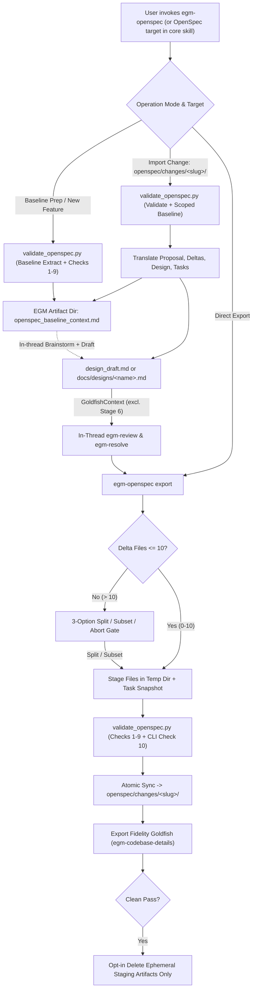

<!--
Copyright 2026 Google LLC

Licensed under the Apache License, Version 2.0 (the "License");
you may not use this file except in compliance with the License.
You may obtain a copy of the License at

    https://www.apache.org/licenses/LICENSE-2.0

Unless required by applicable law or agreed to in writing, software
distributed under the License is distributed on an "AS IS" BASIS,
WITHOUT WARRANTIES OR CONDITIONS OF ANY KIND, either express or implied.
See the License for the specific language governing permissions and
limitations under the License.
-->

# OpenSpec Interoperability in EGM Plugin (`egm-openspec`)

*   **Author:** Brian Suchy ([@briansuchy](https://github.com/briansuchy))
*   **Status:** Draft
*   **Date:** 2026-11-09

--------------------------------------------------------------------------------

## Overview

This design introduces a standalone bidirectional `skills/egm-openspec/` adapter skill for the **Elephant-Goldfish Model (EGM)** ([architecture.md](architecture.md), based on [Elephants, Goldfish, and the New Golden Age of Software Engineering](https://medium.com/@drensin/elephants-goldfish-and-the-new-golden-age-of-software-engineering-c33641a48874)), paired with minimal workspace detection pointers in [egm-brainstorm](../../skills/egm-brainstorm/SKILL.md), [egm-draft](../../skills/egm-draft/SKILL.md), and [egm-review](../../skills/egm-review/SKILL.md).

In EGM terminology, the **Elephant** is the primary coding session holding full workspace and conversation history, while **Goldfish** are isolated, fresh-context review subagents that inspect documents without conversation bias. Building on the skill-compaction work in [PR #369](https://github.com/google/elephant-goldfish-model/pull/369) ([Issue #371](https://github.com/google/elephant-goldfish-model/issues/371)), `egm-openspec` wraps EGM workflows so developers can:

1. Import active OpenSpec baseline specs (`openspec/specs/`) into EGM brainstorming.
2. Import and stage OpenSpec change bundles (`openspec/changes/<slug>/`) into EGM format for multi-stage Goldfish review.
3. Export reviewed EGM designs into archive-ready OpenSpec v1 change bundles backed by a Python 3 standard-library helper (`skills/egm-openspec/scripts/validate_openspec.py`) and an Export Fidelity Goldfish check.

--------------------------------------------------------------------------------

## The Problem

Engineering teams adopt [OpenSpec](https://github.com/Fission-AI/OpenSpec) to maintain canonical system specifications (`openspec/specs/<capability>/spec.md`) and structured change proposals (`openspec/changes/<slug>/`). However, OpenSpec validates syntactic schema rules rather than providing multi-perspective architectural review, and EGM does not natively read or write OpenSpec directory layouts:

1. **Disparate Structural Formats:** EGM design documents ([design_doc.md](../../skills/egm-draft/references/design_doc.md)) unify problem framing, Critical User Journeys (CUJs), architecture, rejected alternatives, and implementation plans in a single Markdown document. OpenSpec splits these across `proposal.md`, `design.md`, `tasks.md`, and `specs/<capability>/spec.md` delta blocks (`ADDED`, `MODIFIED`, `REMOVED`, `RENAMED`).
2. **Siloed Architectural Review:** OpenSpec users running EGM's `/egm-review` pipeline manually transcribe context back and forth between OpenSpec change folders and EGM drafts; losing `SHALL`/`MUST` delta formatting when moving specs back to OpenSpec risks failing `openspec validate` / `openspec archive`.
3. **Lack of Implementation-Readiness Verification:** Standard OpenSpec `tasks.md` files often lack verified file boundaries, API signatures, and exact failure paths required by EGM's [implementation-readiness-standard.md](../../resources/document_standards/implementation-readiness-standard.md).
4. **Tight Skill Context Budgets:** Prior skill compaction in [PR #369](https://github.com/google/elephant-goldfish-model/pull/369) keeps core skills concise (frontmatter-stripped body sizes: `egm-brainstorm` at `7,863` B / `8,256` B raw; `egm-draft` at `10,127` B / `10,491` B raw; `egm-review` at `11,965` B / `12,335` B raw). Injecting OpenSpec schemas, state banners, or export loops into those core skills would bloat every non-OpenSpec run and add branching risk.

--------------------------------------------------------------------------------

## Goals

*   **Standalone Interoperability Orchestrator:** Encapsulate baseline import, change import, optional in-thread brainstorm/draft/review orchestration, deterministic Python schema validation, and change export inside `skills/egm-openspec/`.
*   **Preserve Core EGM Purity:** Keep existing core skills clean and predictable; limit `egm-brainstorm`, `egm-draft`, and `egm-review` edits to a thin top-of-skill detection check (`~200-250` B each) with zero hidden HTML state comments or OpenSpec export branching inside `egm-draft` / `egm-review`.
*   **Traceable, Fidelity-Checked Export:** Verify via Python checks and an isolated `egm-codebase-details` Export Fidelity Goldfish that Stage 9 implementation details, CUJ coverage, and `tasks.md` completion states map accurately between EGM and OpenSpec without unrequested speculative additions.
*   **Full OpenSpec v1 Delta Compliance:** Enforce `openspec/config.yaml` schema compatibility (`spec-driven` default), valid `ADDED`/`MODIFIED`/`REMOVED`/`RENAMED` delta headers, strict path/symlink containment, and optional `openspec validate` CLI verification when installed.
*   **Cross-Harness Support:** Support tested EGM harnesses documented in [harnesses.md](../../docs/harnesses.md) (Antigravity CLI/App/IDEs, Claude Code, Claude Cowork, Codex, ChatGPT, Oh My Pi (`omp`), Muse) and keep experimental adapters ([cursor.md](../../docs/cursor.md), [copilot.md](../../docs/copilot.md), [opencode.md](../../docs/opencode.md)) packaging cleanly.

## Non-Goals

*   **No Changes to Core Goldfish Reviewer Personas:** `egm-openspec` will not modify any of the `8` existing review agent prompts (`REVIEWERS`), `agents/structural.md`, or `agents/synthesizer.md`, and will not invent new OpenSpec-only agent personas.
*   **No Native OpenSpec CLI Runtime Dependency:** `egm-openspec` must function cleanly in offline, air-gapped, and Node-free environments without requiring `@fission-ai/openspec` npm installation.
*   **No Lifecycle Management for Archive or Stores:** `egm-openspec` will not run `openspec archive`, merge delta files into canonical `openspec/specs/`, modify OpenSpec `Stores` state, or prune checked-in `docs/designs/<name>.md` files during export.
*   **No Website Redesign or Unrequested Runtime Hooks:** `site/` Astro icon wiring and `docs/designs/skill_icons.md` are deferred to a follow-up website PR; no automatic IDE/git hooks or changes to `/egm-review-loop` ([egm-review-loop](../../skills/egm-review-loop/SKILL.md)) or `/egm-drift-report` ([egm-drift-report](../../skills/egm-drift-report/SKILL.md)) are in scope.

--------------------------------------------------------------------------------

## Critical User Journeys (CUJs)

### CUJ 1: Starting an OpenSpec Feature in EGM
*   **Actor:** Developer in a repo initialized with `openspec/`.
*   **Flow:**
    1. User invokes `egm-openspec` directly (e.g., `/egm:egm-openspec` in Claude Code/Antigravity CLI or skill picker in Codex) to start a new feature, or runs `/egm:egm-brainstorm` where a thin check emits a single non-blocking recommendation note when `openspec/specs/*/spec.md` or active `openspec/changes/*/proposal.md` exist (or pivots in-thread if the user explicitly asked for OpenSpec).
    2. `egm-openspec` inspects `openspec/config.yaml` and runs `skills/egm-openspec/scripts/validate_openspec.py` to extract bounded baseline context into `openspec_baseline_context.md` in the `EGM artifact directory` (such as `~/.gemini/config/...` or `.claude/`).
    3. `egm-openspec` delegates in-thread to [egm-brainstorm](../../skills/egm-brainstorm/SKILL.md) (instructing it to fold key baseline requirements directly into `[AnchoredFeatureHypothesis]` rather than altering [synthesizer.md](../../agents/synthesizer.md)), flows into [egm-draft](../../skills/egm-draft/SKILL.md) (`design_draft.md`), runs [egm-review](../../skills/egm-review/SKILL.md), and offers export to `openspec/changes/<slug>/`.

### CUJ 2: Stress-Testing an Existing OpenSpec Change with EGM Review
*   **Actor:** Tech lead reviewing an in-flight change folder `openspec/changes/<slug>/`.
*   **Flow:**
    1. User invokes `egm-openspec import openspec/changes/<slug>` (or targets `openspec/changes/<slug>/` when invoking `egm-review`, which pivots in-thread by reading `skills/egm-openspec/SKILL.md`).
    2. `egm-openspec` validates inputs via `validate_openspec.py`, extracts scoped baseline context (`openspec_baseline_context.md`) for capabilities touched by the change, and translates `proposal.md`, `specs/*/spec.md`, and optional `design.md` / `tasks.md` into `<EGM artifact directory>/design_draft.md` (preserving existing `[Not present in source OpenSpec change]` gaps without inventing unrequested content).
    3. If `design.md` or `tasks.md` is absent, `egm-openspec` informs the user and recommends either Stage 9-targeted `Preset 2` review or filling Stage 9 implementation details before re-exporting.
    4. User runs `/egm:egm-review` (`Stages 5-9` Goldfish review) and `/egm:egm-resolve` ([egm-resolve](../../skills/egm-resolve/SKILL.md)) with `openspec_baseline_context.md` included in `GoldfishContext` (Stages 5, 7, 8, and 9; Stage 6 Comprehension excludes it).
    5. User can alternatively run `/egm:egm-review-loop` ([egm-review-loop](../../skills/egm-review-loop/SKILL.md)) directly on `openspec/changes/` for lightweight read-only audits without translating into `design_draft.md`.

### CUJ 3: Exporting an Unimported EGM Spec to OpenSpec
*   **Actor:** Developer who authored `<EGM artifact directory>/design_draft.md` or a checked-in `docs/designs/<feature>.md` (a Stage 1 Design PR artifact) without starting from OpenSpec.
*   **Flow:**
    1. User invokes `egm-openspec export <path-or-slug>` (or asks to export at the end of `egm-review` when OpenSpec folders exist).
    2. `egm-openspec` resolves `<slug>` (`--change <slug>` > kebab-case normalized line-1 `# Title`), verifies the `<= 10` capability-delta limit (running an explicit 3-option split gate if exceeded), stages files in a temporary directory, runs `validate_openspec.py` (including optional `openspec validate` if on `PATH`), and syncs `openspec/changes/<slug>/`.
    3. An isolated `egm-codebase-details` Goldfish verifies preservation of Stage 9 implementation details, CUJ coverage, links, and placeholder cleanliness in `<EGM artifact directory>/openspec_export_report.md`.

### CUJ 4: Day-2 Re-Sync After Addressing Review Feedback
*   **Actor:** Developer iterating on `design_draft.md` or `docs/designs/<feature>.md` after earlier implementation tasks in `openspec/changes/<slug>/tasks.md` were already marked done (`- [x]`).
*   **Flow:**
    1. Before staging the updated export, `validate_openspec.py` snapshots the existing `openspec/changes/<slug>/tasks.md`.
    2. User selects **Update / re-sync existing change** at the collision gate.
    3. Export updates `proposal.md`, `design.md`, `specs/*/spec.md`, and `tasks.md`, retaining `- [x]` checkboxes strictly where both normalized task text/referenced file paths (ignoring numeric index) and the underlying `design.md` requirement/file spec remain unchanged; modified tasks reset to `- [ ]`.
    4. After a clean Export Fidelity pass, `egm-openspec` offers opt-in cleanup strictly for ephemeral workspace staging artifacts (`design_draft.md`, `openspec_baseline_context.md`, `openspec_export_report.md`), never deleting checked-in `docs/designs/<name>.md` files or editing `SITEMAP.md`.

--------------------------------------------------------------------------------

## Technical Plan (Architecture)

### Core Architectural Mechanisms

1. **Decoupled Orchestrator & Thin Intake Pointers:**
   * `skills/egm-openspec/` owns all OpenSpec schemas, state translation, validation scripts, and export fidelity orchestration.
   * Existing core skills ([egm-brainstorm](../../skills/egm-brainstorm/SKILL.md), [egm-draft](../../skills/egm-draft/SKILL.md), [egm-review](../../skills/egm-review/SKILL.md)) receive only a compact top check (`~200-250` B each):
     * *Explicit OpenSpec target* (user passes `openspec/...` or asks for OpenSpec): the core skill pivots in-thread by reading `skills/egm-openspec/SKILL.md` directly (without spawning a nested skill call).
     * *Ambient OpenSpec workspace* (`openspec/specs/*/spec.md` or active `openspec/changes/*/proposal.md` excluding `archive/**` present while target is not already `docs/designs/*.md` or a standalone brief): output a single plain-text recommendation line using the host's command form (such as `/egm:egm-openspec` in Claude Code/Antigravity CLI or skill selector in Codex) without interrupting the workflow. Notice that these pointers avoid emitting bare `/egm-openspec` or `/egm-draft` strings alone so [egm-brainstorm](../../skills/egm-brainstorm/SKILL.md) scenario regexes stay intact.
   * Core skills retain zero HTML state comments (`<!-- ... -->`), preserving line-1 `# Title` invariants across [design_doc.md](../../skills/egm-draft/references/design_doc.md).
2. **Subagent Context Isolation & Fail-Closed Execution:**
   * EGM does **not** enforce hardware-level sandboxing; review independence relies on harness-level fresh-context subagent isolation documented in [harnesses.md](../../docs/harnesses.md): Claude Code `>= 2.1.271` uses `omitClaudeMd: true` ([claude.md](../../docs/claude.md)), Codex uses `fork_turns: "none"` ([codex.md](../../docs/codex.md)), while standalone Antigravity IDE or restricted ChatGPT Work threads may lack fresh-context subagents ([harnesses.md](../../docs/harnesses.md)).
   * **Fail-Closed Rule:** If the host harness cannot dispatch a fresh-context subagent for Export Fidelity review, `egm-openspec` halts export verification with an explicit error and NEVER simulates a Goldfish inside the parent Elephant context.
3. **Python 3 Standard-Library Validation & Extraction Helper (`skills/egm-openspec/scripts/validate_openspec.py`):**
   * Rather than repurposing [structural.md](../../agents/structural.md) with an `EXTRACT` mode, deterministic filesystem containment, baseline extraction, link rebasing, and schema validation live in a zero-dependency Python 3 stdlib helper shipped with the plugin via `scripts/pack_plugin.py` (`SHARED` includes `"skills/*/scripts/*.py"`). Prompt-only fallback instructions remain in `skills/egm-openspec/references/` for environments restricted from executing local scripts.
   * **Filesystem & Symlink Containment:** Every resolved capability path, delta path, and link target must pass `os.path.realpath()` containment checks under the repository root; symlink escapes fail immediately with `STATUS: RESOURCE_UNREADABLE`. Archive snapshots (`openspec/changes/archive/<name>`) are rejected as read-only for change import/export.
4. **Workspace Schema & Config Resolution (`openspec/config.yaml`):**
   * Supports arbitrary `<EGM artifact directory>/design_draft.md` and custom repository paths (`<DESIGN_DIR>/<FEATURE>.md`).
   * Parses `openspec/config.yaml` via strict allowlisted key extraction (`schema:`, `context:`, `rules:`): defaults missing or absent `schema:` to `spec-driven`, rejects unknown custom schemas loudly unless explicit `--schema` override is confirmed, and warns/excludes any OpenSpec workspace telemetry triggers if configured while never transmitting user data itself (upstream `@fission-ai/openspec` collects anonymous CLI usage telemetry unless opted out locally).
5. **Bounded Context Extraction (`openspec_baseline_context.md`) & Dynamic Relative Links:**
   * Extracts each canonical `openspec/specs/<cap>/spec.md` header from line 1 up to the first `## Requirements` heading (dropping brittle fixed-line caps), plus `Active Sibling Changes` (change slug + `proposal.md` `## Why` first sentence) and `Referenced Capabilities`.
   * Writes clean `openspec_baseline_context.md` under `<EGM artifact directory>/`. During **CUJ 2** Change Import, extracts only capabilities touched by the change deltas (`MODIFIED`/`REMOVED`/`RENAMED`) or named in `proposal.md`, and passes `openspec_baseline_context.md` into `GoldfishContext` for Stages 5, 7, 8, and 9 (explicitly excluded from Stage 6 Comprehension).
   * **Overflow Rule (`> 32,768` B):** Keep prompt/delta-referenced capabilities in full (`## Purpose` + key requirements); downgrade remaining low-priority capabilities to header-only index lines (`slug`, `## Purpose`, verbatim `### Requirement:` headings); if still over budget, drop tail entries and append `[Truncated: <cap-1>, ...]`. Unreadable inputs emit `STATUS: RESOURCE_UNREADABLE` with exact missing paths.
   * **Dynamic Link Rebasing:** Helper computes relative Markdown links dynamically via `os.path.relpath()` between the target `openspec/changes/<slug>/` file (`design.md` or `specs/<cap>/spec.md`) and repo source files. When `design_draft.md` resides outside the git repo tree (e.g., `~/.gemini/...`), links use repo-root paths rendered in inline backticks (and never emit clickable links into `openspec/` until files are committed).
6. **Exact Bidirectional Mapping & Greenfield Capability Rules:**

#### Forward Mapping (`design_doc.md` -> `openspec/changes/<slug>/`)

| Source EGM Section | Target OpenSpec File / Section | Preservation Contract |
| :--- | :--- | :--- |
| `# Title`, status, author | `proposal.md` (title header) + `.openspec.yaml` (`schema`, `created: YYYY-MM-DD`) | Rejects `archive` slug; `<slug>` normalized kebab-case (`/^[a-z][a-z0-9]*(-[a-z0-9]+)*$/`) via `--change <slug>`, else line-1 `# Title` (single-select confirm on ambiguity/collision). |
| `## Overview` + `## The Problem` | `proposal.md` -> `## Why` | Preserves problem motivation, root causes, and constraints. |
| `## Goals` + `## Critical User Journeys (CUJs)` | `proposal.md` -> `## What Changes` + `## Capabilities` + `specs/<cap>/spec.md` | Every CUJ/Goal maps to concrete capability delta blocks (`ADDED`/`MODIFIED`/`REMOVED`/`RENAMED`) with testable `SHALL`/`MUST` requirements and `#### Scenario:` cases. |
| `## Technical Plan` + `## Non-Goals` | `proposal.md` -> `## Impact` + `design.md` (`## Context`, `## Goals / Non-Goals`, `## Decisions`) | Maintains Mermaid diagrams, component boundaries, harnesses, and non-goal scope locks. |
| `## Alternatives Considered` | `design.md` -> `## Alternatives Considered` | Preserves every rejected option and rationale verbatim. |
| `## Risks & Mitigations` | `design.md` -> `## Risks / Trade-offs` | Preserves identified risks and operational mitigations. |
| `## Detailed Implementation Plan` (`Target Scope`, `Proposed Changes`, `Verification Plan`) | `design.md` (`## File-Level Architecture & APIs`, `## Verification Plan`) + `tasks.md` | Retains all exact file paths, API signatures, CLI commands, and checks; `tasks.md` tracks ordered phases as `- [ ]` / Day-2 `- [x]` checkboxes. |

*   **Greenfield Capability Grouping & Delta Rules:** Match existing `openspec/specs/<cap>/` folders first. Group net-new CUJs by cohesive subsystem domain into `1..N` kebab-case capability slugs (or one `<slug>` capability when the entire change spans a single subsystem); never emit one capability folder per CUJ. Emit `RENAMED` (`- FROM:` / `- TO:`) only when the core `SHALL`/`MUST` subject stays intact and only its title changes; otherwise emit `REMOVED` (allowing optional `**Reason**:` / `**Migration**:` metadata) + `ADDED`.
*   **Reverse Mapping (`openspec/changes/<slug>/` -> `design_draft.md`):** Maps `proposal.md` (`## Why` -> `## Overview` + `## The Problem`; `## What Changes` + `## Impact` -> `## Goals` + `## Non-Goals`), `specs/*/spec.md` (`### CUJ N` per requirement/scenario group), optional `design.md` (`## Technical Plan`, `## Alternatives Considered`, `## Risks & Mitigations`), and optional `tasks.md` (`## Detailed Implementation Plan`). When `design.md` or `tasks.md` is absent, emits stub sections holding `[Not present in source OpenSpec change]`, instructs review resolution not to invent unrequested implementation specs to silence gaps, and prompts the user to choose `Preset 2` or supply Stage 9 details before re-export.
*   **Day-2 `tasks.md` Checkbox Retention:** Snapshot pre-existing `openspec/changes/<slug>/tasks.md` before staging edits. Preserve `- [x]` strictly when normalized task text and referenced repo file paths match (ignoring item numbering) **and** the corresponding requirement/file specification in `design.md` did not change; modified or new items become `- [ ]`.
7. **Capacity Limit (`MAX_DELTAS_PER_CHANGE = 10`) & Split Gate:**
   * Counts capability delta files (`openspec/changes/<slug>/specs/*/spec.md`), allowing `0..10` deltas (`0` is valid for pure internal refactors declaring `## Capabilities: None` alongside `design.md` + `tasks.md`). Never merges canonical `openspec/specs/<cap>/` capabilities to stay under `10`; greenfield subsystems are clustered up to `<= 10`.
   * If `> 10` capabilities are required, halt export and present a 3-option gate:
     * `Option 0:` Split into sequenced OpenSpec changes (`<slug>-part-1`, `<slug>-part-2`, ...).
     * `Option 1:` Choose up to `10` capabilities for this change and omit the remainder.
     * `Option 2:` Abort export without writing files.
8. **10-Point Schema Validation (`validate_openspec.py` + CLI Check 10):**
   * **Checks 1-5:** Valid `.openspec.yaml` (`schema`, `created`), required `proposal.md` H2 sections, capability slug syntax and no `archive` collisions, `0 <= len(delta_files) <= 10`, valid relative paths and symlink realpath containment.
   * **Check 6 (Delta Normative Syntax):** Strictly scopes `SHALL`/`MUST` first-line assertion checks (`<= 500` chars) and mandatory `#### Scenario:` children to `## ADDED Requirements` and `## MODIFIED Requirements`. Allows `**Reason**:`/`**Migration**:` under `## REMOVED Requirements` and `- FROM:` / `- TO:` pairs under `## RENAMED Requirements`.
   * **Check 7 (Modifies/Removes Canonical Match):** Every `MODIFIED` or `REMOVED` requirement exists verbatim in canonical `openspec/specs/<cap>/spec.md`.
   * **Check 8 (`RENAMED` Integrity):** `FROM:` requirement exists in canonical `openspec/specs/<cap>/spec.md`, `TO:` title is absent from canonical `spec.md`, and any companion `MODIFIED` block references the new `TO:` title.
   * **Check 9 (Cleanliness & Links):** Zero leaked `[Not present in source OpenSpec change]`, `TODO`, or `TBD` tokens in exported files, and all relative Markdown links resolve inside the repo.
   * **Check 10 (`openspec validate` CLI Cross-Check):** Automatically runs `openspec validate <slug> --type change --strict --no-interactive --json` with sanitized environment variables (`OPENSPEC_TELEMETRY=0`, `DO_NOT_TRACK=1`, `NO_COLOR=1`) across Linux and Windows when `openspec` is detected on `PATH`, blocking export on non-zero exit or invalid JSON output.
9. **Export Fidelity Verification (`egm-codebase-details`) & Cleanup:**
   * After `validate_openspec.py` passes and staged files sync atomically into `openspec/changes/<slug>/`, `egm-openspec` dispatches `egm-codebase-details` (`Mode: REVIEW`, with general-purpose fallback reading [codebase_details.md](../../agents/codebase_details.md) + `references/validation-rules.md`) in a fresh subagent context.
   * **Strict Bounded Inputs (Zero Raw Canonical Specs):** Goldfish inspects only: (1) source EGM design doc, (2) exported `openspec/changes/<slug>/**`, (3) prior `tasks.md` snapshot (if Day-2), and (4) `references/validation-rules.md`. If `> 5` delta files or `> 48 KiB` total text, Goldfish batches into Pass A (`proposal.md` + `design.md` + `tasks.md`) and Pass B (`specs/*/spec.md` in chunks of `<= 5`).
   * **5-Point Export Fidelity Checklist & Severity:**
     1. Stage 9 preservation in `design.md` (every repo file path, API signature, diagram edge, rejected alternative, CLI/test command).
     2. CUJ & scope accuracy across `proposal.md` + `specs/*/spec.md` (no dropped CUJs; no fabricated paths or requirements).
     3. `tasks.md` parity & Day-2 `- [x]` verification against snapshot.
     4. Valid rebased links and zero clickable `openspec/` links pointing at non-committed paths.
     5. Zero leaked placeholder strings.
   * **Severity & Report Contract:** `Blocker` (dropped/altered path/API/alternative/command/CUJ, fabricated file/requirement, broken link, leaked placeholder, invalid `- [x]` retention) triggers at most `1` automated repair pass and otherwise fails closed; `Major` (weak paraphrasing with identifiers intact) logs non-blocking warnings; `Nit` is advisory. Report line 1 MUST be `STATUS: COMPLETED` or `STATUS: RESOURCE_UNREADABLE`, persisted to `<EGM artifact directory>/openspec_export_report.md` (retained on abort/Blocker; included in opt-in ephemeral cleanup on clean pass).

--------------------------------------------------------------------------------

## Risks & Mitigations

*   **Risk:** Harness without fresh-context subagent support (e.g., standalone Antigravity IDE or restricted ChatGPT Work threads) masks reviewer bias.
    *   **Mitigation:** Fail closed on export fidelity verification if native fresh-context subagent delegation is unavailable; never simulate a Goldfish review in parent conversation context.
*   **Risk:** Symlink escapes or malformed external OpenSpec files poison repository reads or writes.
    *   **Mitigation:** Enforce `os.path.realpath()` repository containment in `validate_openspec.py`, reject `openspec/changes/archive/*` as read-only snapshots, and fail immediately with `STATUS: RESOURCE_UNREADABLE`.
*   **Risk:** Large multi-capability OpenSpec repositories exceed Goldfish prompt budgets.
    *   **Mitigation:** Cap `openspec_baseline_context.md` at `32,768` B with priority header degradation, keep raw canonical `openspec/specs/` out of Export Fidelity Goldfish inputs, and batch `> 5` deltas / `> 48 KiB` exports across multi-pass verification.
*   **Risk:** Core skill bloat breaks PR #369 context discipline or breaks existing test regexes.
    *   **Mitigation:** Restrict core skill hooks to `~200-250` B non-blocking recommendation pointers and exact prompt phrases compatible with `egm-brainstorm/test_scenarios.yaml`, gating each implementation phase on `pytest tests/unit`.

--------------------------------------------------------------------------------

## Alternatives Considered

1. **Tightly Couple OpenSpec State Comments & Loops into Core Skills (Rejected):** Embedding `<!-- egm-openspec: ... -->` HTML state comments and Step 6 / Stage 9 export branching directly into [egm-draft](../../skills/egm-draft/SKILL.md) and [egm-review](../../skills/egm-review/SKILL.md) breaks the line-1 `# Title` invariant, bloats non-OpenSpec runs, and complicates [PR #369](https://github.com/google/elephant-goldfish-model/pull/369) conciseness boundaries. Decoupling via `egm-openspec` keeps core skills untouched apart from thin workspace detection.
2. **Add `Mode: EXTRACT` / `Mode: REVIEW` to `agents/structural.md` (Rejected):** Repurposing [structural.md](../../agents/structural.md) mixes single-file Markdown formatting audits with deterministic schema parsing and multi-file export verification. Putting deterministic extraction/validation in Python (`validate_openspec.py`) and Export Fidelity in `egm-codebase-details` aligns cleanly with existing agent responsibilities.
3. **Require `@fission-ai/openspec` npm CLI Always (Rejected):** Hard Node.js runtime dependencies break offline users, CI hermeticity, and ChatGPT/Claude Cowork environments. Implementing Checks 1-9 in Python 3 stdlib makes `openspec validate` (Check 10) an additive bonus when present.

--------------------------------------------------------------------------------

## Non-Functional Requirements

*   **Core Skill Byte Budgets:** Core workflow edits must stay well below PR #369 compaction headroom (`~200-250` B body addition per touched core skill over current `7,863` B / `10,127` B / `11,965` B frontmatter-stripped bodies; `8,256` B / `10,491` B / `12,335` B raw), keeping zero HTML comments or loop logic in core skills.
*   **Context Size Caps:** `openspec_baseline_context.md` hard cap `32,768` B; Export Fidelity Goldfish batch limit `<= 5` capability deltas and `<= 48 KiB` per pass.
*   **Delta Size Ceiling:** Maximum `10` capability delta files (`0..10`) per exported OpenSpec change without user split gating.
*   **Test Isolation & Cross-Platform Determinism:** `validate_openspec.py` and `pytest tests/unit` run hermetically offline using Python 3 stdlib across Ubuntu and Windows (`windows-2025`), matching existing CI matrix constraints and [pr-scope-advisory.yml](../../.github/workflows/pr-scope-advisory.yml).

--------------------------------------------------------------------------------

## Additional Resources

*   **OpenSpec Upstream Specification & Validators:** [OpenSpec GitHub Repository](https://github.com/Fission-AI/OpenSpec), specifically upstream `src/core/validation/validator.ts`, `src/core/parsers/change-parser.ts`, and `src/core/schemas/base.schema.ts` conventions for `SHALL`/`MUST` and delta blocks.
*   **EGM Architecture & Governance:** [Feature Inquiry #383](https://github.com/google/elephant-goldfish-model/issues/383), [architecture.md](architecture.md), [README.md](README.md) (already registering `openspec.md`), [PR #369](https://github.com/google/elephant-goldfish-model/pull/369), and [implementation-readiness-standard.md](../../resources/document_standards/implementation-readiness-standard.md).
*   **Harness & Packaging Specifications:** [harnesses.md](../../docs/harnesses.md), [pack_plugin.py](../../scripts/pack_plugin.py), and [install.py](../../adapters/opencode/install.py) (which dynamically auto-discovers `skills/*/SKILL.md` at lines 114-121).

--------------------------------------------------------------------------------

## Future Improvements

*   **Website Skill Icon Registration:** Follow-up PR updating `site/src/components/` Astro components and `docs/designs/skill_icons.md` plus running `npm --prefix site run build`.
*   **Canonical `openspec/specs/` Lifecycle Sync & Drift Audits:** Optional future command comparing merged implementation PRs against archived OpenSpec deltas via `/egm-drift-report`.
*   **Extended Multi-Schema Templates:** Support user-defined custom `openspec/schemas/` pipelines beyond `spec-driven`.

--------------------------------------------------------------------------------

## Detailed Implementation Plan

Implementation executes in **3 sequential green-checkpoint phases** (every phase passes `pytest tests/unit` before moving forward). Stage 1 Design PR only tracks `docs/designs/openspec.md` and `docs/designs/README.md`; all files listed below belong to the Stage 2 Implementation PR.

### Target Scope & File Boundary (Stage 2 Implementation PR)

*   **Create New Skill & Helper Artifacts:**
    *   `skills/egm-openspec/SKILL.md`: Orchestrator prompt (`baseline`, `import`, `export`, in-thread workflow delegation, interactive gates, fail-closed subagent enforcement).
    *   `skills/egm-openspec/scripts/validate_openspec.py`: Python 3 stdlib extractor, symlink-safe path checks, dynamic `os.path.relpath` link rebaser, Checks 1-9 validator, Day-2 `tasks.md` matcher, and cross-platform Check 10 `openspec validate` CLI wrapper.
    *   `skills/egm-openspec/references/import-protocol.md`: Baseline extraction, `32,768`-B overflow trimming, reverse mapping, and stub `[Not present in source OpenSpec change]` handling.
    *   `skills/egm-openspec/references/export-protocol.md`: Forward mapping, greenfield subsystem clustering, temp staging, Day-2 `- [x]` rules, split gate, and ephemeral-only cleanup gate.
    *   `skills/egm-openspec/references/validation-rules.md`: Prompt fallback validation rules and strict Export Fidelity Goldfish checklist (`STATUS: COMPLETED` / `STATUS: RESOURCE_UNREADABLE`).
    *   `skills/egm-openspec/assets/icon.svg`: Monochrome badge icon matching EGM skill asset standards.
    *   `skills/egm-openspec/agents/openai.yaml`: OpenAI/Codex skill metadata (`interface:` block matching [test_packaging.py](../../tests/unit/test_packaging.py)).
    *   `skills/egm-openspec/test_scenarios.yaml`: Deterministic trigger, validation, and boundary eval scenarios (`eval_type: "deterministic"`, `turns`, `assertions` keys matching [test_scenario_coverage.py](../../tests/unit/test_scenario_coverage.py)).
*   **Modify Packaging & Thin Core Skill Pointers:**
    *   [scripts/pack_plugin.py](../../scripts/pack_plugin.py): Add `"skills/*/scripts/*.py"` to `SHARED` tuple so `validate_openspec.py` ships inside plugin bundles; rebuild temp `--target openai` bundle for packaging checks and copy generated `<tmp-dir>/egm-claude/` output into `distributions/claude/`.
    *   [skills/egm-brainstorm/SKILL.md](../../skills/egm-brainstorm/SKILL.md), [skills/egm-draft/SKILL.md](../../skills/egm-draft/SKILL.md), [skills/egm-review/SKILL.md](../../skills/egm-review/SKILL.md): Add `~200-250` B top intake check (in-thread pivot on explicit OpenSpec target; non-blocking 1-line recommendation on ambient `openspec/` workspace).
*   **Create & Update Unit Tests:**
    *   `tests/unit/test_openspec_skill.py`
    *   [tests/unit/test_harnesses.py](../../tests/unit/test_harnesses.py), [tests/unit/test_packaging.py](../../tests/unit/test_packaging.py), [tests/unit/test_opencode_adapter.py](../../tests/unit/test_opencode_adapter.py) (update `len(config["command"]) == 7 -> 8`; no change needed to [adapters/opencode/install.py](../../adapters/opencode/install.py) since it auto-discovers skills).
*   **Update Verified Documentation Files:**
    *   [README.md](../../README.md), [docs/getting_started.md](../../docs/getting_started.md), [docs/privacy.md](../../docs/privacy.md), [docs/designs/architecture.md](architecture.md), [docs/claude.md](../../docs/claude.md), [docs/cursor.md](../../docs/cursor.md), [docs/opencode.md](../../docs/opencode.md), [docs/muse.md](../../docs/muse.md).
    *   *(Unchanged intentionally: `agents/structural.md`, `agents/synthesizer.md`, `adapters/opencode/install.py`, `docs/codex.md`, `docs/copilot.md`, `docs/harnesses.md`, `TESTING.md`, `site/**`, and `docs/designs/skill_icons.md`.)*

### Phase 1: Core Skill, Python Validator, Packaging & Distributions (Green Checkpoint 1)

1. **Create `skills/egm-openspec/scripts/validate_openspec.py`:**
   * Implement strict `os.path.realpath()` containment and archive rejection (`openspec/changes/archive/*` -> read-only error).
   * Implement header extraction up to `## Requirements`, `32,768`-B overflow degradation, and `STATUS: RESOURCE_UNREADABLE` reporting.
   * Implement Checks 1-9 (including `0..10` delta cap, scoped Check 6 `ADDED`/`MODIFIED` rules, Check 8 `RENAMED` cross-checks, Check 9 placeholder/link checks), Day-2 `tasks.md` normalized task+path snapshot diffing, and Check 10 `openspec validate` CLI wrapper with sanitized cross-platform `env`.
2. **Author `skills/egm-openspec/SKILL.md`, `references/*.md`, `assets/icon.svg`, `agents/openai.yaml`, `test_scenarios.yaml`:**
   * Encode explicit interactive gates (all single-select with no silent guesses):
     * *Omitted argument / unrecognized path:* Select action (`Start new feature from baseline`, `Import active change`, `Export draft/design doc`, or abort) or reject archive snapshots cleanly.
     * *Missing/custom `openspec/config.yaml` schema:* Default missing `schema:` key to `spec-driven`; ask before using non-standard custom schemas.
     * *Existing change folder overwrite collision:* `Update / re-sync existing change (Day-2 preserve checked tasks)`, `Choose new change slug`, or `Abort without writing`.
     * *`> 10` capabilities split gate:* `Split into sequenced OpenSpec changes`, `Choose up to 10 capabilities`, or `Abort export`.
     * *Clean post-export ephemeral cleanup gate:* `Keep working files` vs. `Remove ephemeral staging artifacts only (design_draft.md, openspec_baseline_context.md, openspec_export_report.md)`.
     * *Unavailable native subagent harness:* Abort Export Fidelity verification (fail closed, no parent simulation).
   * Document `egm-codebase-details` Export Fidelity dispatch contract (`<= 5` deltas / `<= 48 KiB` per pass, zero raw canonical specs, line-1 `STATUS:` header, `<EGM artifact directory>/openspec_export_report.md`).
   * Add at least `4` dedicated boundary cases in `test_scenarios.yaml`: Day-2 `- [x]` reconciliation, overwrite collision gate, symlink escape rejection, and `RENAMED`/`REMOVED` delta validation.
3. **Update Packaging, `distributions/claude/`, & Core Unit Tests:**
   * Update [scripts/pack_plugin.py](../../scripts/pack_plugin.py) `SHARED` tuple to include `"skills/*/scripts/*.py"`, verify temp `--target openai` staging, and sync rebuilt `egm-claude/` output into `distributions/claude/`.
   * Create `tests/unit/test_openspec_skill.py` covering Checks 1-10, Day-2 snapshot matching, overflow trimming, symlink containment, `0` and `10` delta boundaries, and `openspec archive` E2E validation using a fixture/mock `openspec` CLI binary.
   * Update [tests/unit/test_harnesses.py](../../tests/unit/test_harnesses.py), [tests/unit/test_packaging.py](../../tests/unit/test_packaging.py), and [tests/unit/test_opencode_adapter.py](../../tests/unit/test_opencode_adapter.py) (`7 -> 8`).
   * **Checkpoint 1 Gate:** Run `pytest tests/unit` and confirm full pass.

### Phase 2: Thin Core Skill Intake Pointers & Trigger Scenarios (Green Checkpoint 2)

1. **Add Minimal Workspace Intake Checks (`~200-250` B each):**
   * Update [skills/egm-brainstorm/SKILL.md](../../skills/egm-brainstorm/SKILL.md), [skills/egm-draft/SKILL.md](../../skills/egm-draft/SKILL.md), and [skills/egm-review/SKILL.md](../../skills/egm-review/SKILL.md) with identical thin top-of-skill detection:
     * Explicit `openspec/` target -> pivot in-thread by reading `skills/egm-openspec/SKILL.md`.
     * Ambient active `openspec/` files when targeting non-design-doc inputs -> emit single non-blocking recommendation note using host command syntax (never emitting bare `/egm-openspec` or `/egm-draft` alone).
   * Keep zero HTML comments, zero export loops, and zero changes to `agents/structural.md` or `agents/synthesizer.md`.
2. **Add Core Skill Eval Scenarios & Verify:**
   * Add pointer and pivot trigger assertions to brainstorm/draft/review `test_scenarios.yaml` files without breaking existing baseline scenarios.
   * **Checkpoint 2 Gate:** Run `pytest tests/unit` and verify exact byte budgets and all offline scenario assertions pass.

### Phase 3: Documentation Synchronization (Green Checkpoint 3)

1. **Update Verified User & Harness Docs:**
   * Update explicit skill counts (`seven -> eight`) in [docs/cursor.md](../../docs/cursor.md), [docs/opencode.md](../../docs/opencode.md), and [docs/muse.md](../../docs/muse.md), and add `egm-openspec` to [docs/claude.md](../../docs/claude.md).
   * Document `egm-openspec` workflows, telemetry boundaries (`@fission-ai/openspec` usage telemetry stays outside EGM runtime unless user runs external `openspec` CLI locally), and Stage 1/2 usage in [README.md](../../README.md), [docs/getting_started.md](../../docs/getting_started.md), [docs/privacy.md](../../docs/privacy.md), and [docs/designs/architecture.md](architecture.md).
   * **Checkpoint 3 Gate:** Run full offline verification suite (`pytest tests/unit` + markdown/link integrity checks) and rebuild `distributions/claude/` if needed.

### Verification Plan

*   **Offline Unit & Contract Suite:** Run `pytest tests/unit` across all `3` checkpoints covering Python Checks 1-10, Day-2 `- [x]` reconciliation, symlink containment, `0..10` delta boundaries, `32,768`-B overflow truncation, OpenCode `7 -> 8` command manifest count, link integrity, and packaging into temp `--target openai` and `distributions/claude/`.
*   **Simulated Fixture CLI E2E Test:** Verify Check 10 subprocess execution (`env={...}`) and archive-readiness against a deterministic fixture `openspec` binary simulating `openspec validate` and `openspec archive` validation rules across Linux and Windows test runners.

--------------------------------------------------------------------------------

*Drafted with EGM*
