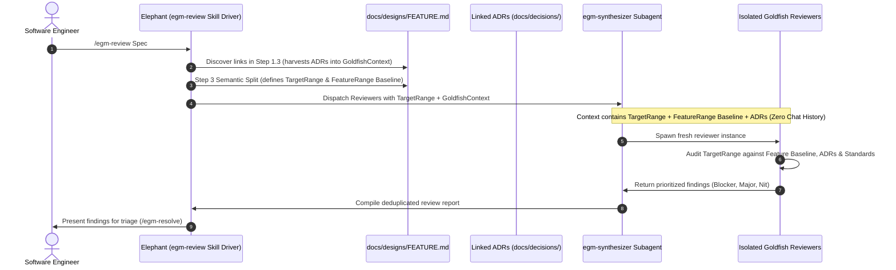

# EGM Recorded Decisions & Bounded Goldfish Context

*   **Author:** Crispinvz ([@Crispinvz](https://github.com/Crispinvz))
*   **Status:** Draft
*   **Date:** 2026-11-10
*   **Issue:** [#408](https://github.com/google/elephant-goldfish-model/issues/408)

--------------------------------------------------------------------------------

## Overview

The **Elephant-Goldfish Model (EGM)** separates drafting (the deep-context
Elephant) from review (the stateless Goldfish) to prevent confirmation bias and
hallucination cascades. Goldfish subagents evaluate documents in fresh contexts
without the prior conversational history.

In practice, an absolute zero-context assumption creates a severe failure mode:
reviewers that know nothing about earlier decisions repeatedly flag
architectural compromises, trade-offs, and platform constraints that have
already been settled. This constant relitigation creates review noise and
developer fatigue, teaching teams to discount or ignore Goldfish output
altogether.

This design introduces a verified, bounded mechanism to supply Goldfish
reviewers with the draft specification and explicitly recorded decisions
(Architecture Decision Records, established platform constraints, and
settled trade-offs), while strictly withholding the author's conversational
transcript, prompt history, and iterative reasoning. Reviewers stay independent
and unpolluted without operating in an artificial vacuum.

## The Problem

1.  **Relitigation Noise & Reviewer Fatigue**: When a Goldfish reviewer is
    spawned with zero context beyond the active document draft, it cannot
    distinguish between an unconsidered oversight and an intentional, settled
    design constraint. Reviewers repeatedly flag settled decisions as defects
    (e.g., questioning why an existing company relational database was chosen
    over a specialized document store, when the relational store was an
    immutable organizational constraint). Developers spend excessive effort
    dismissing these findings, eroding trust in the review loop.
2.  **The False Dichotomy of Context**: EGM documentation currently frames
    context as binary: either deep conversational context (the Elephant) or zero
    context (the Goldfish). In human engineering organizations, independent
    peer reviewers are given the proposal along with organizational constraints
    and accepted ADRs; they are not forced to guess what constraints exist, nor
    are they burdened with the author's stream-of-consciousness chat logs.
3.  **The Critique Evasion Risk**: If an author could simply type arbitrary
    decisions into an unreviewed proposal and claim they are "settled", authors
    could shield speculative complexity or flawed architectures from Goldfish
    critique. Any mechanism that introduces decision context must require
    provenance and enforce a clear boundary between immutable constraints and
    unvetted feature proposals.
4.  **Semantic Split Blindness**: Under `skills/egm-review`, the review pipeline
    splits documents into `FeatureRange` (`1..L-1`) and `DetailedRange`
    (`L..End`). Stage 9 (`egm-implementation-readiness`) evaluates only
    `DetailedRange`. If the high-level specification and recorded constraints
    reside exclusively in `FeatureRange`, the implementing Tech Lead reviewer
    is blind to the goals and architectural boundaries the implementation steps
    must fulfill.

## Goals vs. Non-Goals

### In-Scope Goals

*   **Context Separation**: Differentiate between *conversational history*
    (author prompts, iterative reasoning, brainstorming transcripts), which
    remains strictly withheld, and *recorded architectural decisions* (ADRs,
    settled constraints, approved standards), which are supplied as baseline facts.
*   **Standardized Document Section & Ingestion**:
    *   Standardize an H2 section: `## Architectural Constraints & Context`
        in technical design specifications for fixed platform premises and cited
        ADR links.
    *   Consolidate feature-level choices into `## Alternatives Considered & Design Decisions`,
        pairing each local decision directly with evaluated and rejected options.
    *   Support linked ADR files (e.g., `docs/decisions/0001-storage.md`) harvested
        automatically via `skills/egm-review` Step 1.3 link discovery.
*   **Decision Provenance & Anti-Evasion**:
    *   Require verifiable provenance: recorded constraints must cite merged ADRs,
        approved issues/RFCs, or documented infrastructure policies under
        `## Architectural Constraints & Context`.
    *   Treat feature choices under `## Alternatives Considered & Design Decisions`
        as active proposals subject to trade-off scrutiny against rejected
        alternatives, preventing authors from shielding unvetted choices behind
        a "settled" label.
*   **Pipeline Semantic Split Integration (Split Target, Unified Context)**:
    *   Update `skills/egm-review` Step 3 to pass the high-level specification
        (`1..L-1`) into `GoldfishContext` as read-only baseline context for Stage 9
        (`egm-implementation-readiness`), while keeping its evaluation target
        strictly scoped to `DetailedRange` (`L..End`). This eliminates fragile
        regex line-slicing while providing full visibility into goals and constraints.
*   **Persona Calibration & Operational Rubrics**:
    *   Instruct Goldfish personas (`egm-design`, `egm-implementation-readiness`,
        `egm-zoom-out`, `egm-comprehension`) on how to evaluate recorded
        decisions without opening settled questions or neutering critique.
    *   Provide `egm-implementation-readiness` with an explicit negative constraint
        prohibiting abstraction critiques against the read-only baseline (`1..L-1`).
*   **Targeted Context Ingestion**:
    *   Restrict external decision loading to explicitly referenced or linked
        files to prevent context bloat and token dilution.

### Out-of-Scope Non-Goals

*   **No Chat History Leakage**: Raw chat logs, prompt transcripts, and
    author deliberations remain strictly excluded from Goldfish subagents.
*   **No Rubber-Stamping**: Reviewers must still flag defects if a recorded
    decision creates a mathematical or physical impossibility with stated goals,
    violates hard security/quota limits, or lacks required failure-mode
    mitigations.
*   **No Wildcard Directory Dumping**: Reviewers will not ingest entire
    directories (`docs/decisions/*.md`) indiscriminately.
*   **No Stateful Subagents**: Reviewers remain stateless, single-turn subagents
    spawned in fresh context windows.

## System Architecture & Workflow

### Context Boundary Matrix

| Information Type | Allowed for Elephant? | Allowed for Goldfish? | Boundary Enforcement |
| :--- | :--- | :--- | :--- |
| Project codebase & files | Yes | Yes (via tools) | Read-only workspace access |
| Target specification (`TargetFile`) | Yes | Yes | Scope restricted by active line range |
| High-level specification baseline (`1..L-1`) | Yes | Yes (Stage 9 read-only context) | Provided via `GoldfishContext`; audit forbidden |
| Linked ADRs & Decision Records | Yes | Yes (via `GoldfishContext`) | Explicitly linked files only; no wildcards |
| Document Standards & Rubrics | Yes | Yes | Read from `resources/document_standards/` |
| Author conversation & chat transcripts | Yes | **No (Strictly withheld)** | Never injected into subagent prompts |
| Intermediate brainstorming dead-ends | Yes | **No (Strictly withheld)** | Discarded after brief generation |

### Decision Provenance & Classification

To eliminate the "Trojan Horse" loophole where authors label unreviewed
proposals as settled decisions to avoid critique, reviewers apply this
classification rubric:

1.  **Type A: Verified External Constraints (Settled Premises)**:
    *   *Definition*: Pre-existing platform mandates, corporate compliance
        rules, language runtimes, or merged repository ADRs.
    *   *Placement*: Documented under `## Architectural Constraints & Context`.
    *   *Requirement*: Must cite a verifiable source (e.g., file link to
        `docs/decisions/*.md`, tracking issue, or platform policy).
    *   *Reviewer Mandate*: Accept as a fixed premise. Do not challenge why the
        decision exists. Audit whether the specification handles its failure
        modes, scaling limits, and integration boundaries.
2.  **Type B: Feature-Local Architectural Choices (Proposals Under Audit)**:
    *   *Definition*: Architectural choices introduced by the current feature
        specification itself (e.g., choosing a worker queue over direct RPC).
    *   *Placement*: Documented under `## Alternatives Considered & Design Decisions`.
    *   *Requirement*: Must be paired directly with rejected alternatives and
        concrete trade-off rationales.
    *   *Reviewer Mandate*: Actively stress-test the rationale. If the trade-off
        is fully justified and mitigated, accept it; if the rationale relies on
        unbacked assumptions, flag it.

### Reviewer Operational Rubric for "Unmitigated Blockers"

Reviewers must not bypass settled decisions out of personal preference, nor
may they rubber-stamp fatal flaws. An explicit recorded constraint may only be
flagged as a **Blocker** under three concrete conditions:

1.  **Mathematical or Physical Impossibility**: The recorded constraint makes an
    explicit In-Scope Goal mathematically impossible (e.g., requiring single-digit
    millisecond global consistency while choosing an eventually consistent
    cross-region data store).
2.  **Quota or Security Boundary Violation**: The constraint directly breaches
    an immutable infrastructure quota or security policy documented elsewhere
    in the repository.
3.  **Missing Failure Mode Mitigation**: The choice introduces known, well-defined
    failure modes (e.g., network partition in a distributed coordinator), and the
    specification fails to specify any mitigation or recovery behavior.

## Component Specifications & Skill Integration

### 1. Document Standard (`resources/document_standards/feature-spec-standard.md`)

*   Standardize two non-overlapping sections for decisions and constraints:
    *   `## Architectural Constraints & Context`: Fixed platform premises,
        compliance mandates, and links to merged repository ADRs (`docs/decisions/*.md`).
    *   `## Alternatives Considered & Design Decisions`: Consolidates local
        feature architectural choices paired directly with evaluated and
        rejected options and trade-off rationales.

### 2. Review Orchestrator (`skills/egm-review/SKILL.md`)

*   **Step 1.3 (Link Discovery)**: Relative Markdown links to decision files
    (e.g., `docs/decisions/*.md`) inside the document are automatically added to
    `GoldfishContext`.
*   **Step 3 (Semantic Split & Context Supply)**:
    *   Maintain `TargetRange = DetailedRange` (`L..End`) for Stage 9
        (`egm-implementation-readiness`).
    *   Automatically pass the entire high-level specification (`1..L-1`) into
        `GoldfishContext` under a distinct boundary tag:
        `[ESTABLISHED FEATURE SPECIFICATION (READ-ONLY BASELINE)]`.
    *   Eliminates fragile regex line-slicing (`PremiseRange`) while giving the
        implementing Tech Lead complete visibility into goals and constraints.

### 3. Review Personas (`agents/*.md`)

*   **Universal Core Mandate**:
    Add to all Goldfish personas:
    > *"Stateless Mindset & Recorded Decisions: You evaluate plans with zero
    > conversational history. However, when an architectural choice has verified
    > external provenance or is recorded under 'Architectural Constraints & Context',
    > treat it as a design premise. Do not challenge why the premise was chosen
    > unless it introduces a mathematical impossibility, quota breach, or
    > unmitigated failure mode."*
*   **`agents/design_critic.md`**: Focus critique on failure modes, error
    handling, and system scaling within the chosen constraint boundaries.
*   **`agents/implementation_readiness.md`**: Verify that concrete implementation
    steps faithfully implement the recorded constraints and architecture without
    silent drift.
    *   *Negative Constraint*: Lines `1..(L-1)` represent an established,
        approved baseline. You must not critique lines `1..(L-1)` for abstraction,
        nor propose edits to them. Your audit targets ONLY `DetailedRange`
        (`L..End`) to ensure it comprehensively and concretely realizes that
        baseline without gaps.
*   **`agents/zoom_out.md`**: Respect documented constraints when assessing
    simplicity; do not flag necessary mechanisms as YAGNI if an explicit
    constraint mandates them.
*   **`agents/comprehension.md`**: Clarify that hyperlinked ADRs with brief
    inline summaries satisfy self-containment for established platform premises.

### 4. Integration with Resolution (`egm-resolve`)

Upfront decision injection directly reduces friction during `/egm-resolve`.
Under the existing resolution protocol, reviewers frequently generate dozens of
spurious findings on settled trade-offs, forcing developers to classify them as
`CONTEST` items round after round. Supplying recorded decisions upfront eliminates
these false positives at ingestion, allowing `/egm-resolve` to focus exclusively
on genuine design defects and implementation gaps.

## Alternatives Considered

1.  **Strict Zero Context (Status Quo)**:
    *   *Approach*: Goldfish reviewers receive only the raw document with no
        external decisions or constraint records.
    *   *Rejection*: In real-world projects, this yields excessive false
        positives. Reviewers challenge core architectural choices in every
        review pass, leading users to abandon the review tool.
2.  **Full Chat Transcript Passing**:
    *   *Approach*: Pass the Elephant's full conversation history to the
        reviewer.
    *   *Rejection*: Destroys reviewer independence. The reviewer absorbs the
        author's rationalizations and falls into the same confirmation bias
        the Elephant suffered from.
3.  **Wildcard Directory Ingestion (`docs/decisions/*.md`)**:
    *   *Approach*: Automatically inject all ADRs in the repository into every
        review pass.
    *   *Rejection*: Severe context bloat. Irrelevant ADRs consume token budget,
        dilute model attention, and slow down review turnaround. Explicit link
        discovery keeps context lean.
4.  **Evaluating Entire Document in Stage 9 (Implementation Readiness)**:
    *   *Approach*: Point `egm-implementation-readiness` directly at `1..End`
        as its audit target.
    *   *Rejection*: Direct evaluation of high-level narrative prose causes the
        Tech Lead persona (governed by the Zero-Decision Rule) to flag normal
        architectural abstractions as unactionable vagueness, reopening settled
        high-level debates in the terminal stage. Providing `1..L-1` as read-only
        baseline context delivers full visibility without relitigation noise.
5.  **Per-Feature Directory Restructuring (`docs/<feature>/design.md`)**:
    *   *Approach*: Nest every design specification into a feature folder with
        local ADR subdirectories.
    *   *Rejection*: Architecture Decision Records capture repository-wide,
        cross-cutting invariants that require a centralized catalog in
        `docs/decisions/` to prevent discovery fragmentation and cross-directory
        dependency coupling. Furthermore, repository governance (`AGENTS.md`)
        and tooling (`egm-drift-report`) mandate flat `docs/designs/<name>.md`.
        Feature-local trade-offs remain cleanly inline within the spec.

## References

*   [Issue #408](https://github.com/google/elephant-goldfish-model/issues/408):
    Give goldfish reviewers recorded decisions alongside the spec.
*   [EGM Architecture](architecture.md): Component model and lifecycle.
*   [EGM Review Design](review.md): Multi-stage review protocol.
