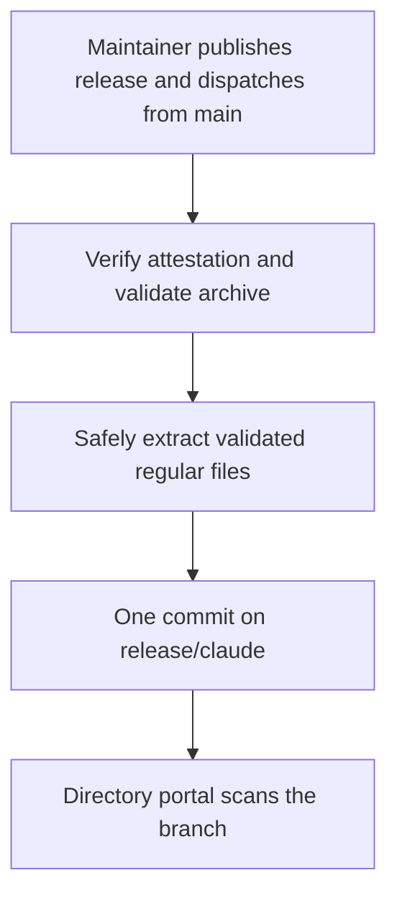

# Release-branch distribution for the Claude directory

*   **Author:** [@n3wth](https://github.com/n3wth)
*   **Status:** Draft
*   **Date:** 2026-10-29

## Overview

The Claude directory is Anthropic's catalog of plugins. Its submission portal
scans a plugin folder in a GitHub repository. Today that folder,
`distributions/claude`, holds the Claude runtime, the plugin package that users
install. `scripts/pack_plugin.py` generates it and the repository commits it to
`main`. This design stops committing it. After a maintainer publishes
a release and dispatches the publisher from `main`, it verifies the attested `egm-claude-<version>.zip`
and adds its contents as one commit to a generated branch, `release/claude`.
The directory tracks that branch.

## Problem Statement

A committed generated folder requires manual synchronization with its source.
The freshness test detects drift but does not regenerate it. The folder was added in f91dccb. From there to
f0ba151, `git log --oneline f91dccb..f0ba151 -- README.md .claude-plugin agents
skills docs` lists 48 source commits. `git log --oneline f91dccb^..f0ba151 --
distributions/claude` lists 38 folder commits, including f91dccb.

`test_published_claude_runtime_is_current` compares every byte of the folder with
a fresh build. It runs on pull requests, so it catches drift only against a
`main` that is already stale. PR #208 ("docs: note Antigravity (agy CLI) also
requires /egm: prefix") changed `README.md` and merged without regenerating the
folder. The test now fails on `main` and on every open pull request, including
Dependabot's. This is historical evidence from f0ba151, not current main:
the packaged README has since been synchronized and #209 is closed.
The current offline suite passes. A one-time synchronization does not prevent
the next drift.

### Directory portal constraints

Source: Anthropic, [Submit your plugin](https://claude.com/docs/plugins/submit),
read on 2026-10-29.

*   The portal reads a GitHub repository, an optional plugin path (the folder
    that holds `.claude-plugin/plugin.json`), and an optional tracked branch or
    tag. It scans each new commit on the tracked branch or tag. It does not
    accept a ZIP for a directory listing.
*   An organization has one submission per repository and plugin path. An
    organization cannot change the repository and plugin path after submitting.
    It can change the tracked branch or tag in the plugin's settings.
*   If `plugin.json` sets `version`, raise it with every release.
*   The portal's Validate step run on 2026-10-29 against
    `google/elephant-goldfish-model`, plugin path `distributions/claude`, branch
    `main` at f0ba151, passed with 6 warnings and 9 policy holds. A policy hold
    sends a version to a reviewer. The author submitted nothing.

## Goals

1.  `main` contains no generated copy of the Claude runtime.
2.  The directory sees a new version only when a maintainer publishes a release.
3.  The plugin subtree on `release/claude` contains exactly the files of the
    release's attested `egm-claude-<version>.zip`. The workflow does not rebuild
    them. The subtree is the branch root or the existing submission's fixed path.
4.  A pull request cannot fail because a generated folder is stale.
5.  Pull requests still fail if the runtime builder is broken.

Goals 1 and 4 hold after Phase 6 (see Rollout and Rollback). Until then the
committed copy and its test remain. Release-to-listing latency, which Goal 2
depends on, is not measured (see Open Questions).

## Non-Goals

*   Changing the contents of the runtime or the OpenAI package.
*   Changing release attestation, `SHA256SUMS`, or the draft-release flow.
*   Submitting to the directory. A maintainer does that in the portal.
*   Resolving the portal's name, publisher, and icon policy holds.
*   Supporting hosts other than Claude on this branch.

## Open Questions

1.  **Existing submission and layout** (owner: @n3wth; gates Phase 4): Has anyone submitted this
    repository to the directory, from any organization or through the earlier
    Console form at `platform.claude.com/plugins/submissions`? The portal refuses
    a second submission for the same repository and plugin path from another
    organization. The first submission fixes the plugin path. This
    design defaults to the root of `release/claude`, with an empty plugin path.
    If a submission with plugin path `distributions/claude` exists, select that
    prefix before publication and preserve it throughout rollout. Any other
    existing path requires a design update before Phase 4. The author's account has no submission for
    this repository.
2.  **Portal scan timing**: How soon after a push does the directory scan the new
    commit? The portal documents a scheduled check and an optional push webhook
    but no interval, so release-to-listing latency is unquantified.
3.  **Organization policy** (answered by Phase 4): Does an organization-level
    Actions policy limit `GITHUB_TOKEN` writes? The author cannot read that
    setting. A throwaway fork under a personal account pushed the branch with
    the same workflow, but a fork does not inherit the organization's policy.

## Critical User Journeys (CUJs)

### CUJ 1: Maintainer ships a release

*   **Given**: A release PR raised `version` in the plugin manifests listed in `docs/releases.md`.
    A `vMAJOR.MINOR.PATCH` tag exists on `main`. **Prepare draft release**
    (`release.yml`) produced a draft with attested ZIPs.
*   **When**: The maintainer reviews and publishes the draft, then dispatches
    **Publish Claude runtime branch** from `main` with the released tag.
*   **Then**: The workflow verifies the attestation, validates the archive before extraction, and
    adds a commit to `release/claude`. The directory scans that commit as a new
    version.

### CUJ 2: Contributor changes a source file

*   **Given**: An open pull request edits `README.md` or a skill.
*   **When**: The pull request is tested and merged.
*   **Then**: No generated folder needs updating. `release/claude` does not
    change until the next release.

### CUJ 3: Verification fails

*   **Given**: One of these is true. The release's Claude ZIP has no valid
    attestation from `release.yml` on `main`. Its manifest version differs from
    the tag. The release is a draft or a prerelease.
*   **When**: The workflow runs.
*   **Then**: The workflow fails before pushing. `release/claude` keeps its
    previous version, and the maintainer sees a failed run.

### CUJ 4: Publish an existing release by hand

*   **Given**: A release exists but `release/claude` lacks it. Causes include the
    branch's first publication, an omitted dispatch, or a failed push.
*   **When**: A maintainer runs the workflow from `main` with the tag.
*   **Then**: The branch gains that release's commit. If the branch already holds
    identical content, the run reports that and changes nothing.

## Proposed Architecture

### Trigger

`.github/workflows/publish-claude-branch.yml` runs only on `workflow_dispatch`
with a `tag` input. The workflow and publisher code must come from `main`,
never from a release tag. Before checkout, require `github.ref` to equal
`refs/heads/main`; checkout that same resolved main commit explicitly.
The workflow checks that the tag matches
`vMAJOR.MINOR.PATCH` and that the release is neither a draft nor a prerelease.
It also checks that the tagged commit is an ancestor of `origin/main`
(this needs `fetch-depth: 0`). Record the trusted main workflow commit separately
from the release tag and attested build source.

A `release` event would select the tagged workflow and code, which may be old.
It is therefore not a write-enabled trigger in this design. The documented
release procedure includes the explicit main-branch dispatch after publication.

### Verify and extract

`release.yml` builds the runtime ZIPs on `main` and attests them with GitHub
artifact attestations. An attestation is a signed statement that a given
workflow run produced a given file. The release notes tell users to check it with
`gh attestation verify`.

The new workflow downloads the single `egm-claude-*.zip` release asset and runs
the same check with `--signer-workflow <repo>/.github/workflows/release.yml` and
`--source-ref refs/heads/main`. Retain the verified attestation digest, actual
source SHA, and build-run identity. Reject missing or ambiguous provenance.
Record both the tag's commit and the actual attested source; do not present
the former as a provenance assertion. It then validates the entire ZIP before
creating any extracted files. It does not run
`pack_plugin.py`. The published bytes are the attested bytes, so the design needs
no assumption that the builder gives identical output on a different runner.

Archive validation rejects absolute paths, `..` components, drive or UNC paths,
backslashes, NULs, duplicate or case-colliding paths, and file/directory conflicts.
Reject symlinks and special file types. Reject more than 4,096 entries or more
than 64 MiB of total declared uncompressed data before reading entry data, and
enforce that byte bound while reading. Verify every entry's CRC. These limits
are above the current runtime's size and require a design change to increase.
Fail closed on unsupported metadata.
Only after all entries pass, write regular files beneath a new private staging
directory using validated relative paths. Never call an unrestricted ZIP
extractor. Verify the staged paths and bytes again before constructing a commit.
Any failure removes staging and leaves the remote branch unchanged.

### Branch commit

`scripts/publish_runtime_branch.py` takes the ZIP, a new staging directory,
the tag, tagged commit, verified provenance, configured plugin path, remote,
and branch name. Its contract:

| Rule | Behavior |
|---|---|
| Inputs | Tag must match `vMAJOR.MINOR.PATCH` without leading zeroes. Every commit identity must be 40 lowercase hex digits. Provenance must include the verified SHA-256 digest and build-run identity. Plugin prefix must be empty or `distributions/claude`. Violations raise `ValueError`. |
| Archive | Validate the complete archive before any extraction using the guards above. The staged folder must hold the same paths and bytes as the ZIP. |
| Manifest | `.claude-plugin/plugin.json` must exist in the folder, and its `version` must equal the tag without `v`. |
| Branch lookup | `git ls-remote --exit-code` exit 0 fetches the tip with `--depth=1`. Exit 2 starts an orphan branch. Any other exit raises `RuntimeError`. |
| Repeat | If the ZIP paths and bytes under the configured prefix equal the branch tree, the script returns without committing. This check runs before the Order rule, so repeating the latest release succeeds. |
| Order | The script refuses a version below the branch's. It also refuses the same version with other content. Versions compare as integer triples. |
| Commit | One commit as `github-actions[bot]`, subject `Release <tag>`. Body records `Tagged-commit`, `Attested-source`, `Artifact-digest`, `Build-run`, and `Publisher-commit` separately from verified workflow outputs. Tag ancestry is not artifact provenance. |
| Push | `git push origin HEAD:refs/heads/<branch>` without force. A Git failure raises `RuntimeError` with Git's message. |
| Bytes | Every Git call runs with `core.autocrlf=false` and `core.safecrlf=false`, so committed bytes equal ZIP bytes on any platform. |

The tree contains only the ZIP's files under the selected plugin prefix.
The default manifest path is `.claude-plugin/plugin.json`; for an existing
`distributions/claude` submission it is
`distributions/claude/.claude-plugin/plugin.json`. Reject a prefix change after
the branch's first publication. Each commit stores a full
copy of about 250 kB, so history grows by about 250 kB per release.

### Failure handling and ordering

*   A failed verification, a version mismatch, an older version, a draft or
    prerelease, or a rejected push fails the job. The branch stays unchanged.
    The maintainer fixes the cause and re-runs the job or runs the workflow by
    hand.
*   One concurrency group runs publishes one at a time and does not cancel a
    running one. GitHub keeps one running and one pending run per group, and a
    newer pending run replaces an older pending run. If two releases publish
    close together, GitHub may skip the older. The older-version rule then refuses a re-run of
    the older tag, which is the intended result.
*   There is no force push and no delete. To correct a bad release, publish a
    higher version.

### Security

*   The workflow sets `permissions: {}` at the top. Verification and extraction
    use a read-only job. A separate push job gets `contents: write`, consumes
    only the verified staged files and provenance, and repeats path/byte checks.
    Neither job executes code from the tag or extracted archive. Both use the
    same guarded main-branch workflow commit.
*   The workflow pins actions by commit SHA, as the other workflows do. The tag passes
    through an environment variable. The workflow matches it against a regular expression
    before use. The workflow uses no secrets other than the job token. The token
    reaches Git as a masked `http.extraheader` set through environment variables
    for one step, and checkout does not persist credentials.
*   The attestation binds `release/claude` to a ZIP that `release.yml` built on
    `main`. It does not bind the ZIP to the commit the tag points to, and `docs/releases.md`
    allows the attested source to differ from the tag. Anyone who can create a
    tag already has write access. This design accepts that difference and records
    both identities explicitly, rather than labeling the tagged commit as the
    attested source. It relies on the `v*` tag ruleset listed in this section.
*   The design does not enforce that only this workflow can push. GitHub rulesets restrict by
    actor, not by workflow. A maintainer with write access can push a normal
    commit to `release/claude`, and the portal scans it as a version.
*   A maintainer applies these settings in Phase 3, which finishes before Phase 4
    starts. The first is a ruleset on
    `release/claude` that blocks deletion and non-fast-forward updates. The second is a
    ruleset on `v*` tags that limits who can create them. Today only the default
    branch has a ruleset and there are no tag rules.

### What stays on main

`scripts/pack_plugin.py`, `scripts/prepare_release.py`, and their tests stay on
`main`. If the builder breaks, a pull
request still fails through
`test_runtime_bundle_is_complete_and_reproducible` in
`tests/unit/test_packaging.py`, which builds both runtimes, and through
`tests/integration/test_claude.py`. Neither compares against a committed copy.

## Alternatives Considered

### Alternative A: Keep the committed copy and regenerate it with a bot

*   **Pros**: The plugin path stays `distributions/claude` on `main`.
*   **Cons**: A bot needs permission to push to `main`, which the default-branch
    ruleset forbids without a bypass. If the portal tracks `main`, every bot
    commit becomes a scanned version. Parallel pull requests that change the same
    inputs conflict on the generated files.
*   **Reason for Rejection**: It adds write access to `main` and extra directory
    scans to solve a problem that disappears when the copy is not committed.

### Alternative B: Regenerate in a pre-commit hook

*   **Pros**: Local commits include a current folder. No server-side change.
*   **Cons**: It adds an install step for every contributor, and some will skip
    it. Today a failing test is the only prompt to regenerate the folder, and it
    has not prevented drift.
*   **Reason for Rejection**: CI must still catch what the hook misses, so a
    stale folder can still fail pull requests.

### Alternative C: Submit the repository root

*   **Pros**: Nothing to generate.
*   **Cons**: The directory scans the whole folder, including the website, tests,
    workflows, and contributor documents that the runtime package leaves out.
    Every merge to `main` becomes a scanned version.
*   **Reason for Rejection**: It changes what the directory reviews and lists.

### Alternative D: Upload the release ZIP, or track a tag

*   **Pros**: The ZIPs already exist and are attested.
*   **Cons**: The directory does not accept a ZIP. A tracked tag stays on its
    commit until the setting changes, and `docs/releases.md` forbids moving a
    tag. Each release would therefore need a manual settings edit.
*   **Reason for Rejection**: A ZIP upload is not possible, and tag tracking
    adds a manual step per release.

### Alternative E: Rebuild from the tag and compare with the ZIP

*   **Pros**: A second, independent check of the attested ZIP.
*   **Cons**: It adds a second build path and assumes the builder gives identical
    bytes on a different runner image, which the repository tests only in one
    environment. A false mismatch would block releases.
*   **Reason for Rejection**: The attestation already ties the ZIP to the build
    that `release.yml` ran. The extra check adds a failure mode and no new
    guarantee.

### Alternative F: Put the Git steps in the workflow and drop the script

*   **Pros**: Fewer files. No Python between the workflow and Git.
*   **Cons**: Shell steps in YAML cannot run in the unit suite. The guards for
    older versions, the same version with other content, line endings, and a
    rejected push would have no test on Ubuntu and Windows.
*   **Reason for Rejection**: The script has unit tests that run on both
    operating systems and a rehearsal on a fork. YAML shell has neither.

## Risks & Mitigations

| Risk | Mitigation or acceptance |
|---|---|
| The 9 policy holds keep a version from listing until a reviewer clears it. | Accepted. This design does not change them. |
| An existing submission uses a different plugin path. | Open Question 1 (existing submission and layout) gates Phase 4. |
| The portal's scan interval is undocumented, so latency is unknown (Open Question 2). | Accepted. Measure it in Phase 5 and record it here. |
| A failed or rejected publish after a release is public leaves the directory on the previous version. | Accepted. The failed run is the signal (CUJ 3). No extra alert is added. |
| A mistaken release reaches the directory. | See Failure handling and ordering. |
| Someone with write access pushes a bad commit to `release/claude`. | See Security. The design accepts ordinary pushes by writers. |
| The new tests have not run on a Windows runner against `main`. | They passed on `windows-2025` in a fork (see Verification Plan). The first run on the real repository is the check. |
| Between Phases 4 and 6, `release/claude` ships a packaged `docs/releases.md` that still describes the committed folder. | Accepted. The next release after Phase 6 corrects it. |

## Rollout and Rollback

| Phase | Change | Gate before the next phase |
|---|---|---|
| 1 | Confirm current `main` passes the offline suite; the historical README drift was already fixed and #209 is closed. | Unit tests pass on the recorded main SHA. |
| 2 | Merge the pull request that adds the script, its tests, and the workflow. | Tests and the repository's workflow scan pass. None of its files go into the runtime package, so the freshness test is unaffected. |
| 3 | A maintainer adds the two rulesets above. | The rulesets are visible in the repository settings. |
| 4 | After Open Question 1 is answered, configure the fixed plugin prefix and dispatch from main with the latest release tag. | The selected subtree equals the release ZIP, provenance identities are recorded, and portal Validate passes for that exact repository, branch, and plugin path. |
| 5 | For a new submission, use the validated path from Phase 4. For an existing submission, preserve its repository and plugin path and change only its tracked branch to `release/claude`. | The portal accepts scanning at the selected path, and the owner confirms the listing now tracks the generated branch. |
| 6 | One pull request deletes `distributions/claude` and the freshness test, and edits the documents listed in the Detailed Implementation Plan. | Unit tests pass, and adding the pull request branch as a marketplace followed by `claude plugin install egm@egm` succeeds. After the next release, `release/claude` gains that release's commit. |

Phase 4 selects the layout; Phase 5 preserves that choice. Phase 6 must not start
until the actual submission has been verified on the generated branch. Keeping
the same `distributions/claude` prefix on that branch permits deleting the
generated copy from `main`; it does not change the submission's plugin path.
Rollback for Phases 1 to 4 is to disable the workflow,
have a maintainer lift the `release/claude` ruleset, and delete the branch. The branch is generated and holds nothing that is not in a
release. After Phase 5, recovery is forward only (see Failure handling and
ordering). A wrong plugin path needs a new submission. Restoring the committed folder after
Phase 6 does not restore the old listing, because the submission no longer
points at it.

## Additional Resources

*   Anthropic, [Submit your plugin](https://claude.com/docs/plugins/submit) and
    [Publish to the directory](https://claude.com/docs/directory/publish).
*   Anthropic,
    [Plugin pre-submission checklist](https://claude.com/docs/plugins/pre-submission-checklist).
*   [Runtime packaging](runtime_packaging.md), [Releases](../releases.md),
    [Directory packages](../directory.md).

## Detailed Implementation Plan

### Target Files to Create/Modify

#### 1. `scripts/publish_runtime_branch.py` (Create, Phase 2)

*   **Type / Scope**: Python script, standard library only.
*   **Proposed Changes**: `validate_and_extract(archive, staging)` validates all
    entries before writing files. `verify_archive(folder, archive)` rechecks the
    staged tree, and `publish` enforces the branch contract above. The command
    line takes the archive and staging paths, tag, tagged commit, verified
    provenance record, remote, branch (default `release/claude`), and configured
    plugin prefix. It validates, extracts, verifies, and then publishes. It prints `Published <tag> on <branch>`
    or `Already current: <tag> on <branch>`.

#### 2. `.github/workflows/publish-claude-branch.yml` (Create, Phase 2)

*   **Type / Scope**: GitHub Actions workflow named **Publish Claude runtime
    branch**, dispatched only from main, with read-only verification and a
    separate write-enabled push job on `ubuntu-24.04`.
*   **Proposed Changes**: These steps run in order across the two jobs.

| Step | Behavior |
|---|---|
| Guard | Require `workflow_dispatch` and `github.ref == refs/heads/main` before any checkout or untrusted input use, in both jobs. |
| Checkout | Pin `actions/checkout` by SHA. Explicitly use the guarded main workflow SHA, `fetch-depth: 0`, and `persist-credentials: false`. Never checkout the tag to execute publisher code. |
| Resolve tag | Take `inputs.tag` through `env`. Validate semantic-version syntax, resolve its commit, and require main ancestry. Record the tag commit and publisher commit separately. |
| Download and verify | Require a published non-prerelease. Download exactly one matching Claude ZIP. Verify attestation with the approved signer and main source ref; retain the verified digest, actual source SHA, and build-run identity. Reject incomplete or ambiguous verification output. |
| Validate and stage | In the read-only job, validate the entire archive before extraction, then write only validated regular files to private staging. Verify staged paths and bytes against the archive. Pass archive, staging, and provenance through a digest-checked job artifact. |
| Publish | In the write-enabled job, recheck artifact digest, staging bytes, provenance, manifest version, and fixed prefix. Build the masked token header through `GIT_CONFIG_*` only for the push step. Execute only the guarded main publisher code. |

The workflow sets `permissions: {}` at the top level, read permissions on the
verification job, and `contents: write` only on the push job. One concurrency
group, `publish-claude-branch`, has `cancel-in-progress: false`.

#### 3. `tests/unit/test_publish_runtime_branch.py` (Create, Phase 2)

*   **Type / Scope**: Unit tests against a local bare repository. The workflow
    has no test beyond the linters and the manual run.
*   **Proposed Changes**: Each case asserts the remote is unchanged when it
    expects a failure.
    *   First release creates the branch with the bot author, subject, and
        separate tagged/source/digest/run/publisher provenance fields, and no co-author line.
    *   CRLF and LF bytes survive.
    *   A later release fast-forwards, keeps the parent, and removes deleted files.
    *   Identical content publishes nothing.
    *   Unrelated history already on the branch is kept.
    *   `verify_archive` rejects changed, extra, and missing files, and a
        corrupted entry.
    *   Before any extraction write, reject path traversal, absolute and drive
        paths, backslashes, duplicate/case-colliding entries, symlinks, special
        files, file/directory collisions, excessive entry count or size, and
        failed CRC checks. Assert staging and remote remain unchanged.
    *   `publish` rejects tags `1.2.3`, `v01.2.3`, and `v1.2.3;echo`, commit
        `abc`, a manifest version that differs from the tag, and a folder without a
        manifest. It also rejects a version below the branch's, the same version
        with other content, and a malformed version already on the branch.
    *   An unreachable remote raises `RuntimeError("git ls-remote failed")`.
    *   A `pre-receive` hook that rejects the push raises `RuntimeError("git push
        failed")` (skipped on Windows, which lacks a POSIX shell).
    *   A real build publishes at the root and at `distributions/claude` in
        separate repositories. A later prefix change is rejected.
    *   Workflow guards reject dispatches from a tag or non-main branch before
        checkout. Verification failure prevents the write job. The tag's code
        is never executed. Distinct tag and attested source SHAs remain distinct
        in the resulting commit metadata.
    *   The command line publishes, repeats as a no-op, and exits nonzero on a
        tampered folder.

#### 4. Phase 6 changes (Modify or Delete)

*   **Type / Scope**: One pull request.
*   **Proposed Changes**:
    *   Delete `distributions/claude/`.
    *   In `tests/unit/test_packaging.py`, delete
        `test_published_claude_runtime_is_current`. `build` and `ROOT` stay in use, and no import
        becomes unused.
    *   `docs/directory.md`: replace the first five sentences of the paragraph
        that begins "For Anthropic, the generated runtime is checked in" (through
        "Do not commit ZIPs.") with: "For Anthropic, dispatching the publisher
        from `main` after a release adds the runtime to `release/claude`. In the directory portal,
        use repository `google/elephant-goldfish-model` with tracked branch
        `release/claude` and the fixed plugin path validated in rollout. Preserve
        an existing submission's path. Do not commit the runtime or
        ZIPs to `main`." Keep the OpenAI sentences.
    *   `docs/releases.md`: change step 2 to "Run `pytest tests/unit`. Include any
        migration notes in the PR." Change step 6 to: "Publish the draft manually
        only after review. Then dispatch **Publish Claude runtime branch** from
        `main` with the released tag to add it to `release/claude`. If it fails, fix the cause
        and run it again from `main` with the tag. Directory publication is
        separate." The numbering does not change.
        This file is in the runtime package. If someone edits it before someone
        deletes the folder, the freshness test fails. It is the only packaged file
        among those listed.
    *   `docs/designs/runtime_packaging.md`: replace the paragraph that begins
        "Generate `distributions/claude` from the same builder" with "Publish the
        Claude runtime to `release/claude` from the attested release archive. See
        [Release-branch distribution](release_branch_distribution.md)."
    *   `docs/designs/runtime_packaging.md`: also change "overwrite refusal,
        reproducibility, and generated freshness" to "overwrite refusal, and
        reproducibility". `docs/designs/releases.md` stays unchanged.
    *   `docs/designs/skill_icons.md`: replace "Regenerate `distributions/claude`;
        do not edit its copies independently." with "Do not edit generated
        copies independently."
    *   Run `grep -rn "distributions/claude" . --exclude-dir=.git
        --exclude=release_branch_distribution.md` before and after. The
        expected hits before are `docs/directory.md`, `docs/releases.md`,
        `docs/designs/runtime_packaging.md`, `docs/designs/skill_icons.md`,
        `tests/unit/test_packaging.py`, and `distributions/claude/docs/releases.md`.
        There are none after.
    *   Not changed: `.claude-plugin/marketplace.json` has `"source": "./"`, which
        points at the repository root, where `.claude-plugin/plugin.json` exists.
        Installs through `claude plugin marketplace add
        google/elephant-goldfish-model` do not read `distributions/claude`. The
        Phase 6 gate checks this.

### Verification Plan

*   **Compilation/Build**: Not applicable. The script is interpreted.
*   **Unit Tests**: Run `pytest tests/unit` on Ubuntu and Windows against the
    current main integration. The historical failure at f0ba151 and fork runs
    below do not establish the revised implementation's status. #209 is closed;
    do not use its merge as a rollout dependency.
*   **Static Analysis & Linting**: `actionlint` and `zizmor` report nothing on the
    workflow, including `zizmor --persona=auditor`. The repository's Actions
    security scan runs on the pull request.
*   **Test Coverage Requirement**: Every implemented guard must have a test that
    fails when removed. The author's 2026-10-29 mutation checks covered the
    earlier prototype, not the revised extraction and workflow trust boundaries.
*   **E2E/Integration**: The author ran these historical prototype checks on
    2026-10-29 and deleted the fork. They do not verify the revised main-only,
    two-job workflow, safe extractor, alternate prefix, or provenance fields.
    Stage 2 must rerun the checks for those revised contracts before rollout.
    *   Locally, against release v0.1.0 of the real repository: attestation
        verification passed, and the 63-entry ZIP published to a scratch bare
        repository as one commit. A repeat made no commit.
    *   On a throwaway fork with Actions enabled and the default read-only token,
        the runs gave these results. The Tests workflow passed on `ubuntu-24.04` and
        `windows-2025`. **Prepare
        draft release** attested the ZIPs. Publishing a release whose tag lacks the
        workflow did not trigger it. A manual run created `release/claude` from
        v0.1.0. A tag outside `main` failed at the tag check. A repeat reported
        "Already current". Publishing a v0.1.1 draft triggered the workflow from
        the release event and fast-forwarded the branch with one parent. Each
        branch tree equaled its release ZIP. The run logs held no token.
    *   On the same fork with the final version of the script and workflow, the
        workflow refused a prerelease at the download step. A repeat of v0.1.1 was
        a no-op. The script refused v0.1.0 after v0.1.1. Each of these runs left
        the branch unchanged. The Tests workflow passed on both operating systems.
    *   The portal's Validate step on the fork's `release/claude` at the
        repository root, with an empty plugin path, passed. It reported 96 files,
        6 warnings, and 6 policy holds. The holds that name the `google` owner did
        not appear because the fork's owner is a personal account.
    *   Not run: a push to the real repository, and the portal's Validate step on
        the real repository's `release/claude`. Phase 4 supplies both checks.

*Drafted with EGM (Elephant-Goldfish Model). Revised after three EGM reviews on 2026-10-29.*
