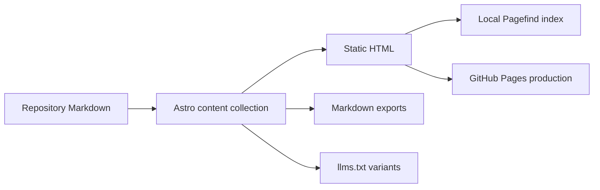

# EGM website and documentation

- **Author:** @n3wth
- **Status:** Proposed. Maintainer scope approval is pending.
- **Date:** 2026-11-04
- **Scope issue:** #303. Related work: #7, #58, #301, and #302.

## Overview

Use Astro Starlight to publish a guide and skill pages from the website Markdown in `docs/site/`.
Keep one shared header, footer, type scale, and color system across the website.
Provide Markdown exports and local search without a server runtime.

The existing prototype is evidence for review. It does not replace design approval or authorize a production release.

## The Problem

The current website introduces EGM but sends readers to GitHub for most instructions.
Readers need clear installation steps and a direct route to each skill.
Students, architects, project managers, and software engineers need an explanation that does not assume a coding workflow.

The default draft and design-review skills target software designs.
The custom review skill supports other documents through explicit reviewer and standard choices.
The website must explain this distinction without a dense homepage disclaimer.

Issue #7 proposes a single guide page and excludes search and multiple documentation pages.
This proposal has a separate scope. Issue #7 and the worked-example issue #58 require separate work.

## Goals

- Publish `/guide`, `/install`, `/getting-started`, `/workflow`, and `/skills`.
- Publish one `/skills/<skill-name>` page for each of the seven existing skills.
- Keep one page for each skill in `docs/site/skills/`. Each page explains the skill to a person who uses the plugin.
- Link each skill page to its canonical `SKILL.md`.
- Keep website guide text in `docs/site/`, outside presentation components.
- Share the header and footer between the homepage and documentation.
- Use the existing Material Web gBreeze styles, fonts, marks, and skill icons.
- Give body text one shared color role in both themes.
- Provide keyboard-accessible local search and a copy-as-Markdown action.
- Export each documentation page as Markdown and generate the three `llms.txt` variants.
- Preserve the existing GitHub Pages production deployment.

## Non-Goals

- Change skill execution, review permissions, or host support.
- Change plugin manifests, categories, policy links, or skill descriptions.
- Replace the existing production consent and analytics rules.
- Add accounts, a database, remote search, or an AI chat service.
- Produce a recorded review example or claim an invented example is a real review.
- Replace the repository contribution process with prototype approval.
- Add support for another AI application.

## Open Questions

- A maintainer must approve the new scope and assign `design-ready` to its issue.
- The design must merge before the issue can receive `pr-ready` for implementation.
- PR #302 retains its separate metadata scope decision. This proposal does not grant that exception.

## Critical User Journeys

### Understand EGM

- **Given:** A reader visits the homepage without prior EGM knowledge.
- **When:** The reader scans the explanation and process diagram.
- **Then:** The reader can distinguish a context-aware author from a separate reviewer.
- **Then:** The reader sees that a person checks findings and decides what changes.

### Install the plugin

- **Given:** A reader uses a supported desktop application or command-line application.
- **When:** The reader opens `/install`.
- **Then:** The published ChatGPT and Codex desktop link appears first, with its desktop-only limit.
- **Then:** Separate sections explain Claude Cowork and the existing command-line install paths.
- **Then:** The reader can continue to the first-project guide and inspect host-support limits.

### Choose and read a skill

- **Given:** A reader knows the next task but not its command.
- **When:** The reader opens `/skills` and chooses a task group.
- **Then:** The page shows each skill's canonical icon, name, command, and short purpose.
- **Then:** A skill link opens a separate page that explains the skill and links to its repository instructions.

| Task group | Skills and commands |
| --- | --- |
| Develop an idea | Brainstorm (`/egm-brainstorm`), Draft (`/egm-draft`) |
| Review a document | Review (`/egm-review`), Resolve findings (`/egm-resolve`), Custom review (`/egm-review-loop`) |
| Work with code | Document a codebase (`/egm-bootstrap`), Check for drift (`/egm-drift-report`) |

### Search and copy documentation

- **Given:** A reader opens a documentation page with JavaScript available.
- **When:** The reader opens search, enters a term, and selects a result.
- **Then:** Pagefind searches the local index and opens the matching page or section.
- **When:** The reader selects Copy page.
- **Then:** The site copies the page's Markdown and announces success.
- **Then:** A failed copy exposes a direct Markdown link and an error message.

### Read without JavaScript or a wide screen

- **Given:** JavaScript is unavailable, or the reader uses a narrow screen.
- **When:** The reader opens a documentation URL.
- **Then:** Static page text and ordinary links remain available.
- **Then:** The mobile navigation and layout fit the viewport when JavaScript is available.
- **Then:** Wide code and tables scroll within their content area.

## Technical Plan

### Static content pipeline

Astro keeps static output. Starlight supplies documentation layout, navigation, contents, search integration, and code rendering.
The Astro content loader reads `docs/site/**/*.md`.
Each collection entry ID is the file path below `docs/site/` without `.md`, and the route is `/` plus that ID.
For example, `docs/site/skills/egm-review.md` has the route `/skills/egm-review`.
A `SKILL.md` file gives instructions to an AI assistant. The website does not render those files.
Canonical skill instructions remain unchanged.

The Markdown transform resolves relative repository references to canonical GitHub URLs.
It must preserve absolute URLs, website routes, anchors, and code examples.

### Dependency and loader choices

Use Node.js 22.23.4 or later. The candidate lockfile resolves the following package versions:

| Package | Version |
| --- | --- |
| `astro` | `7.4.5` |
| `@astrojs/starlight` | `0.42.9` |
| `starlight-llms-txt` | `0.12.0` |
| `@astrojs/markdown-remark` | `7.3.5` |
| `unified` | `11.0.5` |
| `remark-parse` | `11.0.0` |
| `remark-gfm` | `4.0.1` |
| `remark-stringify` | `11.0.0` |

Preserve these resolutions in `package-lock.json`. Use `npm ci` for validation and deployment.
The candidate passes Astro checks, static builds, and documentation checks with these versions.

Define the `docs` collection with `defineCollection` and the Astro `glob` loader from `astro/loaders`.
Use the repository root as its base (`..` from `site/`), with pattern `docs/site/**/*.md`.
Use `generateId` to produce the collection entry ID.
Validate frontmatter against Starlight `docsSchema()`.
Reject a missing title or invalid Starlight metadata through schema validation.

### Skill pages

Each skill page has the file name `docs/site/skills/<skill-name>.md`, where `<skill-name>` equals the skill directory name.
The icon lookup, the sidebar, and the redirects depend on that name.
Each page has these sections in this order: What it does, When to use it, What you get, Example, Full instructions.
The frontmatter title is the display name in the task-group table above. The frontmatter description is website text. It does not change the canonical skill description.
A new skill needs a page, a sidebar entry, and a redirect.
If a page and its `SKILL.md` disagree, the `SKILL.md` is correct and the page has a defect.

For Markdown exports, parse `entry.body` with `unified`, `remark-parse`, and `remark-gfm`.
Apply the shared repository transform, then serialize with `remark-stringify`.
Prefix the page title and description. Use the same transform in Astro's remark pipeline for rendered pages.

### Repository URL rules

Use revision `main` for repository references. These links intentionally follow current repository content rather than a pinned build revision.
Resolve relative paths against the source Markdown file, not its website route.
Keep query strings and fragments. Preserve absolute URLs, root-relative website paths, and anchor-only references.
Reject paths outside the repository and missing relative targets during the documentation check.

- Link to repository files through `https://github.com/google/elephant-goldfish-model/blob/main/<path>`.
- Link to repository directories through `https://github.com/google/elephant-goldfish-model/tree/main/<path>`.
- Resolve image nodes through `https://raw.githubusercontent.com/google/elephant-goldfish-model/main/<path>`.
- For reference definitions used by images, use the raw asset destination. Other definitions follow the file or directory rule.

An image and an ordinary link can share one reference definition. Use the raw destination for that definition so the image remains valid.
Test inline images, image reference definitions, directories, and document links with fragments in both rendered HTML and Markdown exports.
Keep code examples unchanged.

Legacy HTML routes redirect as follows:

- `/docs` redirects to `/guide`.
- `/docs/getting-started` redirects to `/getting-started`.
- `/docs/workflow` redirects to `/workflow`.
- `/docs/skills` redirects to `/skills`.
- `/docs/skills/<skill-name>` redirects to `/skills/<skill-name>` for the seven commands above.

No other legacy paths are part of this contract.

### Shared interface

`Nav.astro` owns the wordmark, site links, active section, and GitHub link.
The Starlight header wrapper adds search and reserves mobile-menu space.
Both layouts use the same 68-pixel header height and shared page gutters.

Material Web supplies the installed `@material/web` package.
Its `labs/gb` styles implement gBreeze through native element classes and CSS custom properties.
The site wrappers reuse these classes without the Lit custom-element runtime.
The shared token source is `site/src/styles/tokens.css`.

The shared footer owns legal links and the theme control.
The theme menu opens above the footer and supports keyboard navigation.
The theme choice persists locally and follows the system when the reader selects System.

Use one body-text role, one heading role, and the existing secondary-text role.
Map Starlight neutral colors to these shared tokens instead of copying hexadecimal values.
Keep the wordmark white in dark mode and dark in light mode.
Keep brand mark colors and code syntax colors separate from prose colors.

Documentation body text uses 18 pixels, a 1.7 line height, and a maximum width of 42 rem.
The outer desktop grid has a maximum width of 1160 pixels.
Navigation rails use 200 pixels each where space permits.
At smaller widths, the layout collapses to the Starlight mobile navigation.

Use canonical skill SVGs without changing their geometry.
Bundle Google Material Symbols Rounded locally for interface icons.
The search dialog uses compact text and flat result rows with clear focus states.
Expressive Code retains syntax highlighting and copy behavior without decorative terminal controls.

### Machine-readable content

Each documentation URL has a matching `.md` URL and an HTML alternate link.
The Markdown endpoint uses the same collection and reference transform as the HTML pages.
`starlight-llms-txt` generates `/llms.txt`, `/llms-full.txt`, and `/llms-small.txt`.
These files improve content access. They do not promise model compatibility or answer quality.

### External data and privacy

The build may fetch the public GitHub star count once, with a five-second timeout.
Invalid data or a network failure removes the count without failing the site build.
The browser does not fetch GitHub counts or remote fonts.

Preserve the production hostname and consent gates from current `main`.
No Google analytics resources load on localhost or noncanonical hosts.
Do not change consent behavior as part of this feature.
The documentation layout must receive the same production consent behavior before production rollout.

Extract the existing inline consent script into `site/src/components/Analytics.astro` without changing its logic.
The component accepts `pageTitle: string` and reads `PUBLIC_GA_MEASUREMENT_ID` during the build.
`Base.astro` and the Starlight `Head.astro` override both render this component.
The component emits no script when the measurement ID is empty.
Its script still checks `window.location.hostname === 'egm.dev'` before it loads external resources.
The shared footer keeps the consent-management control.

Update `site/tests/analytics.test.mjs` to test the extracted script.
Update `site/scripts/verify-analytics.mjs` to test both homepage and documentation HTML under the same consent cases.
Check pending, rejected, accepted, revoked, failed-initialization, and noncanonical-host states on both layouts.

### Deployment

GitHub Pages remains the production target for `egm.dev`.
Its build reacts to site files, website Markdown, and skill icon changes.
A daily build refreshes public star data.

## Alternatives Considered

### Keep a single custom guide page

This option has fewer dependencies but needs custom navigation, search, and content-export code.
It does not meet the selected multi-page guide and skill-reference requirements.

### Move documentation to a hosted documentation service

This option supplies a complete documentation interface but adds another deployment and content system.
The selected design keeps repository Markdown, the current Astro site, and the existing production host.

### Render each `SKILL.md` file

The first version of this design rendered each `skills/*/SKILL.md` file as its skill page.
This option keeps one text for each skill and cannot diverge.
A `SKILL.md` file addresses an AI assistant: it names parameters, tool calls, and loop rules.
It does not meet the requirement for an explanation that does not assume a coding workflow.

### Add a written introduction above the rendered `SKILL.md`

This option keeps the canonical text on the page.
The reader still gets the assistant instructions as most of the page, and the local search returns them.
The selected design links to the canonical file instead.

## Risks

| Risk | Mitigation or acceptance |
| --- | --- |
| A skill page and its `SKILL.md` diverge. | `npm run check:docs` requires one page for each skill directory and a link from each page to its own `SKILL.md`. A content check is separate work in [#391](https://github.com/google/elephant-goldfish-model/issues/391). |
| A `SKILL.md` change does not start a site build. | Accepted. The page text does not come from that file. The daily build finds a deleted or renamed link target. |
| Markdown exports and `llms.txt` carry the page text, not the assistant instructions. | Accepted. Each export links to the canonical instructions. |
| Local search does not find terms that appear only in a `SKILL.md`. | Accepted. |
| The Full instructions link shows `main`, which can differ from an installed plugin version. | Accepted. |

## Non-Functional Requirements

### Accessibility

Keep semantic headings, descriptive links, visible keyboard focus, and text labels beside decorative icons.
Body text must meet a 4.5:1 contrast ratio in both themes.
The selected body colors exceed 9:1 against the main page backgrounds.
Static content must remain readable without JavaScript.

### Performance

Keep static HTML and local assets. Load the local search implementation through the existing Starlight integration.
Do not add a server runtime or a remote search request.
Retain self-hosted fonts and respect reduced-motion preferences.

### Rollout and rollback

Review the design before implementation. Check the exact implementation branch before production release.
Use local browser captures for visual review. A prototype does not establish production approval.
Rollback the production implementation commit if routes, assets, or consent behavior fail.

## Detailed Implementation

### Scope boundaries and PR dependencies

The implementation remains one feature, reviewed through four dependent Stage 2 PRs.
The review units are dependencies and primitives, the documentation engine, the shared interface, and the homepage.
Each unit retains this design, issue #303, and the full feature approval requirements.
This split reduces review scope. It does not use the minor-patch exception.
Keep plugin metadata changes in PR #302 and published install documentation in PR #301.
Neither PR is a required code dependency for the site feature.

Draft implementation PRs can expose the stack for review before approval.
No implementation PR can merge before this design merges and the issue receives `pr-ready`.

### Implementation phases

1. Add the content collection, route mapping, reference transform, exports, and their build checks.
   Require all documentation URLs, Markdown exports, and generated assets to resolve.
2. Add the shared interface and consent component. Connect the homepage and Starlight layouts.
   Require Astro checks, consent tests, and desktop and mobile browser checks to pass.
3. Add the final content, canonical icons, code styles, and production build triggers.
   Require the complete site and repository checks before implementation review.

Check each intermediate stack state. Review the homepage after the documentation engine and shared interface.
Until earlier PRs merge, later upstream diffs include preceding commits. Their descriptions must link an incremental comparison.

### Interface contracts

| Interface | Contract |
| --- | --- |
| Content loader | Each collection entry ID equals the file path below `docs/site/` without `.md`. |
| Content metadata | Each page defines its title and description in frontmatter. The schema requires the title. |
| `repositoryLink(url, file)` | Return a resolved URL string. Keep schemes, root-relative URLs, and anchors unchanged. Resolve other paths against the source file in the repository. |
| `transformRepositoryMarkdown(tree, file)` | Mutate the tree. Rewrite `link`, `image`, and `definition` URLs. Leave code nodes unchanged. |
| Markdown endpoint | Return one static path per collection entry with its entry as props. Serialize the page title, description, and transformed body. Use `text/markdown; charset=utf-8`. |
| `githubStars` | Export `Promise<number \| null>`. Accept only a safe non-negative integer. Use the optional build token and a five-second timeout. Return null on any failure. |
| `Nav` | Accept optional `embedded: boolean` and a named search slot. The embedded form uses the existing Starlight header container. |
| `PageActions` | Accept placement `title`, `rail`, or `standalone`. Scope feedback and fallback state to each visible action. |
| Button wrappers | Preserve existing variants and accessible labels. Forward native popover attributes and `data-*` attributes. Keep link security attributes. |
| `Symbol` | Accept a local symbol name and optional class. Throw on a missing symbol. Treat rendered symbols as decorative. |
| Theme control | Store `light`, `dark`, or an empty System value under `starlight-theme`. Storage failures affect persistence only. System changes follow the media query. |
| Cross-tab theme changes | Do not add a cross-tab synchronization contract. Each page reads the stored preference at load. |
| Documentation checks | Check optional star-data failure cases, URL preservation, relative references, unchanged code examples, route exports, and existing local asset files. |

### File operations

Create the website Markdown files, collection loader, `Home.astro`, docs adapters, symbol assets, content helpers, Markdown endpoint, grid stylesheet, and docs stylesheet below.
Change the existing configuration, dependency files, workflow, README, header, footer, base layout, homepage route, tokens, and global styles below.
Create `site/src/components/gb/Symbol.astro`. Change `Button.astro`, `IconButton.astro`, and `site/src/components/Install.astro`.
Create `Analytics.astro`. Change `site/tests/analytics.test.mjs` and `site/scripts/verify-analytics.mjs` for shared consent validation.
Create `site/scripts/check-docs.mjs` and change `tests/unit/test_link_integrity.py`.
Remove the replaced homepage components `Hero.astro`, `Install.astro`, `Model.astro`, `Loop.astro`, and `Skills.astro` after removing their callers.
Keep `SkillIcon.astro` for the documentation pages. Do not add unused symbols or a wrapper around Starlight's unchanged footer.
Do not commit generated output.

### Documentation and configuration files

| Files | Change and reason |
| --- | --- |
| `docs/site/guide.md`, `docs/site/install.md`, `docs/site/getting-started.md`, `docs/site/workflow.md`, `docs/site/skills.md` | Add repository-owned website text and page routes. |
| `docs/site/skills/<skill-name>.md` for the seven skills | Add one page that explains each skill to a person. |
| `site/src/content.config.ts` | Load the website Markdown in `docs/site/`. |
| `site/astro.config.mjs` | Add Starlight, component overrides, code settings, exports, redirects, and the explicit sidebar. |
| `site/package.json`, `site/package-lock.json` | Declare and lock the documentation dependencies and validation commands. |
| `.github/workflows/deploy-site.yml` | Watch source Markdown and icons, run documentation checks, and refresh star data. |
| `site/README.md` | Explain local development, content ownership, validation, and deployment. |

### Shared interface files

| Files | Change and reason |
| --- | --- |
| `site/src/pages/index.astro`, `site/src/components/Home.astro` | Publish the concise homepage, process diagram, install action, and task links. |
| `site/src/components/Nav.astro`, `site/src/components/Footer.astro` | Share navigation, active states, legal links, and theme selection. |
| `site/src/layouts/Base.astro` | Load shared tokens and grid styles while preserving production consent gates. |
| `site/src/components/Analytics.astro`, `site/tests/analytics.test.mjs`, `site/scripts/verify-analytics.mjs` | Share the existing consent script and check it through both page layouts. |
| `site/src/styles/tokens.css`, `site/src/styles/grid.css`, `site/src/styles/global.css`, `site/src/styles/docs.css` | Share text roles, gutters, readable content width, theme colors, and documentation styles. |
| `site/src/components/Install.astro` | Update its guide destination in the interface step, then remove the panel with the old homepage. |
| `site/src/components/gb/Button.astro`, `site/src/components/gb/IconButton.astro`, `site/src/components/gb/Symbol.astro` | Reuse native Material Web classes and local rounded symbols. |

### Starlight adapter files

All paths in this table start at `site/src/components/docs/`.

| Files | Change and reason |
| --- | --- |
| `Header.astro`, `PageFrame.astro` | Embed the shared site header and footer in Starlight. |
| `Head.astro` | Publish self-hosted fonts and machine-readable alternate links. |
| `Sidebar.astro`, `MobileMenuToggle.astro` | Provide flat task navigation and an accessible mobile control. |
| `PageTitle.astro`, `PageSidebar.astro` | Show page metadata, canonical skill icons, contents, and page actions. |
| `PageActions.astro` | Copy Markdown with live feedback and a visible failure fallback. |
| `Search.astro` | Open native Starlight search from the shared rounded icon button. |
| `ThemeSelect.astro` | Apply and persist the shared theme choice through a native popover. |
| `Pagination.astro` | Keep previous and next page actions compact. Use Starlight's default footer without an adapter. |

### Assets and content helpers

| Files | Change and reason |
| --- | --- |
| `site/src/assets/symbols/README.md` | Record the icon source and license. |
| `site/src/assets/symbols/arrow_back.svg`, `arrow_forward.svg`, `check.svg`, `close.svg`, `content_copy.svg`, `dark_mode.svg` | Bundle rounded interface icons locally. |
| `site/src/assets/symbols/description.svg`, `menu.svg`, `search.svg` | Complete the locally bundled interface icon set. |
| `site/src/lib/github-stars.ts` | Fetch and check optional public star data during the build. |
| `site/src/lib/repository-markdown.mjs` | Preserve code examples and rewrite relative repository links. |
| `site/src/pages/[...slug].md.ts` | Export page Markdown from the content collection. |
| `site/scripts/check-docs.mjs` | Check routes, exports, reference transforms, local assets, search output, and star-fetch failures. |
| `tests/unit/test_link_integrity.py` | Resolve website routes to source Markdown and exclude generated build output. |

Reuse `site/src/components/SkillIcon.astro` and `skills/*/assets/icon.svg` from current `main`.
Do not add or edit canonical skill instructions, manifests, or generated runtime files in the site implementation.

## Required Tests

- Run `npm ci`, `npm run check`, `npm run build`, `npm run check:docs`, and `npm test` in `site/`.
- Run the repository unit suite and package-consistency tests.
- Check every documentation route, Markdown export, generated asset reference, and legacy redirect.
- Check that each skill directory has one skill page, that each page links to its own `SKILL.md`, and that each page uses the canonical icon.
- Check search open, query, clear, result navigation, Escape, and focus return.
- Check copy success, denied permission, and the direct Markdown fallback.
- Check the theme menu, system preference changes, and persisted selection.
- Compare home, guide, install, and skills pages in desktop light and dark themes.
- Check mobile navigation, content overflow, table scrolling, and code scrolling.
- Check that production consent behavior is present on both layouts before production release.
- Check that localhost and noncanonical hosts do not request Google analytics resources.

The prototype passes the site build, documentation checks, nine site unit tests, and 336 repository unit tests.
The test run skips two optional native host probes. These results do not replace tests on the final implementation branches.
The full EGM review, denied-clipboard check, and production consent parity remain explicit review requirements.

## Design Review Record

Fresh-context reviewers apply the EGM Zoom Out, Comprehension, Implementation Readiness, and Codebase Details rubrics.
The draft now defines skill groups, redirects, file operations, interface contracts, phases, and the required consent extraction.
The Zoom Out review finds no major issue. Comprehension findings pass a resolution check.
The readiness review identifies two file classifications. The draft now states both operations explicitly.
The exact interface dimensions remain in this document to keep the selected visual target measurable.

On 2026-11-09 the skill pages changed from rendered `SKILL.md` files to pages written for a person.
Fresh-context reviewers applied the Structural, Style, and Design Critic personas with the feature spec standard to that change.
The draft now records the rejected alternatives, the risks, and the skill page contract.
The prototype test results above predate that change.

These bounded rubric reviews do not establish full `egm-review` completion or convergence.
The full protocol and maintainer approval remain pending.
