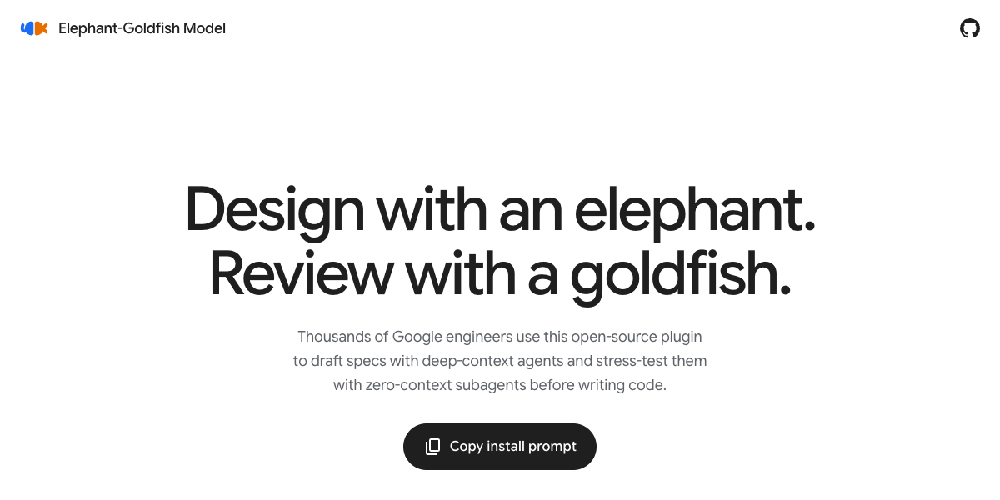
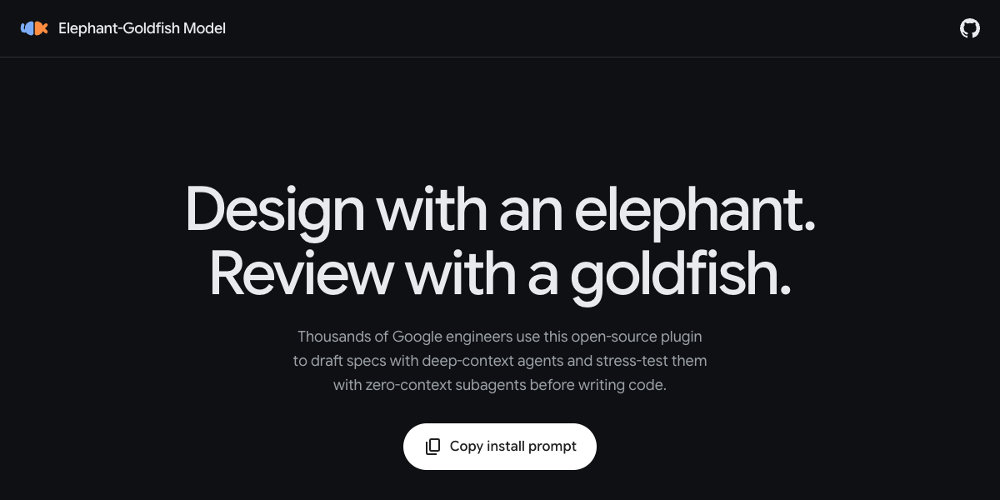
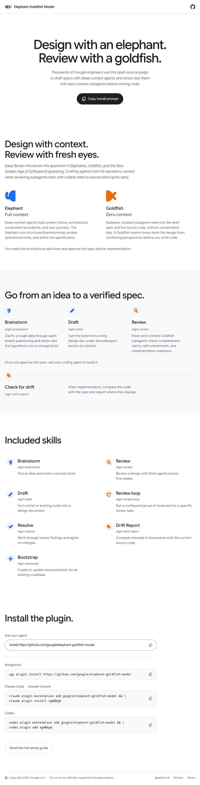
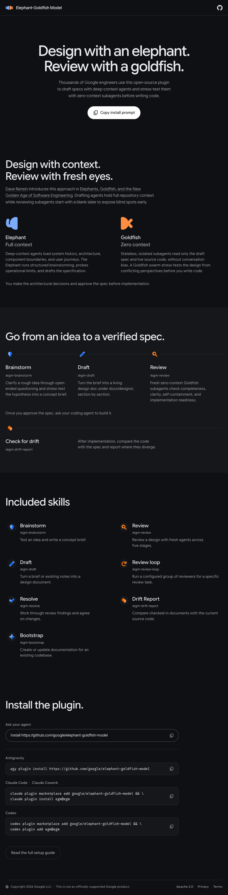
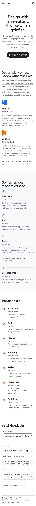
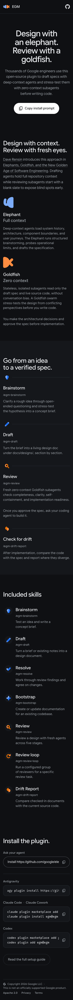

# egm.dev

Landing site for the Elephant-Goldfish Model, served at https://egm.dev from
GitHub Pages.

| Light | Dark |
| --- | --- |
|  |  |

<details>
<summary>Full page and mobile</summary>









</details>

## Stack

- [Astro](https://astro.build) static output, one page, no client framework.
- [gBreeze](https://www.npmjs.com/package/@material/web) (`@material/web`
  `labs/gb`) in its native-element form: the page emits the package's own
  class names (`btn`, `icon-btn`, `list-item`, `badge`, `divider`) and imports the
  package stylesheets. No custom elements, no Lit runtime.
- Google Sans Flex and Google Sans Code, self-hosted under
  `src/assets/fonts/` (OFL).

## Rules

- No analytics, no cookies, no third-party scripts, and no requests to Google
  hosts at runtime. The open-source release depends on it.
- Theme only through gBreeze tokens (`src/styles/tokens.css`) and the
  components' documented custom properties. Do not restyle component boxes.
- Keep skill names and commands identical to the repository README.

## Skill icons

`src/components/SkillIcon.astro` imports the canonical
`../skills/egm_*/assets/icon.svg` files with `?url`. The website and plugin packages
use these same assets; do not copy them into `public/` or redraw them in components.
Each decorative glyph is 28px inside a 40px circle using the existing surface
tokens, with an adjacent skill name or command providing its accessible label.
The workflow and skill catalog share this component. The workflow shows
Brainstorm, Draft, and Review, followed by a short handoff to the coding agent and
a separate Check for drift follow-up after implementation.

## Develop

```sh
npm install
npm run dev      # http://localhost:4321
npm run check    # astro check
npm run build    # writes dist/
npm run capture  # rebuilds, then regenerates public/og.png and screenshots/*.png
```

`npm run capture` needs a local Chrome (set `CHROME_PATH` if it is not found).
The social image comes from `scripts/og.html`; edit that file, not the PNG.
Run `npm run capture` after any visible change so the committed images stay in sync.

## Deploy

`.github/workflows/deploy-site.yml` builds and publishes `dist/` on every push
to `main` that touches `site/`, and on manual dispatch. `public/CNAME` pins the
custom domain.
