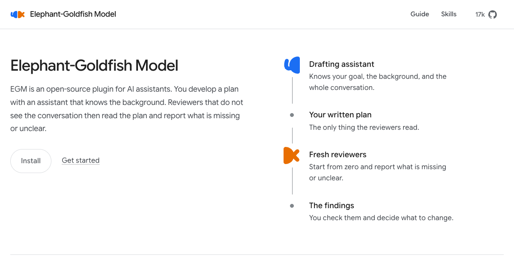
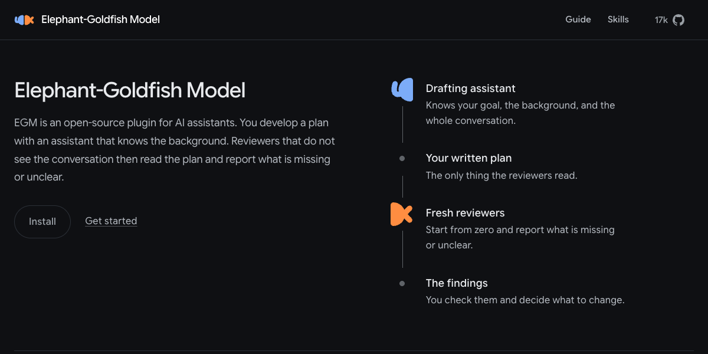
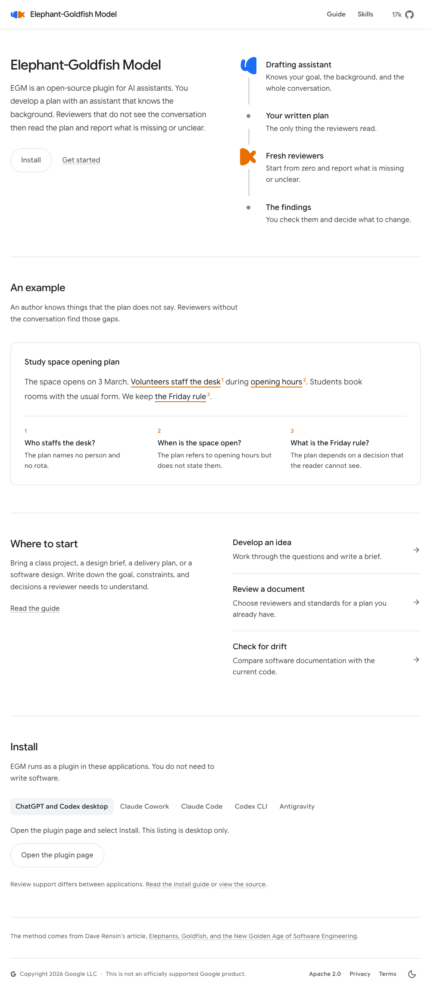
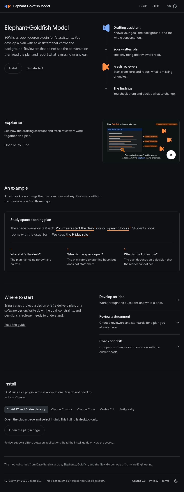
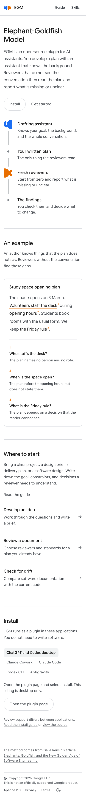
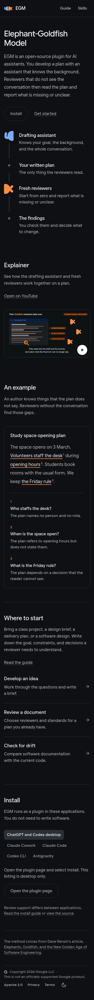

# egm.dev

Website and documentation for the Elephant-Goldfish Model, served at https://egm.dev from
GitHub Pages.

| Light | Dark |
| --- | --- |
|  |  |

<details>
<summary>Full page and mobile</summary>









</details>

## Stack

- [Astro](https://astro.build) static output with a custom homepage and
  [Starlight](https://starlight.astro.build) documentation. Starlight provides
  local Pagefind search, a responsive sidebar, and a page contents panel.
- [gBreeze](https://www.npmjs.com/package/@material/web) (`@material/web`
  `labs/gb`) in its native-element form: the page emits the package's own
  class names (`btn`, `icon-btn`, `list-item`, `badge`, `divider`) and imports the
  package stylesheets. The gBreeze controls use native HTML without a Lit runtime.
- Google Sans Flex and Google Sans Code, self-hosted under
  `src/assets/fonts/` (OFL).

## Rules

- Theme only through gBreeze tokens (`src/styles/tokens.css`) and the
  components' documented custom properties. Do not restyle component boxes.
- Keep skill names and commands identical to the repository README.
- **Explainer video**: `src/components/Explainer.astro` renders a self-hosted
  poster inside a button and creates the `youtube-nocookie.com` iframe only
  after the visitor clicks play.
- **Cookies and analytics (`egm.dev` only)**: The EGM plugin itself collects zero
  telemetry. On the canonical `https://egm.dev` site only (when the build sets
  `PUBLIC_GA_MEASUREMENT_ID` and
  `window.location.hostname === 'egm.dev'`), the page loads Google Cookie
  Notification Bar (`cookienotificationbar.min.js`). Google Analytics 4
  (`gtag.js`) loads only after the bar reports an affirmative accepted choice
  with `loaded.detail.required === true`. Pending, rejected, absent, and failed
  consent initialization never load GA. CNB's non-required fallback is not
  affirmative consent. The documented instance `statuschange` listener updates
  Consent Mode v2. Revocation sets GA's measurement disable flag before queuing
  denied consent and blocks later event/config calls. CNB uses a separate data
  layer so its defaults cannot enable analytics or advertising. Google Signals
  and advertising storage/personalization stay disabled. The script scrubs URLs
  and referrers before configuration. External forks, preview domains, local builds,
  and builds without a measurement ID make zero requests to Google hosts.

### Consent integration contract

The integration follows the public [CNB script](https://www.gstatic.com/glue/cookienotificationbar/cookienotificationbar.min.js)
inspected on 2026-10-30 (SHA-256
`e99eda4f401f141e55dcf8ccc1baa988e5165c99e89372d126841b8e7d26cd26`).
Its constructor registers the global callback on `loaded`. After fetching
configuration and storage, it emits `detail: { required, status }`. The
autoloaded instance is available as `glue.CookieNotificationBar.instance`.
Its `listen('statuschange', callback)` method receives `detail: { status }`.
Its supported `customDataLayerName` option selects the data layer for its own
consent commands. The browser fixtures model these source contracts.

Google's [programmatic Analytics opt-out documentation](https://developers.google.com/tag-platform/security/guides/privacy#turn_off_google_analytics)
states that the tag checks `ga-disable-MEASUREMENT_ID` before setting cookies
or sending data. This check grounds revocation after the library loads,
including automatic events that do not use the page's `gtag` wrapper.
Revocation sets the flag before it queues denied consent.

Browser checks intercept every network response. They check pending and
rejected consent, grant, revocation before and after script execution, regrant,
and disabled builds. Their GA fixture implements the documented disable flag.
These are integration regression checks, not a live Google library audit.

## Skill icons

`src/components/SkillIcon.astro` imports the canonical
`../skills/egm-*/assets/icon.svg` files with `?url`. The website and plugin packages
use these same assets. Do not copy them into `public/` or redraw them in components.
Each decorative glyph is 28px inside a 40px circle using the existing surface
tokens, with an adjacent skill name or command providing its accessible label.
Documentation page titles use this component beside each skill name.

## Develop

```sh
npm install
npm run dev      # http://localhost:4321
npm run check    # astro check
npm run build    # writes dist/
npm run check:docs # validates built documentation and Markdown exports
npm run capture  # rebuilds, then regenerates public/og.png and screenshots/*.png
```

`npm run capture` needs a local Chrome (set `CHROME_PATH` when Chrome is not on `PATH`).
The social image comes from `scripts/og.html`. Edit that file, not the PNG.
Run `npm run capture` after any visible change so the committed images stay in sync.

## Search metadata

The homepage declares the site name as JSON-LD and links both the adaptive SVG
favicon and a 96px PNG fallback. The PNG uses the SVG's light-theme colors;
regenerate it when `public/favicon.svg` changes. The build generates
`sitemap-index.xml` for the homepage and every documentation page.

## Documentation

The docs collection loads `docs/site/**/*.md` from the repository. The loader
maps these files to `/guide`, `/install`, `/getting-started`, `/workflow`,
`/skills`, and `/skills/<command>`. Each skill page in `docs/site/skills/`
describes one skill for a reader and links to its canonical `SKILL.md`.

Each documentation page has a matching `.md` URL and an alternate link in its
HTML. `starlight-llms-txt` generates `/llms.txt`, `/llms-full.txt`, and
`/llms-small.txt`. These are static files with no AI service or API key.

Copy page appears below the desktop contents list and near the mobile title.
Both the homepage and docs use the shared header, footer, grid, and gBreeze controls.
The build fetches the GitHub star count once and omits it when GitHub is unavailable.
The header rounds counts above 1,000 stars to the nearest thousand.

## Deploy

`.github/workflows/deploy-site.yml` builds and publishes `dist/` on every push
to `main` that touches `site/`, `docs/site/`, or a skill icon. A daily
scheduled build refreshes the star count. The workflow also supports manual dispatch.
`public/CNAME` pins the custom domain.
